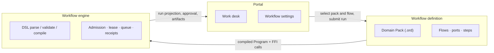

# Polaris

Self-hosted control plane for agentic workflows.



## Docs

This README is the source-owned onboarding guide. Product pages, operator
runbooks, and release evidence live in `apps/docs/site`.

```bash
pnpm run docs:dev
```

Serves VitePress on `http://127.0.0.1:4180`. From the parent workspace, the
same command is the `docs` service in `paseo.json`.

- [Polaris product docs](apps/docs/site/polaris/index.md) — Portal, Vaults,
  Gateway, Paseo, DSL, and CLI
- [Operations](apps/docs/site/operations/index.md) — deploy, gateway,
  incidents, and release records
- [CHANGELOG.md](CHANGELOG.md) — release history

## Local Development

Set up and check common tools before starting Polaristool. Each tool owns
its env and other prerequisites in `backend.lock.json`. Polaristool does
not hardcode those values.

```bash
# clone
git clone --recurse-submodules git@github.com:jianxiaoyitech/Polaris.git
cd Polaris
# init submodules
git submodule update --init --recursive
# copy and edit .env.dev (minimum below)
cp .env.dev.example .env.dev
```

Minimum `.env.dev`:

```bash
POLARIS_AUTH_MODE=disabled
POLARIS_AUTH_DEFAULT_USER_ID=100000000000000001
POLARIS_VAULT_MODE=host
POLARIS_DATA_ROOT=/path/to/polaris/data
```

Keep `POLARIS_AUTH_MODE=disabled` and `POLARIS_VAULT_MODE=host`. Authing
and Vault env are unused. Use one `POLARIS_DATA_ROOT` in every process.
Host tools share the general cache at `$POLARIS_DATA_ROOT/cache`.
Polaristool derives `POLARIS_LITERATURE_CACHE_ROOT` from that path when
it is unset.

Then check what each tool still needs:

```bash
set -a && . ./.env.dev && set +a
pnpm --dir apps/polaris run polaris -- ops tool-precheck
```

Required findings fail the command. Recommended findings print as
warnings with a next step (env, DISPLAY, Camofox, API keys, packages).
Fix those, then re-run `ops tool-precheck` until the required set is
clear.

To inspect one tool:

```bash
./tools/browser/check-setup
./tools/data-collection/check-setup
./tools/semantic-scholar/check-setup
```

Headed PDF capture needs an X11 display and a Camofox session. See
[tools/browser/SETUP-BROWSER.md](tools/browser/SETUP-BROWSER.md). Put
the values those guides name into `.env.dev`.

After tools are ready, start Polaristool:

```bash
bash ./scripts/run-polaris-local-stack-service.sh .env.dev
```

Portal start also runs `ops tool-precheck` and logs remaining gaps.
After the stack is up, open `/settings/tools` to see the same
`check-setup` result and re-run it from the Recheck control.

## Local CI

```bash
bash ./scripts/ci-local.sh
```
