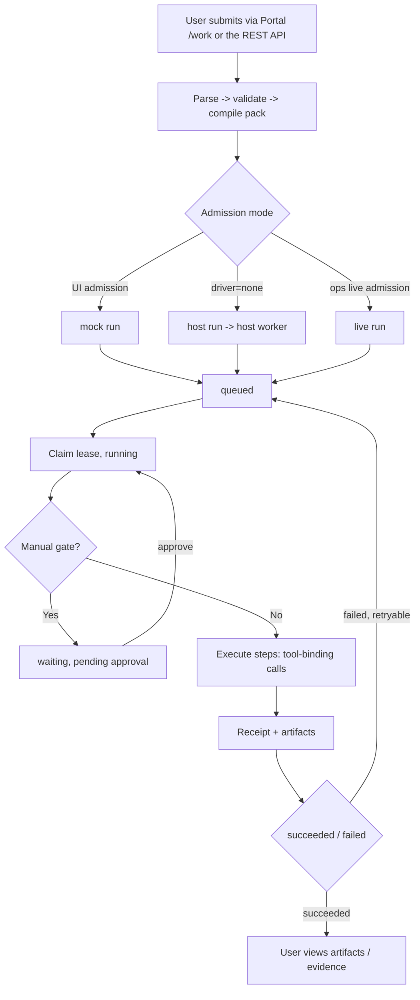
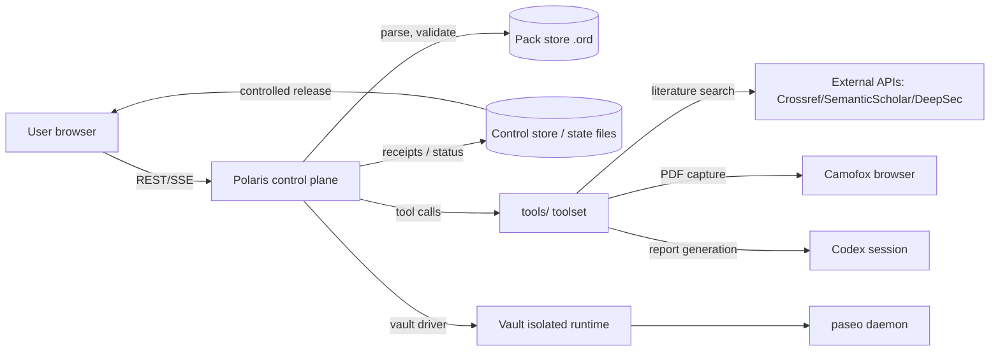
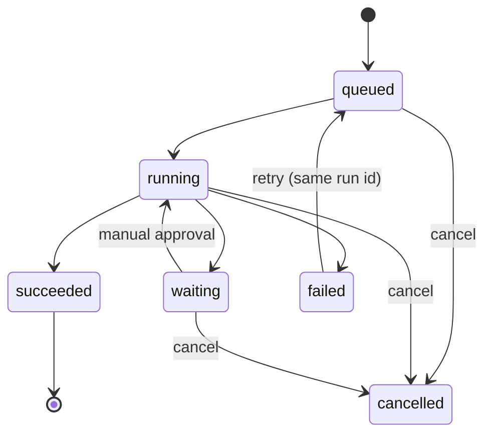
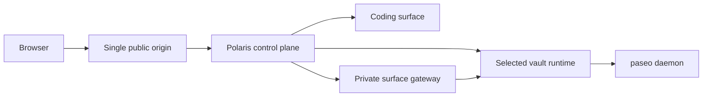

# Polaris Product Requirements Document (PRD)

Version: V3.1.0

| Version | Date       | Author   | Notes |
|---------|-----------|----------|-------|
| V1.0.0 | 2026/10/16 | opencode | Compiled from the current state of the codebase |
| V1.1.0 | 2026/10/16 | opencode | Added isolation executor / sandbox CLI port / step-level retry requirements |
| V1.2.0 | 2026/10/16 | opencode | Moved into the Development section; declared the sole ground truth; removed fixed-version delivery commitments |
| V1.3.0 | 2026/10/16 | opencode | Added the trial pack contract: four-primitive sandbox, module tool dispatcher protocol, hard constraints and acceptance |
| V1.4.0 | 2026/10/16 | opencode | Review revisions: SQLite status, idempotency key, sandbox boundary statement, LLM dependency stance, artifact redaction, executable pollution assertions |
| V1.5.0 | 2026/10/16 | opencode | Ruling: north-star metrics aligned to the three switching-cost dimensions; delivery order changed to 3.10 first, sandbox optional |
| V1.6.0 | 2026/10/16 | opencode | Added artifact release guardrails (final gate / depth gate / provenance completeness) |
| V1.7.0 | 2026/10/16 | opencode | Ruling: retry/budget/timeout belong to step policy (3.10); module tools do a single attempt and never re-implement the attempt loop |
| V1.8.0 | 2026/10/16 | opencode | Ruling generalized: platform cross-cutting capabilities (retry / isolation / receipts / audit / orchestration / handoff) are never re-implemented in tools; added the 3.11.7 capability ownership mapping |
| V2.0.0 | 2026/10/16 | opencode | DSL v2: `.ord` upgraded to structured orchestration (six constructs, unbounded while + budget stop-loss backstop); removed the "linear DAG" constraint; cut ahead of M2 |
| V2.1.0 | 2026/10/16 | opencode | Added the 3.10.9 budget hierarchy gap fix: run-level budget cap (paper per-CVE $5/45min scale) + step-level maxAttempts into the `.ord` grammar; cut ahead of M2 |
| V2.2.0 | 2026/10/16 | opencode | 3.10.9 adds a third tier: flow-level `budgetUsd`/`timeoutMs` into the `.ord` grammar, packs declare the paper per-CVE cap themselves; host-side flow declaration > env |
| V2.3.0 | 2026/10/17 | opencode | Added 3.14 LLM invocation runtime (CLH: preset schema + compiler + wrapper + dispatcher seam, dsh-first backend, LLM-primitive-vs-harness ontology); 3.10.9 adds run-level maxRuns (run retry count, paper baseline 5) |
| V2.4.0 | 2026/10/17 | opencode | Added 3.11.8 pack self-containment: domain-specific tools ship with the pack (pack-local tools + full install); capability ownership ruling — CLH global (packages/llm-harness), paper-reproduction tools pack-specific, existing autoresearch globals untouched |
| V2.5.0 | 2026/10/17 | opencode | 3.14 hardening (four defects proven by the CVE comparison run): preset schema adds per-preset `timeoutMs`; api backend switches to streaming (long generations no longer cut off by the gateway); call-level 429/transient backoff into 3.14.4 (attempt-internal convergence, owned by CLH); step-failure error values thread through |
| V2.6.0 | 2026/10/18 | opencode | Ruling (second CVE comparison run: budget cap silently inert): built-in official pricing catalog (family → per-MTok, env override > catalog > none); fail-closed at run start with a declared flow/run budget and unresolvable pricing (stable code), never silent zero accrual — resolves 3.11.4 [TBD], no estimation |
| V3.0.0 | 2026/10/19 | opencode | Third product pillar: 3.15 observability panel (cost / reliability / quality / evaluation views over existing tables — no new collection); 1.1.1 restated as three pillars (pillars 1-2 generate the evidence, pillar 3 makes it legible); the north-star success-rate and rescue-rate metrics become computable from receipts |
| V3.1.0 | 2026/10/19 | opencode | New domain capability 3.16 media ingestion: one global tool `media.ingest` with three commands (download-video / extract-audio / transcribe), dispatcher protocol + inventory registration, deterministic backends (yt-dlp/ffmpeg, versions pinned) and an env-resolved transcription binding (gateway Whisper-first, local binary fallback), demo flow in a media-ingestion pack |

---

## 1. Overview (why)

### 1.1 Product overview and goals

#### 1.1.1 Background

Multi-agent systems are becoming a core productivity tool for teams, but
when handing real business workloads to them, teams generally lack a
unified control plane:

- Hard-coding a specific domain into the product cannot scale or be
  reused;
- Writing each step as a list of commands and arguments degrades a
  Domain Pack into a shell script: later steps cannot validate inputs,
  and there is no record of "what a given step may touch";
- Runs leave no receipts or artifacts, so failures cannot be traced;
- Identity, quota, lifecycle, and audit are scattered everywhere,
  leaving fuzzy permission boundaries;
- Receipts, budgets, and artifacts accumulate as audit stubs: cost,
  reliability, and quality evidence piles up, but no surface makes it
  legible enough to act on.

Polaris's answer rests on three pillars: a DSL + Domain Pack carries
"what the work is" (domain-agnostic and reusable); a self-hosted
control plane carries "who can run it, how it runs, and what evidence
it leaves" (identity, quota, budgets, receipts, audit); and a
visualization panel turns that evidence into decisions — cost against
budget, success and rescue rates, artifact quality. Pillars one and
two generate the evidence; pillar three makes it legible.

> Requirements health-check note: this document is the sole ground
> truth of the Polaris product — scope, process, and priority defer to
> it; on conflict with other documents, this document wins; no delivery
> is promised against fixed version numbers. Missing user evidence and
> quantified success metrics are recorded as the first item of the
> "items to confirm" list.

#### 1.1.2 Product overview

Polaris is a self-hosted control plane for isolated multi-agent systems.
Users submit workflow runs through the Portal (browser app) or the REST
API; the Polaris engine parses, validates, and compiles Domain Packs,
performs admission, grants leases, queues and schedules work, and
retains a receipt and artifacts for every step.

#### 1.1.3 Product goals

Three north-star metrics mapped to the three switching-cost dimensions
(learning / migration / trust) — the product's value = driving down the
adoption cost of a new workflow domain.

**Business goals**

| Goal | Metric | Target | Timeline |
|------|--------|--------|----------|
| Lower learning cost (north star 1) | New-domain onboarding person-days: from domain idea to a pack that turns green and runs | Set after measuring a baseline [TBD]; direction: monotonically decreasing | Ongoing |
| Lower migration cost (north star 2) | Run success rate: succeeded / terminal runs | ≥ 90% [TBD]; old-approach baseline: a script crash reruns everything | Ongoing |
| Lower migration cost (north star 2) | Retry rescue rate: eventually succeeded after retries / ever failed | Set after measuring a baseline [TBD] | Ongoing |
| Lower trust cost (north star 3) | Traceability completeness: terminal runs can answer "who, when, which version, inputs and outputs" | 100% | Achieved |
| Least privilege | Executors can only run pinned definitions while holding a valid lease | 100% enforced | Achieved |

Metrics are computed and surfaced by the observability panel (3.15):
run success rate and retry rescue rate derive from receipts and step
results, so the two [TBD] baselines above become measurable without
new collection.

**User goals**

| Target user | User goal | Measuring metric |
|-------------|-----------|------------------|
| Domain expert (packager) | A new domain needs only a pack + tools, no product internals | New-domain onboarding person-days (north star 1) |
| Submitter | Occasional failures do not sink a run; live progress and artifacts visible | Run success rate / retry rescue rate (north star 2); timeline updates |
| Approver | One-click handling at manual gates, operations leave a trail | waiting → running transition; complete audit |
| Platform ops | Environment gaps visible in one precheck | `ops tool-precheck` required items all green |

#### 1.1.4 Target users

| Role | Description | Core need |
|------|-------------|-----------|
| Platform engineer / ops | Deploys and maintains Polaris, manages Domain Packs | Simple deployment, clear precheck, recoverable |
| Domain expert (packager) | Wraps a domain into a Pack with the DSL | Enough expressiveness, manageable versions |
| Submitter / executor | Submits runs, executes definitions within a lease | Transparent progress, retrievable artifacts |
| Approver | Approves / rejects manual gates | Clear list, one-click action, audit trail |
| Observer / reconciler | Views evidence, checks receipts and failures | Read-only, scope-controlled |

### 1.2 Glossary

| Term | Description |
|------|-------------|
| DSL | The language describing "what the work is, how data flows, which capabilities are allowed" |
| Domain Pack | A versioned domain: entities, flows, ports, tags |
| `.ord` | Domain pack declaration file; one `.ord` file or a directory containing `main.ord` |
| Flow / Step | A workflow and its steps |
| Port | Tool FFI interface; the Host decides who implements it and how it binds |
| Host worker | Host-side executor, receives `driver=none` runs |
| Vault | An isolated runtime environment, runs execute inside it when `driver=vault` |
| Admission | Turning a run request into a managed run object |
| Lease | The credential an executor needs to run a pinned definition |
| Receipt | The record credential produced when a step completes |
| Artifact | Output files produced by a run and released in a controlled way |
| Run mode | `mock` (normal UI admission) / `host` (host executor) / `live` (ops-only path) |
| Portal | Browser app (`apps/polaris-portal`), React/Vite |
| Paseo | Embedded daemon carrying concrete agent session execution |
| Surface / Gateway | Feature entry surface / private entry gateway, handles admission, tickets, and rate limiting |

### 1.3 Roles and permissions

| Role | Permission scope | Data scope |
|------|------------------|------------|
| observer | Reads packs and in-scope evidence | Authorized scope |
| proposer | Creates disabled drafts | Own drafts |
| approver | Approves / rejects drafts or run actions | In-scope runs |
| executor | Runs pinned definitions (requires a current lease) | Pinned definitions |
| reconciler | Checks receipts and failures | In-scope runs |
| operator (outside the product) | Pack install/remove, live metadata admission, precheck | System-wide |

> Rule: membership does not imply execution.

### 1.4 Document audience

| Audience | Focus |
|----------|-------|
| Engineering | Functional requirements, data dictionaries, system integration |
| UI/UX | Portal routes and interactions, global rules |
| Testing | Exception flows, acceptance criteria |
| Ops | Version planning, non-functional requirements, tool precheck |

---

## 2. Product description (what)

### 2.1 Product requirement description

**What we build**: a control plane combining "declarative Domain Packs
+ a persistent run engine + Portal/API", covering install → pin →
admit → queue → execute → receipt/artifacts → review.

**What we do not build**:

- No domain business logic lives here (Domain Packs and tools own it);
- No public multi-tenant SaaS (self-hosted first);
- Regular users cannot start live-mode runs (ops-only path).

**Hard constraints**:

- A single public origin; the browser never touches Docker ports,
  internal service addresses, or host-path URLs;
- Every run pins the pack version and digest for its whole lifetime;
- `driver=none` and `vaultId` are mutually exclusive; `driver=vault`
  requires `vaultId`;
- `.ord` v2 expresses structured orchestration (sequence/parallel/
  choice/forEach/while/subflow, see 3.13); orchestration moves into the
  DSL, while domain convergence iterations inside an attempt stay in
  tools;
- Domain tools never re-implement platform cross-cutting capabilities:
  attempt-level retry, timeout, and budget stop-loss belong to step
  policy (3.10); isolated environments and clean retries belong to the
  isolation executor (3.8); receipts, audit, and artifact retention
  belong to the control plane; module tools do a single attempt of the
  domain logic (capability ownership in 3.11.7);
- Exploit code never runs on the host, only in isolated environments;
- fail-closed: a pack stays non-executable when tools are incomplete;
- Tests use synthetic fixtures, never real data.

### 2.2 Overall product process

#### 2.2.1 Main flow



#### 2.2.2 Sub-flows

- **Approval sub-flow**: a run enters `waiting` at a manual gate step
  and returns to `running` once the approver approves; Polaris holds
  the flow state and approval leaves an audit record.
- **Retry sub-flow**: a `failed` or `cancelled` run re-enters the
  queue under the same run id, skipping completed steps and continuing
  the rest.
- **Tool precheck sub-flow**: `ops tool-precheck` collects required
  items (missing items fail) and recommended items (warning + next-step
  guidance); Portal `/settings/tools` shows the same result and
  supports Recheck.

#### 2.2.3 Data flow diagram (DFD)



#### 2.2.4 State transition diagram (STD)



### 2.3 Global notes

#### 2.3.1 Global exception handling

| Exception scenario | Handling | Message |
|--------------------|----------|---------|
| Network error | Prompt + retry | "Please check your network connection" [TBD] |
| Service unavailable | Portal shows the error, SSE auto-reconnects | "Service temporarily unavailable, try again later" [TBD] |
| Insufficient permission | Reject the action, record audit | "No permission for this action" [TBD] |
| Pack validation failure | Intercept before admission, return the specific error | Show parse/validate error details |
| Missing tool dependency | Precheck flags required items red with a next step | "Required items unmet, see next-step guidance" |
| Data not found | Empty-state page | "Run not found or deleted" [TBD] |

#### 2.3.2 List rules

| Rule | Description |
|------|-------------|
| Run list | `/work` renders host/Vault runs as cards |
| Sorting / pagination | [TBD]; suggested default: newest first by creation time + pagination |
| Empty data | Empty-state prompt [TBD] |
| Flow list | `/settings/workflows` shows full flows per pack, each flow can be toggled |

#### 2.3.3 Global interactions

| Scenario | Interaction |
|----------|-------------|
| Submit run | Async operation, button guards against double submit [TBD] |
| Run detail | `/work/runs/:runId` timeline (SSE push) |
| Approve / cancel / retry | Detail-page action controls with confirmation [TBD] |
| Open artifact | Controlled preview (artifact preview), never a raw URL |

### 2.4 Version planning

No delivery is promised against fixed version numbers. Scope and
priority follow the 2.6 functional inventory (this document is the sole
ground truth); delivery cadence rolls with requirement signals: new
requirements enter the 2.6 functional inventory for review first, then
development, and each completed item becomes visible on the inventory.
The product owner maintains the inventory: completing an item marks it
done in 2.6.

### 2.5 Product framework



| Layer | Responsibility |
|-------|----------------|
| `apps/polaris-portal` | React pages, cards, navigation, Zustand, SSE client; holds no identity or authorization authority |
| `@polaris/polaris-shell` | Routing / product lines / host actions / user contract |
| `apps/polaris` (server) | Auth API, pack projection, persistent workflow control, SSE, lifecycle adapters, static artifact serving |
| `packages/polaris-workflow` | DSL runtime (parse/resolve/validate/compile) |
| `tools/` | ~25 Python tools implementing Ports |
| `packages/vault-runtime` | Vault isolated runtime |
| Polaris Gateway | Surface admission, tickets, rate limiting, proxy policy |

### 2.6 Functional inventory

| Module | Feature | Priority | Notes |
|--------|---------|----------|-------|
| Workflow definition | Pack install / list / remove | P0 | CLI shares the same parse→resolve→validate |
| Workflow definition | Flow enable/disable | P0 | `/settings/workflows` |
| Runs | Portal submission (work desk) | P0 | Pick scenario + optional Vault target |
| Runs | REST API submission | P0 | Delivered (2026/10/17): `/api/workflow-runs` + idempotency key (Idempotency-Key header / body field, same key same run) |
| Runs | Persistent host runs | P0 | `driver=none`, `mode:"host"` |
| Runs | Same-run retry | P0 | Skips completed steps |
| Runs | Step-level retry and budget stop | P0 | Delivered (2026/10/16): maxAttempts / timeout / budget; default maxAttempts=1 behavior unchanged |
| Runs | Isolated environment executor (clean-environment retry) | P1 | Optional, delivered after 3.10 as needed |
| Ports | Sandbox CLI execution port | P1 | Optional, pairs with 3.8 |
| Approval | Manual gate (manual review) | P0 | waiting/approve/audit |
| Artifacts | Controlled preview and export | P0 | Atomic export |
| Monitoring | Run timeline (SSE) | P0 | In-scope events |
| Users | Identity / roles / product-line access | P0 | Authing with a disableable mode |
| Ops | Tool precheck | P0 | CLI + `/settings/tools` |
| Ops | Live metadata admission | P1 | The only live path |
| Tools | Domain module tools and inventory registration | P0 | Delivered (2026/10/17): four thin cve tools on CLH; pack turns green after registration (see 3.11) |
| Tools | Pack self-containment (pack-local tools + full install) | P0 | Delivered (2026/10/17): five cve packages moved into the pack; pack-local-first resolution; full install includes tools/+harness/, see 3.11.8 |
| Artifacts | Release guardrails (final gate + depth gate + provenance) | P0 | Delivered (2026/10/17): R-1/R-2/R-3 guards + three-state publication, see 3.12 |
| Definition | DSL v2 structured orchestration (parallel/choice/forEach/while/subflow) | P0 | Delivered (2026/10/16): engine + Portal rendering, see 3.13 |
| Runs | Run-level budget cap + step-level/flow-level budget syntax | P0 | Delivered (2026/10/16): run cap + maxAttempts syntax + flow-level declaration, see 3.10.9 |
| Runs | Run-level maxRuns (run retry count) | P1 | Delivered (2026/10/19): flow-level `maxRuns <n>`, default 1 unchanged; paper baseline 5; a live eval round-1 setup failure was rescued by a whole-run rerun, see 3.10.9 |
| Infrastructure | LLM invocation runtime (CLH: preset schema + compiler + wrapper + dispatcher seam) | P0 | Delivered (2026/10/17): dsh-first backend; api/bounded/open kinds; 8 presets, see 3.14 |

---

## 3. Functional requirements (how)

### 3.1 Workflow definition management (Domain Pack)

#### 3.1.1 Description
Install, view, and remove Domain Packs; enable/disable flows per pack.

#### 3.1.2 User stories
```
As ops, I want to install a .ord pack through the CLI and see the
validation results, so that only trusted definitions passing
parse→resolve→validate get published.
As a submitter, I want to see all flows of a pack in /settings/workflows
and toggle them, so that I control the flow scope visible in my work
desk.
```

#### 3.1.3 Preconditions

| Type | Condition |
|------|-----------|
| Permission dependency | Install/remove requires ops permission |
| Data dependency | An `.ord` file or a directory containing `main.ord` |

#### 3.1.4 Postconditions
- The pack enters the installed inventory and generates a manifest;
  later runs pin the pack version and digest.

#### 3.1.5 UI and interactions

| Element | Type | Required | Default | Validation | Feedback |
|---------|------|----------|---------|------------|----------|
| pack add target | CLI argument | Yes | - | Existing .ord / directory | Validation failure prints error details |
| Flow enable toggle | Toggle control | No | Install-time default [TBD] | - | Takes effect immediately and is recorded |

#### 3.1.6 Business flow
`pack add` → parse → resolve → validate → atomic install (the same
three steps as the engine's admission prerequisites); first-party packs
(`packs/`) and third-party packs (`third_party/`) are auto-discovered.

#### 3.1.7 Exceptions / branches

| Scenario | Trigger | Handling | Message |
|----------|---------|----------|---------|
| Validation failure | DSL syntax / reference error | Reject install, print errors | parse/validate error details |
| Duplicate install | Same domain + version exists | Idempotent or reject [TBD] | "This version is already installed" |
| Removing a referenced pack | A run pins that version | Reject or remove per version [TBD] | - |

#### 3.1.8 Data dictionary (pack install inventory)

| Field | Type | Required | Description | Example |
|-------|------|----------|-------------|---------|
| packId | String | Yes | Domain identifier | "autoresearch" |
| version | String | Yes | Semantic version | "0.4.0" |
| digest | String | Yes | Content digest, pinned by runs | "sha256:..." [TBD] |
| source | Enum | Yes | first-party/third-party | "first-party" |
| installed_at | DateTime | Yes | Install time | 2026-09-11 |

### 3.2 Run submission and admission

#### 3.2.1 Description
Users submit runs via the Portal work desk or the REST API; the engine
completes admission and persists the run.

#### 3.2.2 User stories
```
As a submitter, I want to submit a literature-review run via
POST /api/workflow-runs, so that I can later check progress and
artifacts on the detail page.
As a submitter, I want to pick a Domain Pack as the work scenario in
/work and submit, so that I can start runs without writing code.
```

#### 3.2.3 Preconditions

| Type | Condition |
|------|-----------|
| Data dependency | Target pack installed and its flows enabled |
| Permission dependency | User holds executor permission |
| Constraint dependency | `driver=none` cannot combine with `vaultId`; `driver=vault` requires `vaultId` |

#### 3.2.4 Postconditions
- A persistent run object is created (with pinned pack version/digest)
  and enters `queued`;
- Normal UI admission produces `mode:"mock"`, host admission produces
  `mode:"host"`.

#### 3.2.5 UI and interactions (REST request body)

| Field | Type | Required | Default | Validation | Description |
|-------|------|----------|---------|------------|-------------|
| packId | String | Yes | - | Installed pack | Domain pack |
| flowId | String | Yes | - | Enabled flow inside the pack | Flow |
| driver | Enum | No | none | none/vault | Execution target |
| vaultId | String | Conditional | - | Required when driver=vault | Isolated environment |
| values | String | Yes | - | `key=value` pairs | Inputs, e.g. question, audience |
| scenario | String | No | - | - | Scenario ([TBD] concrete values) |
| Idempotency-Key | String | No | - | Globally unique [TBD] | Duplicate submission returns the same run |

#### 3.2.6 Business flow
See the first half of the main flow in 2.2.1.

#### 3.2.7 Exceptions / branches

| Scenario | Trigger | Handling | Message |
|----------|---------|----------|---------|
| Flow disabled | flowId not enabled | Reject admission | "Flow not enabled" |
| Missing parameters | values missing key fields | Reject admission, list missing items | Form / error details |
| driver conflict | none + vaultId | Reject admission | "Parameters are mutually exclusive" |
| Duplicate submission | Same Idempotency-Key POSTed again | Return the same run, no new run created | Reuse the existing run |
| Unauthenticated | Session missing / expired | Redirect to /welcome | Show auth mode |

#### 3.2.8 Data dictionary (workflow_run)

| Field | Type | Required | Description | Example |
|-------|------|----------|-------------|---------|
| runId | String | Yes | Unique run identifier | "run-..." [TBD] |
| packId / flowId | String | Yes | Definition references | "autoresearch"/"LiteratureReview" |
| pinnedVersion / digest | String | Yes | Pinned definition version | "0.4.0" |
| mode | Enum | Yes | mock/host/live | "host" |
| driver | Enum | Yes | none/vault | "none" |
| values | Object | Yes | Input key-values | question=... |
| status | Enum | Yes | queued/running/waiting/succeeded/failed/cancelled | "queued" |
| createdAt / updatedAt | DateTime | Yes | Timestamps | 2026-10-16 |

### 3.3 Run execution and monitoring

#### 3.3.1 Description
The engine executes steps via queueing/lease scheduling and produces
receipts and artifacts; the Portal renders the timeline over SSE.

#### 3.3.2 User stories
```
As a submitter, I want to see a per-step timeline and receipts at
/work/runs/:runId, so that I know which step a run is stuck on.
As a reconciler, I want to inspect failed receipts and evidence, so
that I can locate the cause of a failure.
```

#### 3.3.3 Preconditions
The run has been admitted and persisted; the user has observation
permission for that run's scope.

#### 3.3.4 Postconditions
Each step produces a receipt; artifacts enter the controlled artifact
area; the state machine transitions per 2.2.4.

#### 3.3.5 UI and interactions

| Element | Type | Required | Default | Validation | Feedback |
|---------|------|----------|---------|------------|----------|
| Timeline | Step list (SSE) | Yes | Full replay + incremental | - | Appends in real time |
| Attempt history | Step grouping (attempt number) | No | Collapsed | - | Failed steps expand past attempt receipts |
| Action area | Buttons (approve/cancel/retry) | Yes | Shown by state | Clickable only in legal states | Greyed out to prevent repeats |
| Artifact entry | Link cards | No | - | Controlled release | Opens preview |

#### 3.3.6 Business flow
`queued` → worker claims (lease) → execute step by step (tool
bindings) → receipt per step → terminal state. Manual gate steps turn
`waiting`.

#### 3.3.7 Exceptions / branches

| Scenario | Trigger | Handling | Message |
|----------|---------|----------|---------|
| Step failure | Tool returns failure | Run turns `failed`, receipts kept | Detail page shows the failed step |
| Lease expiry | lease expired | Stop execution [TBD] | - |
| SSE disconnect | Network interruption | Auto-reconnect + full reconciliation | Brief prompt |
| Repeated action | Double-click retry/cancel | Idempotent handling | Button greyed out |

#### 3.3.8 Data dictionary (receipt)

| Field | Type | Required | Description | Example |
|-------|------|----------|-------------|---------|
| runId | String | Yes | Owning run | "run-..." |
| stepId | String | Yes | Step identifier | "literature.collection" |
| status | Enum | Yes | succeeded/partial/failed | "succeeded" |
| output | Object | No | Output reference / summary | - |
| createdAt | DateTime | Yes | Completion time | 2026-10-16 |

### 3.4 Manual approval (manual gate)

#### 3.4.1 Description
A flow pauses at a declared manual gate; after the approver approves or
rejects, it continues or terminates.

#### 3.4.2 User stories
```
As an approver, I want to see the pending list and approve with one
click, so that the flow continues under control.
```

#### 3.4.3 Preconditions
The user holds the approver role; the run is in `waiting`.

#### 3.4.4 Postconditions
- State moves `waiting → running`; an audit record is written;
- Approval identity is stable (review identity), supporting
  traceability across resumed runs.

#### 3.4.5 UI and interactions

| Element | Type | Required | Default | Validation | Feedback |
|---------|------|----------|---------|------------|----------|
| Pending list | List page | Yes | - | In-scope only | Empty state |
| Approve / reject | Buttons | Yes | - | Confirmation [TBD] | State updates immediately |

#### 3.4.6 Business flow
`running` → gate step → `waiting` → approver acts → `running` (approved)
or terminate/reject per the flow definition [TBD: behavior after
reject].

#### 3.4.7 Exceptions / branches

| Scenario | Trigger | Handling | Message |
|----------|---------|----------|---------|
| Non-approver acts | Insufficient permission | Reject + audit | "No permission for this action" |
| Concurrent approval | Two users act at once | First wins; the second fails idempotently | "Already handled by someone else" |
| Approval timeout | [TBD: whether a timeout exists] | Stays waiting | - |

#### 3.4.8 Data dictionary (review audit)

| Field | Type | Required | Description | Example |
|-------|------|----------|-------------|---------|
| reviewId | String | Yes | Stable approval identifier | "rev-..." |
| runId | String | Yes | Owning run | "run-..." |
| reviewerId | String | Yes | Approver | User ID |
| action | Enum | Yes | approve/reject | "approve" |
| at | DateTime | Yes | Action time | 2026-10-16 |

### 3.5 Artifact viewing and export

#### 3.5.1 Description
Run artifacts (reports, graphs, PDFs, BibTeX, etc.) are released to
authorized users through controlled preview and atomic export.

#### 3.5.2 User stories
```
As a submitter, I want to preview the final report on the detail page
and export it, so that I can use it offline and archive it.
```

#### 3.5.3 Preconditions
The run reached a state where artifacts can be released; the user is
within the authorized scope.

#### 3.5.4 Postconditions
Artifact views record access; export is atomic (never a partial file).

#### 3.5.5 UI and interactions

| Element | Type | Required | Default | Validation | Feedback |
|---------|------|----------|---------|------------|----------|
| Artifact preview | Embedded preview component | No | - | Type whitelist | Unsupported types get download |
| Export | Button | No | - | Confirmation [TBD] | Atomic export success prompt |

#### 3.5.6 Business flow
The artifact service (static artifact serving) checks permission →
preview/export; the browser only ever sees public-origin routes, never
storage paths.

#### 3.5.7 Exceptions / branches

| Scenario | Trigger | Handling | Message |
|----------|---------|----------|---------|
| Artifact missing | Generation failed / cleaned up | Empty state | "Artifact not found" |
| No permission | Out-of-scope access | Reject + audit | "No access permission" |

#### 3.5.8 Data dictionary (artifact)

| Field | Type | Required | Description | Example |
|-------|------|----------|-------------|---------|
| artifactId | String | Yes | Artifact identifier | "art-..." [TBD] |
| runId | String | Yes | Owning run | "run-..." |
| kind | Enum | Yes | report/pdf/dot/bibtex/... | "report" |
| visibility | Enum | Yes | review-list/non-review etc. [TBD] | "review-list" |
| size / createdAt | - | Yes | Metadata | - |

### 3.6 Users and permissions

#### 3.6.1 Description
Authing identity mapping (disableable mode), tenant and Vault
ownership, role and product-line access control.

#### 3.6.2 User stories
```
As ops, I want to boot a local environment with
POLARIS_AUTH_MODE=disabled quickly, so that development and debugging
do not depend on an external identity service.
```

#### 3.6.3 Preconditions / 3.6.4 Postconditions
The local disabled mode uses the default user from
`POLARIS_AUTH_DEFAULT_USER_ID`; production mode completes the code
exchange via `/auth/callback`.

#### 3.6.5 UI and interactions
`/welcome` (shows the current auth mode), `/auth/callback`,
`/settings/user` (basic info / credentials / sessions side by side).

#### 3.6.6 Exceptions / branches
Session expiry → redirect to `/welcome`; identity mapping failure →
explicit error [TBD].

#### 3.6.7 Data dictionary
See `apps/docs/site/polaris/user-management.md` (not repeated here).

### 3.7 Tool integration and precheck

#### 3.7.1 Description
Tools (tools/) implement Ports; `ops tool-precheck` and
`/settings/tools` expose the same check-setup result: missing required
items fail, recommended items come with next-step guidance.

#### 3.7.2 User stories
```
As ops, I want a one-click precheck of all tool dependencies before
startup, so that I quickly find gaps like a missing API key, DISPLAY,
or Camofox.
```

#### 3.7.3 UI and interactions

| Element | Type | Required | Default | Validation | Feedback |
|---------|------|----------|---------|------------|----------|
| Precheck result | Grouped list | Yes | - | Required / recommended tiers | Missing items flagged red |
| Recheck | Button | No | - | - | Re-runs check-setup |

#### 3.7.4 Exceptions / branches
A single tool's check-setup failure affects only that tool; when
required items are missing, Portal startup still records and reports
the remaining gaps (startup is not blocked).

### 3.8 Isolated environment executor (Vault)

#### 3.8.1 Description
Status quo: Vault-target runs can only be `mode:"mock"` — the engine
does not enable the tool executor for Vault runs. Goal: real
`mode:"vault"` — runs execute inside the isolated Vault runtime (with
the embedded paseo daemon); each attempt runs in a brand-new isolated
environment (copy-on-write), enabling "clean-environment retry" so
contamination never propagates across attempts.

Delivery order: this feature and 3.9 are optional (sandbox or no
sandbox), delivered after 3.10 (step-level retry and budget stop) as
needed, see 2.4.

#### 3.8.2 User stories
```
As an executor, I want retries of failed steps to run in a brand-new
isolated environment, so that environment contamination left by the
previous attempt does not affect later attempts.
As ops, I want intermediate artifacts of long flows retained together
with environment snapshots, so that recovery starts from a clean state
after failure.
```

#### 3.8.3 Preconditions

| Type | Condition |
|------|-----------|
| Permission dependency | driver=vault requires vaultId |
| Feature dependency | 3.2 run submission and admission |

#### 3.8.4 Postconditions
- The run executes inside an isolated environment; after the attempt,
  the environment snapshot and artifacts are stored.

#### 3.8.5 UI and interactions

| Element | Type | Required | Default | Validation | Feedback |
|---------|------|----------|---------|------------|----------|
| vaultId | Picker | Conditional | - | Owned by the current user | Reject without permission |
| Retry | Button | No | - | Only when state is failed | New-environment retry prompt |

#### 3.8.6 Business flow
failed → retry → create a new isolated environment (clean copy) →
resume from completed steps → re-execute the failed step.

#### 3.8.7 Exceptions / branches

| Scenario | Trigger | Handling | Message |
|----------|---------|----------|---------|
| Environment creation failure | Insufficient resources / missing image | Run turns failed, receipts kept | "Failed to create the isolated environment" |
| Environment timeout | Step-level budget exceeded | Step fails, retry policy triggers | "Execution timed out" |

#### 3.8.8 Data dictionary (isolated environment)

| Field | Type | Required | Description | Example |
|-------|------|----------|-------------|---------|
| vaultId | String | Yes | Isolated environment identifier | "vault-..." |
| baseImage | String | Yes | Base image | "ubuntu-22.04" [TBD] |
| envState | Enum | Yes | fresh/dirty/snapshotted | "fresh" |
| snapshotRef | String | No | Environment snapshot reference | "snap-..." [TBD] |

### 3.9 Sandbox CLI execution port

#### 3.9.1 Description
The only channel for agents to interact with the isolated environment,
with four primitives: exec / get_file / write_file / list_dir. Declared
as a Port and bound by the Host (binary/timeoutMs/workdir), with
command-level receipts (exitCode/stdoutRef/costUsd); Domain Packs never
hard-code implementation details.

The controlled single boundary: sandbox environment scrub (the process
environment carries no host credentials) + path confinement (any path
resolution refuses to escape the environment root) + per-command
timeoutMs.

Delivery order: this feature is optional (sandbox or no sandbox), pairs
with 3.8, and is delivered after 3.10 as needed, see 2.4.

#### 3.9.2 User stories
```
As a packager, I want to declare a sandbox CLI port so flow steps can
run controlled commands inside the isolated environment, so that
domain logic never enters product code.
As ops, I want to limit the commands a port can execute and its
timeout, so that I control risk.
```

#### 3.9.3 Preconditions

| Type | Condition |
|------|-----------|
| Data dependency | 3.8 isolated environment available |
| Permission dependency | Port declared by the Pack, bound by the Host |

#### 3.9.4 Postconditions
- Every command execution produces a receipt (command, exit code,
  duration).

#### 3.9.5 UI and interactions (port declaration fields)

| Field | Type | Required | Default | Validation | Description |
|-------|------|----------|---------|------------|-------------|
| portId | String | Yes | - | Unique | Port identifier |
| kind | Enum | Yes | - | cli-sandbox | Port type |
| binary | String | Yes | - | Existing executable | Bound implementation |
| timeoutMs | Number | No | 600000 [TBD] | > 0 | Per-command timeout |
| workdir | String | No | Default directory in the environment | Path inside the sandbox | Working directory |

> Capability boundary: the port has no command whitelist; the
> controlled semantics come from the sandbox boundary (environment
> scrub + path confinement + timeoutMs); unauthorized paths are
> rejected with audit.

#### 3.9.6 Business flow
A step calls the port → executes inside the isolated environment →
receipt (stdout/stderr/exit code) → artifacts land in the shared
directory.

#### 3.9.7 Exceptions / branches

| Scenario | Trigger | Handling | Message |
|----------|---------|----------|---------|
| Command timeout | timeoutMs exceeded | Kill the command, receipt records failure | "Command timed out" |
| Non-zero exit | Command failed | Recorded in the receipt, handled by step policy | Show stderr |
| Unauthorized path | Access outside the sandbox | Reject + record audit | "Path not accessible" |

#### 3.9.8 Data dictionary (command execution receipt)

| Field | Type | Required | Description | Example |
|-------|------|----------|-------------|---------|
| runId / stepId | String | Yes | Owning run and step | "run-..." |
| command | String | Yes | Executed command | "pip install ..." |
| exitCode | Number | Yes | Exit code | 0 |
| stdoutRef / stderrRef | String | No | Output artifact references | "art-..." |
| durationMs / costUsd | Number | No | Duration and cost [TBD] | 3000 / 0.02 |

> stdoutRef/stderrRef artifacts are redacted by default: environment
> credential content never lands in artifacts (see 4.1).

### 3.10 Step-level retry and budget stop

#### 3.10.1 Description
Each step can configure maxAttempts + timeoutMs + budgetUsd; consecutive
failures or budget overrun terminate the step, handing over to the
run-level state machine. Status quo: only run-level retry exists
(failed/cancelled runs re-enter the queue under the same run id,
skipping completed steps); there is no step policy — occasional
failures of LLM-like steps sink the entire run.

#### 3.10.2 User stories
```
As a submitter, I want to configure a max attempt count and a budget
cap for unstable steps, so that occasional failures of LLM-like steps
do not sink the whole run.
```

#### 3.10.3 Preconditions / 3.10.4 Postconditions
- Depends on 3.3 run execution and monitoring; after hitting the limit
  the step fails and all attempt receipts are retained.

#### 3.10.5 UI and interactions (step policy fields)

| Field | Type | Required | Default | Validation | Description |
|-------|------|----------|---------|------------|-------------|
| maxAttempts | Number | No | 1 [TBD] | >= 1 | Max attempt count |
| timeoutMs | Number | No | - | > 0 | Per-attempt timeout |
| budgetUsd | Number | No | - | > 0 | Step-level cost budget [TBD] |

#### 3.10.6 Business flow
An attempt fails → attempt count < maxAttempts → re-execute the step
(optionally in a clean environment, see 3.8) → limit reached or budget
overrun → step fails → run turns failed.

#### 3.10.7 Exceptions / branches

| Scenario | Trigger | Handling | Message |
|----------|---------|----------|---------|
| Attempts exhausted | Failures reach maxAttempts | Step fails, attempt receipts kept | Detail page shows attempt history |
| Budget overrun | costUsd exceeds budgetUsd | Stop immediately, step fails | "Step-level budget overrun" |

#### 3.10.8 Data dictionary (step policy)

| Field | Type | Required | Description | Example |
|-------|------|----------|-------------|---------|
| stepId | String | Yes | Step the policy belongs to | "build.env" |
| maxAttempts | Number | No | Max attempt count | 5 |
| timeoutMs | Number | No | Per-attempt timeout | 2700000 |
| budgetUsd | Number | No | Step-level cost budget | 1.0 [TBD] |

#### 3.10.9 Budget and attempt hierarchy (gap fix)

Two platform gaps found while aligning CVE-Genie (paper scale: per-CVE
budget cap $5 + 45 minutes, a global cap across the whole module, not a
single step):

| Tier | Status quo | Gap fix |
|------|------------|---------|
| Run-level budget cap | None (only step-level budgetUsd/timeoutMs) | Add run-level budgetUsd/timeoutMs: accrued across all steps and parallel branches, hitting the cap stops the entire run; env-configurable + overridable at submission |
| Step-level maxAttempts syntax | Not expressed in `.ord` (the parser only knows timeoutMs/budgetUsd; maxAttempts went through a global env, so different workflows could not configure their own) | The parser accepts `maxAttempts <n>` as a step part; step policy reads the step-level value first with env as fallback |
| Flow-level budget declaration | The run-level cap is env-only, packs cannot declare the paper's per-CVE cap themselves | Flow-level `budgetUsd <n>`/`timeoutMs <n>` enter the `.ord` grammar (flow declaration part); host-side flow declaration > env fallback; the trial pack declares the paper scale $5/45min |
| Run-level maxRuns (run retries) | None (a failed run is terminal, requiring manual re-submit) | Flow-level `maxRuns <n>` enters the `.ord` grammar: after a run fails, rerun the whole run in a brand-new environment (when 3.8 is active), at most n times; default 1 (unconfigured = unchanged); over the limit → stable error code `run-retries-exhausted`. Paper baseline: 5 (retry benefit 0.76 vs 0.54 without retry, converges within 5) |

### 3.11 Domain module tools and inventory registration (dispatcher protocol)

#### 3.11.1 Description
Domain modules are implemented as generic tools; once registered into
the tool inventory the pack turns green and becomes executable. The
product only knows the protocol and the inventory, never a specific
domain. Tool invocation protocol:
`tools/<entrypoint> workflow <command> --input <in.json> --output
<out.json>`; input JSON envelope:
`{runId, tenantId, flowId, stepId, outputFields, workspaceRoot,
input:{...uses}}`; a non-zero exit fails the step (fail-closed).

#### 3.11.2 User stories
```
As a packager, I want to implement module tools per the dispatcher
protocol and register them into the tool inventory, so that the pack
turns green from non-executable.
```

#### 3.11.3 Modules and commands

Using the current trial pack's four modules as contract examples (the
product executes per protocol, never bound to a domain):

| Module | Command | Responsibility |
|--------|---------|----------------|
| cve.processor | fetch | Locate source code, extract affected versions |
| cve.processor | build-knowledge | Structured knowledge base (summary / root cause / exploitation details) |
| cve.builder | plan | Environment setup plan |
| cve.builder | setup | Execute the plan in the sandbox + critic correction loop |
| cve.exploiter | exploit | Single attempt: only dev+critic convergence iterations inside; attempt-level retry (maxAttempts=5), timeoutMs, budgetUsd are owned by step policy (3.10); the brand-new isolated environment per retry (when 3.8 is active) is provided by step-level retry |
| cve.verifier | verify | CTF flag-retrieval verifier (Verifier Dev + Flag Checker + Verifier Critic inside the tool; at most 5 verifier revisions; the paper's weak/strong are a judgment-quality spectrum, not a two-phase flow) |

#### 3.11.4 LLM dependency and cost accounting
- Module tools call LLMs via a binary and model injected through env
  (e.g. `POLARIS_CVE_CODEX_BIN`, model name [TBD]); the process
  environment is scrubbed by the sandbox and inherits no host
  credentials;
- When credentials are missing the module fails closed: non-zero exit
  noting "LLM provider unavailable", handed to 3.10 step policy;
- costUsd accounting: prefer reading back the CLH wrapper (3.14)
  billing output; pricing resolves per 3.14.8 (built-in catalog + env
  override); with a declared budget, unresolvable pricing fails closed
  (V2.6.0), no estimation fallback;
- Public reference implementations (e.g. CVE-Genie) serve only as
  method and prompt comparison; their bundled infrastructure is not
  ported (capability ownership in 3.11.7).

#### 3.11.5 Registration and turning green
- Register into `tools/tool-inventory.json` (entrypoint + commands);
- After inventory validation (E_FFI_TOOL / E_FFI_COMMAND) passes,
  catalog warnings clear and the pack turns green and becomes
  executable.

#### 3.11.6 Exceptions / branches

| Scenario | Trigger | Handling | Message |
|----------|---------|----------|---------|
| Tool missing | The tool referenced by a port is not in the inventory | Catalog warning; execution fails closed | "Tool not installed" |
| Command missing | step command not provided | Rejected at validation | "Command undefined" |
| Tool exits non-zero | Module execution failed | Step fails, receipt kept, handed to 3.10 step policy | Show stderr |

#### 3.11.7 Platform capability ownership (tools never re-implement)

For cross-cutting capabilities the platform already has, domain tools
never re-implement them; a tool does a single attempt of the domain
logic. Domain convergence inside an attempt (e.g. critic correction
iterations) is the module's own logic, not platform retry. Public
reference implementations (e.g. CVE-Genie) serve only as method and
prompt comparison; nothing in the right column below is ported:

| Platform capability | Owner | Parts of the reference implementation not ported |
|---------------------|-------|--------------------------------------------------|
| Attempt retry / timeout / budget | Step policy (3.10) | The exploiter main loop's attempt counting, budget checks, backoff |
| Clean environment (snapshot / rebuild) | Isolation executor (3.8, optional) | vm_library's QEMU snapshot management and environment reuse |
| Receipts / audit / logs | Control plane (receipts / timeline / audit) | log.txt, conversations/*.json self-built logs |
| LLM calls and credentials | CLH runtime (3.14) + env-injection fail-closed (3.11.4) | agentlib's llm_api retry and model-selection logic |
| Orchestration and resumption | `.ord` v2 structured orchestration + same-run retry (skips completed steps) | main.py's pipeline orchestration, checkpoint resumption |
| Inter-step data handoff | artifacts (outputFields/uses) | shared directory self-built conventions |

#### 3.11.8 Pack self-containment (pack-local tools + full install)

Motivation: reproducing each domain (e.g. a paper) adds a batch of
domain-specific tools to the global `tools/`, which bloats without
bound; and the installed artifact lacks harness presets/prompts — the
pack is not self-contained, making "install" a misnomer. Ruling
(option C, hybrid):

| Capability | Owner | Notes |
|------------|-------|-------|
| LLM harness (CLH) | **Global** (`packages/llm-harness`) | Cross-domain shared platform capability, not inside a pack |
| Domain-specific tools (e.g. the four cve tools) | **Pack-local** (`packs/<pack>/tools/`) | Paper/domain-specific, shipped and installed with the pack |
| Existing global tools (autoresearch family) | Global, untouched | Compatible: existing `tools/` entries keep working |

Rules:
- Resolution order: pack-local `packs/<pack>/tools/<entrypoint>` first,
  global `tools/<entrypoint>` as fallback;
- Inventory registration: entrypoints in the global
  `tools/tool-inventory.json` may point at pack-local paths
  (`packs/<pack>/tools/...`); the product only knows the protocol and
  the inventory (3.11.1 unchanged);
- Installed artifact = the full pack directory (`main.ord` +
  `manifest.json` + `tools/` + `harness/`) — fixing the
  presets-not-installed gap together;
- Removing a pack removes its local tools; global tools are unaffected
  by pack removal.

#### 3.11.9 User stories (pack self-containment)
```
As a packager, I want domain-specific tools shipped and installed with
the pack directory, so that reproducing a domain does not add tools to
the global tools/.
As ops, I want a pack's local tools removed together with the pack, so
that the global tool directory is not polluted by domain leftovers.
```

### 3.12 Artifact release guardrails (final gate)

#### 3.12.1 Description
Release guardrails for terminal artifacts: `final` has preconditions
(non-empty evidence registry + minimum length + reproducible
provenance); when unmet, the artifact is marked `degraded` with
troubleshooting guidance. Upstream failures (e.g. provider rate
limiting yielding 0 claims) must not cascade into an empty final report
published as usual.

#### 3.12.2 User stories
```
As a submitter, I want artifacts with an empty registry or insufficient
length not to be marked final, so that upstream failure does not
cascade into an empty final report.
As a reconciler, I want the final report's provenance (input config,
digest, re-run command) complete and reproducible, so that
investigating "why is it short" has an entry point.
```

#### 3.12.3 Guardrail definitions

| # | Guardrail | Definition | Failure blocked |
|---|-----------|------------|-----------------|
| R-1 | final precondition check | Non-empty registry + minimum word count; an empty registry fails the review (closes the "nothing to verify = silently passes empty" loophole) | Rate limit → 0 claims → skeleton published as final |
| R-2 | Depth gate | Paragraph/word counts feed the revise trigger (soft gate, triggers revision rather than fail); the review adds a depth dimension | Checklist-style report with one sentence per claim |
| R-3 | Provenance completeness | Source tasks written back, input digest, re-run command recorded; missing means degraded | The troubleshooting entry itself is not reproducible |

#### 3.12.4 Exceptions / branches

| Scenario | Trigger | Handling | Message |
|----------|---------|----------|---------|
| Empty registry | 0 claims resolved | Review fails; final report marked degraded + troubleshooting guidance | "Insufficient evidence, see troubleshooting guidance" |
| Insufficient length | Below minimum length | Triggers revise (soft gate) | Expands revision rounds |
| Missing provenance | Input config / digest / command not recorded | Backfill; degraded mark | "Config not recorded" |

#### 3.12.5 Data dictionary (publication state)

| Field | Type | Required | Description | Example |
|-------|------|----------|-------------|---------|
| status | Enum | Yes | final/degraded/short-report | "final" |
| registryCount | Number | Yes | Evidence registry entry count | 35 |
| bodyWords | Number | No | Final report body word count [TBD] | 1240 |
| provenanceComplete | Boolean | Yes | Whether input config / digest / command are complete | true |
| degradedReason | String | Conditional | Required when status != final | "empty-registry" |

### 3.13 DSL v2 (structured orchestration expressiveness)

#### 3.13.1 Description
`.ord` v2 upgrades orchestration expressiveness from a linear step
sequence to structured control flow: sequence, parallel (fork-join),
choice (conditional branches), forEach (per item of a list artifact),
while (conditional loop), subflow (flow composition). Ruling rationale:
a linear chain cannot express branch/parallel/conditional orchestration,
so orchestration leaks back into tools, contradicting 3.11.7 capability
ownership. The goal is not Turing completeness but structured
expressiveness — orchestration patterns live in the DSL, computation
stays in tools.

#### 3.13.2 Construct semantics

| Construct | Semantics | Termination |
|-----------|-----------|-------------|
| sequence | Linear step sequence (already in v1) | Statically guaranteed |
| parallel | Branches run concurrently, continue only when all arrive (join) | Static DAG check |
| choice | Conditional branch on step outputs / input fields | Predicates statically validated |
| forEach | Execute per item of a list artifact, maxInFlight concurrency cap | Data-bounded |
| while | Conditional loop, no static iteration cap | Step-level budget/timeout stop-loss backstop |
| subflow | Call another flow, DAG expansion for reuse | Expansion check |

#### 3.13.3 while semantics (ruling 2026/10/16)
while has no static iteration cap (static termination checking is
dropped); stop-loss belongs to the platform: every step inside the loop
executes with step-level timeoutMs/budgetUsd (3.10), and exceeding
either fails the step and terminates the loop; the while condition
reads only inputs and outputs of completed steps.

#### 3.13.4 User stories
```
As a packager, I want to express branch, parallel, and loop
orchestration directly in .ord, so that orchestration is not forced
into tool internals (consistent with 3.11.7 capability ownership).
```

#### 3.13.5 Companion changes
- interpreter: linear for loop → topological execution + join
  semantics;
- validator: cycle detection, join completeness, choice predicates,
  subflow expansion checks; no while termination check;
- Step policy (3.10) applies per branch/iteration; parallel branches
  share the run budget;
- Timeline and graph views render parallel branches, choice paths, and
  iteration grouping;
- v1 linear packs stay backward compatible (linear is a subset of v2).

### 3.14 LLM invocation runtime (CLH, configurable LLM harness)

#### 3.14.1 Description
Platform-level LLM invocation infrastructure eliminating "every tool
rebuilds its own LLM calling logic" (the lesson of the literature
pipeline hitting 429 raw → 0 claims). Two ontological layers: the
**LLM primitive** (prompt in → completion out, no loops, no tools) and
the **harness** (everything that gives an LLM agency: loop ownership,
tool execution, context management, parsing, sandbox). The reference
implementation's "multiple agents" are really multiple harness
configurations over the same LLM primitive — the contract introduces no
"agent" concept, only presets. CLH has three components:

| Component | Responsibility |
|-----------|----------------|
| preset schema | Step-level declaration: kind + model + tool boundary + loop cap + output contract + permission |
| compiler | preset + task context → backend patch/config + rendered prompt; one-shot run, zero persistent state |
| wrapper | spawns the backend → parses session logs → receipt (tokens/costUsd/tool call count/exit) |

#### 3.14.2 preset schema

| Field | Type | Description |
|-------|------|-------------|
| kind | Enum | api / bounded / open (see 3.14.3) |
| model | String | Model id, resolved via env (tier light/strong → env chain); missing fails closed (3.11.4) |
| toolBoundary | Enum | none / read-only / full (dispatcher four primitives) |
| loopCap | Number | In-session iteration cap (attempt-internal convergence, e.g. the reference implementation's 60) |
| outputContract | Enum | precise-json / artifact (artifact existence + criteria) |
| permission | Enum | Session sandbox permission: read-only / workspace-write (backend semantics) |
| timeoutMs | Number | Per-preset invocation timeout (api backend per call / dsh whole session); undeclared falls back to env; missing fails closed at the timeout (V2.5.0: the 120s env default proved too short for real generations, packs must declare their own) |

#### 3.14.3 kind and backend binding

| kind | Semantics | Backend |
|------|-----------|---------|
| api | Pure LLM call (no tools, no loops) | Direct OpenAI-compatible endpoint (zero harness dependency), **streaming (SSE)** — non-streaming long generations get cut off at minute scale by the gateway/network (V2.5.0 evidence: the same call dropped after ~5 minutes non-streaming, streamed to completion) |
| bounded | Read-only transform (immutable input + exact output) | Harness engine (dsh first, read-only sandbox) |
| open | Writable execution (the workspace is the operand) | Harness engine (dsh first, workspace-write) |

Backend binding is implementation-agnostic: dsh first (MIT, same TS/pnpm
stack, version pinned); later swappable to codex/opencode/newer dsh —
developer-preview breaking-change risk is isolated at the compiler layer
(preset untouched, recompile with a new backend). Selection rule: single
call / no tools → api; read-only transform → bounded; writable / command
execution → open.

#### 3.14.4 Ownership boundaries (V1.8.0 consistency)
1. **Orchestration stays on the platform**: one preset = one backend
   call; the dev↔critic convergence loop with ≤N revisions lives
   inside the tool (attempt-internal convergence, not platform retry);
   never chain multiple presets into the harness engine's subagents —
   orchestration authority is not handed to the engine;
2. **In-loop vs cross-attempt**: the engine's built-in invocation
   retry / iteration cap = attempt-internal (legitimate, not rebuilt);
   cross-attempt retry/timeout/budget = owned by 3.10 outside the CLH;
   call-level backoff (429/transient disconnects, bounded exponential
   backoff) = attempt-internal convergence, owned by CLH — one-shot
   failure fail-closed is not backoff (V2.5.0: the gateway's serial
   limits and minute-scale disconnects proven; without backoff the
   step fails);
3. **Receipt**: one session = one platform attempt; session logs parse
   into one receipt entering the timeline (M1 semantics); loop details
   are referenced by log paths, not split into per-iteration receipts;
4. **Credentials**: endpoint/key injected via env; the process
   environment is sandbox-scrubbed; never stored, never in artifacts
   (3.11.4); missing fails closed.

#### 3.14.5 Isolation seam
Command execution for the open kind is swapped to a dispatcher adapter
via the plugin mechanism (commands follow the dispatcher protocol);
once the 3.8 isolation executor lands, the dispatcher points at the
isolated environment and the seam is unchanged. Mirrors the reference
implementation's SSH toolbox mode.

#### 3.14.8 Pricing catalog and budget threading (V2.6.0 ruling)

Evidence: in the CVE-2024-4340 comparison run costUsd was unresolvable
(no pricing) → `stepBudgetSpentUsd` never accrued → the flow-level
`budgetUsd 5.0` never took effect (~2.7M tokens of cost invisible to
the budget machinery).

| Rule | Content |
|------|---------|
| Built-in pricing catalog | CLH ships a built-in official price table for model families (family prefix match → per-MTok input/cached-input/output), each entry with a source URL and as-of date; prices are data, not code, updated via surgical PRs |
| Resolution order | env override (`POLARIS_CLH_*_PRICE_*`) > built-in catalog > none |
| fail-closed | A flow/run budget is declared AND any in-use preset model's pricing is unresolvable → reject before run start, stable code `CLH_PRICING_UNRESOLVED`; **never silent zero accrual** (resolves 3.11.4 [TBD], no estimation) |
| Billing | costUsd = input×p_in + cached×p_cached + output×p_out (cached reads counted; the catalog provides the cached price); no catalog entry and no env → unresolvable |

#### 3.14.6 User stories
```
As a module tool author, I want to declare LLM calls per preset
(kind/model/boundary/cap/output contract), so that I never rebuild
backoff/billing/credential/session logic.
As a packager, I want to swap backends (dsh/codex/opencode/direct) for
the same preset by changing only the binding, so that engine churn
never enters the contract.
```

#### 3.14.7 Reference implementation landing
- CVE-Genie's 9 harness configurations map to 8+1 presets (the internal
  structure of 3.11.3's four modules); prompts introduced under
  Apache-2.0 with attribution; agentlib is not ported (3.11.7);
- The literature pipeline (LR) migrates to a bounded preset: attachment
  snapshots, read-only constraints, exact JSON, stale-session fallback
  in the wrapper, eliminating hand-written hard-coded logic inside
  tools.

### 3.15 Observability panel (evaluation and UX)

#### 3.15.1 Description
The third pillar: the control plane already records receipts, budget
accrual, attempt grouping, failure classifications, and artifact
outcomes; the panel turns that recorded evidence into decision
surfaces. No new data collection — every view reads existing tables
(workflow runs, step results, effect receipts, artifacts). Live-run
evidence (CVE-2024-4340): costUsd accrual, retry rescue, and failure
taxonomies are already recorded per run; without a surface they stay
audit stubs.

Four views (v1):

| View | Content | Data source |
|------|---------|-------------|
| Cost | per-run costUsd accrual vs the declared budget cap; cached-read share of tokens | effect receipts (costUsd, cachedTokens) + flow meta (budgetUsd) |
| Reliability | success rate per flow; failure taxonomy (timeout / budget / contract); retry rescue rate (eventually succeeded after retries / ever failed); step- and run-level attempt counts | workflow runs + step results + receipts |
| Quality | PoC rubric per run — five binary criteria: boundary probe, patched-version contrast, minimal reproduction, DoS semantics, verifier independence | artifacts + verify results |
| Evaluation | cross-run and cross-system comparison (success rate, cost, time, rubric) | aggregated runs |

#### 3.15.2 User stories
```
As a submitter, I want to see a run's cost accrual against its budget
cap and where the tokens went, so that cost is visible, not implicit.
As an operator, I want success rate and rescue rate per flow with a
failure taxonomy, so that reliability is a number, not an anecdote.
As an evaluator, I want cross-run comparison on one page, so that
system changes are judged on data.
```

#### 3.15.3 Acceptance view
- Every view reads only existing tables — no new collection;
- Rescue rate and success rate are computed from receipts (the
  north-star [TBD] metrics become measurable);
- Default views respect role scoping (observer read-only).

#### 3.15.4 Non-goals (v1)
- No alerting, no custom user dashboards, no export beyond the
  existing artifact export.

### 3.16 Media ingestion tools

#### 3.16.1 Description
A generic media-ingestion capability: turn a video URL into a local
transcript, as three dispatcher-protocol commands of one global tool
(`media.ingest`) registered in the tool inventory. Download and audio
extraction are deterministic transformations (no LLM); transcription is
model-backed with an env-resolved binding. The tools are global
(cross-domain, like `pdf.capture`), not pack-local — media ingestion is
not tied to any one Domain Pack.

#### 3.16.2 Commands and backends

| Command | What it does | Backend (pinned) | Output artifact |
|---------|--------------|------------------|-----------------|
| download-video | fetch a video by URL into the workspace | `yt-dlp` (version pinned) | video file + provenance (source URL, format, duration) |
| extract-audio | strip the audio track from a local video | `ffmpeg` (version pinned) | audio file (wav/mp3) |
| transcribe | speech-to-text on a local audio file | env-resolved binding: OpenAI-compatible `/audio/transcriptions` endpoint (gateway Whisper) first, local whisper binary fallback; missing → fail-closed (3.11.4) | transcript (text + segments with timestamps) |

#### 3.16.3 Contract details
- Dispatcher protocol conformance (3.11.1): input envelope, out.json
  receipt, non-zero exit = step failure; step policy (3.10) owns
  attempts/timeout/budget — the tool does one attempt (3.11.7);
- costUsd: gateway transcription reads usage back into the receipt;
  local whisper reports honest null (no estimation, 3.14.8);
- Provenance: every artifact records its source (URL for downloads,
  upstream file for extraction, model + language for transcripts);
- Source compliance: downloads respect the source site's terms and
  rate limits; the receipt records the resolved URL and format;
- Registration per 3.11.5: `media.ingest` enters the tool inventory
  (entrypoint + commands); catalog warnings clear, packs binding it
  turn green.

#### 3.16.4 Demo flow
A media-ingestion pack demonstrates the chain end to end: a linear v2
flow `download-video → extract-audio → transcribe`, step policy on the
download (network-bound: generous timeoutMs), transcripts land as
workspace artifacts with provenance.

#### 3.16.5 User stories
```
As a packager, I want video/audio/transcription as inventory tools,
so that media ingestion composes into any flow without product code.
As a submitter, I want transcripts as workspace artifacts with
provenance, so that downstream steps can cite them.
```

---

## 4. Non-functional requirements (notes)

### 4.1 Security and compliance

| Requirement | Description |
|-------------|-------------|
| Single public origin | The browser never sees internal ports / host paths; coding and vertical entries share the origin through Gateway admission |
| Permission model | Five roles + membership does not imply execution; live is ops-only |
| Definition integrity | Runs pin the pack version and digest, invariant across state transitions |
| Audit | Approvals and lifecycle actions leave audit records |
| Secret management | Provider credentials injected via env files / env, never stored, never in the frontend |
| Artifact redaction | Command output artifacts redacted by default; credential fields never land in artifacts; artifact viewing goes through authorization |
| Isolation | The Vault isolated runtime carries untrusted execution |

### 4.2 Statistics requirements (tracking)

| Event | Trigger | Properties | Description |
|-------|---------|------------|-------------|
| page_view | Portal page load | route, user_id | Visit statistics |
| run_submit | Run submitted successfully | packId, flowId, driver, mode | Submission behavior |
| run_action | approve/cancel/retry | runId, action, role | Approval and lifecycle |
| run_finished | Run reached a terminal state | runId, status, duration | Success rate / duration |
| error_occur | Exception occurred | error_code, route | Exception monitoring |

> [TBD] Tracking report channel and retention policy (no reporting
> endpoint defined in product docs).

### 4.3 Performance requirements

| Metric | Requirement |
|--------|-------------|
| Portal first paint | < 2s [TBD] |
| Run submission API | P99 < 500ms [TBD] |
| SSE event latency | < 1s [TBD] |
| Availability | Self-hosted single-machine baseline, 99.5% [TBD] |
| Rollback | Pinned pack versions support rollback; self-hosted recovers via version rollback |

### 4.4 Database design

Status quo: the control store is SQLite — `workflow_runs`,
`workflow_outbox`, capability leases, run events (see workflow.md).
Runs/receipts/artifacts/audit all land in that store.

The isolation executor (3.8) and step policy (3.10) need new tables:
sandbox environments (env spec, snapshot references) and step-level
attempt receipts; indexes and retention/cleanup policies for the new
tables need review. [TBD]

### 4.5 System integration

| System | Interface direction | Protocol | Description |
|--------|---------------------|----------|-------------|
| Crossref / Semantic Scholar / DeepSec | Outbound | HTTP | Literature search and extensions |
| Camofox browser | Outbound | HTTP | PDF / page capture (proxied) |
| Codex | Outbound | CLI process | Analysis and report generation sessions |
| Authing | Outbound | OAuth code exchange | Identity (disableable) |
| paseo daemon | Embedded | Process / FS | Agent session execution |
| Vault runtime | Embedded | - | Isolated execution |

> Degradation: when external literature APIs are unavailable, cached
> results and a partial state are kept; when the identity service is
> unavailable, the local disabled mode is the fallback (dev only).

---

## 5. Appendix

### 5.1 Acceptance criteria and test points

| Feature | Acceptance condition | Priority |
|---------|----------------------|----------|
| Pack install | A valid .ord installs; invalid DSL rejected with errors | P0 |
| Run submission | REST submission produces a queued run with pinned version and digest | P0 |
| State machine | queued→running→succeeded/failed/waiting transitions match 2.2.4 | P0 |
| Same-run retry | After a failed retry, runId is unchanged and completed steps are skipped | P0 |
| Manual gate | waiting returns to running after approval, with an audit record | P0 |
| Artifact export | Export is atomic; a mid-way failure never leaves a partial file | P0 |
| Tool precheck | Missing required items fail the command; recommended items only warn with a next step | P1 |
| Permissions | observer is read-only; membership does not imply execution | P0 |
| live admission | Non-ops paths cannot produce live runs | P0 |
| Local CI | `bash ./scripts/ci-local.sh` passes | P0 |
| Isolation executor | Every attempt of a driver=vault run uses a brand-new isolated environment: attempt N writes a marker file inside the sandbox and then fails; the marker file does not exist in attempt N+1's sandbox | P0 |
| Sandbox port | Command-level receipt contains exitCode/stdoutRef; unauthorized paths rejected with audit | P0 |
| Step policy | After maxAttempts are exhausted the step fails with all attempt receipts retained; budget overrun stops immediately | P0 |
| Module tools | After the four modules register, `pack list` shows no warnings; missing any tool keeps the pack non-executable | P0 |
| Release guardrails | Empty registry fails the review and marks the final report degraded; `final` reachable only with a non-empty registry and complete provenance | P0 |
| DSL v2 | parallel continues only when all branches arrive; choice follows predicates; while terminates the loop when the step-level budget is exceeded; v1 linear pack installs without regression | P0 |
| Budget hierarchy | A run-level budget over its cap stops the entire run (accrual across parallel branches measurable); `.ord` step-level `maxAttempts <n>` and flow-level `budgetUsd`/`timeoutMs` accepted by the parser, flow declaration > env fallback | P0 |
| maxRuns | After a run fails it reruns automatically (brand-new environment when 3.8 is active), at most n times; default 1 behavior unchanged; over-limit error code `run-retries-exhausted` | P1 |
| CLH | Invalid presets rejected; compiler output validates against the backend schema; the wrapper parses session logs into receipts (costUsd/tokens); a single api-backend call includes billing readback; missing credentials fail closed | P0 |
| CLH hardening | api backend streams (minute-scale long generations not cut off by the gateway); 429/transient bounded backoff (call-level, attempt-internal); per-preset `timeoutMs` accepted with env fallback; step-failure error values enter the run record | P0 | Delivered (2026/10/18): live run all 6 steps green |
| Pricing threading | Declared budget + unresolvable pricing → fail-closed before run start (`CLH_PRICING_UNRESOLVED`); models hit by the built-in catalog resolve costUsd without env, including cached-read billing | P0 | Delivered (2026/10/18): live run costUsd ≈$1.11 truly accrued (cached 556K/857K/661K at catalog prices) |
| Observability panel | The four views (cost / reliability / quality / evaluation) render from existing tables only; rescue rate and success rate are computable from receipts; views respect role scoping (observer read-only) | P0 |
| Media ingestion | download-video → extract-audio → transcribe chain runs as a flow end to end; missing transcription binding fails closed; every artifact carries provenance (URL / upstream file / model); inventory registration clears catalog warnings | P1 |
| Observability panel | Four views (cost / reliability / quality / evaluation) render from existing tables; rescue rate and success rate computable from receipts; role scoping respected | P0 | see 3.15 |
| Tools | Media ingestion (download-video / extract-audio / transcribe) | P1 | One global tool `media.ingest`, dispatcher protocol, deterministic backends pinned, gateway Whisper-first transcription, see 3.16 |
| Pack self-containment | Pack-local tool resolution takes precedence over the global `tools/`; the installed artifact contains `tools/` and `harness/`; removing a pack removes its local tools; existing autoresearch pack install/run without regression | P0 |

---

## Items to confirm

### Must confirm (blocks development / review)

(Currently none: north-star metrics and delivery order are both ruled,
see 1.1.3 and 2.6.)

### Should confirm (affects completeness)

1. [TBD] Metric targets: baselines and targets for onboarding
   person-days, success rate, and rescue rate, to be backfilled after
   receipts data is measured. → Suggestion: measure the baseline before
   setting targets. Impact: 1.1.3 acceptance, later review baselines.
2. [TBD] Global prompt messages undefined (network errors, insufficient
   permission, etc.). → Suggestion: reuse the existing Portal i18n
   message table (`apps/polaris-portal/src/i18n`). Impact: 3.2/3.3
   exception-branch test assertions.
3. [TBD] Behavior after a manual-gate "reject" (terminate or roll back
   and redo). → Suggestion: terminate and allow re-submit. Impact:
   3.4.6 flow diagram and state machine.
4. [TBD] Whether approval needs a timeout. → Suggestion: no timeout
   for now. Impact: 3.4.7.
5. [TBD] Policy for duplicate pack installs / removing referenced
   packs. → Suggestion: idempotent install + forbid removing pinned
   versions. Impact: 3.1.7.
6. [TBD] Tracking report channel. → Suggestion: start with a Portal
   local event log, then adopt a formal plan from
   `pm-tracking-spec-writer`. Impact: 4.2.

### Can be added later

7. [TBD] Suggested performance metric values (all of 4.3). →
   Suggestion: measure against the local CI baseline, then backfill.
   Impact: acceptance criteria.
8. [TBD] Run data retention and cleanup policy (4.4). → Suggestion:
   review together with the isolation executor storage design. Impact:
   ops manual.
