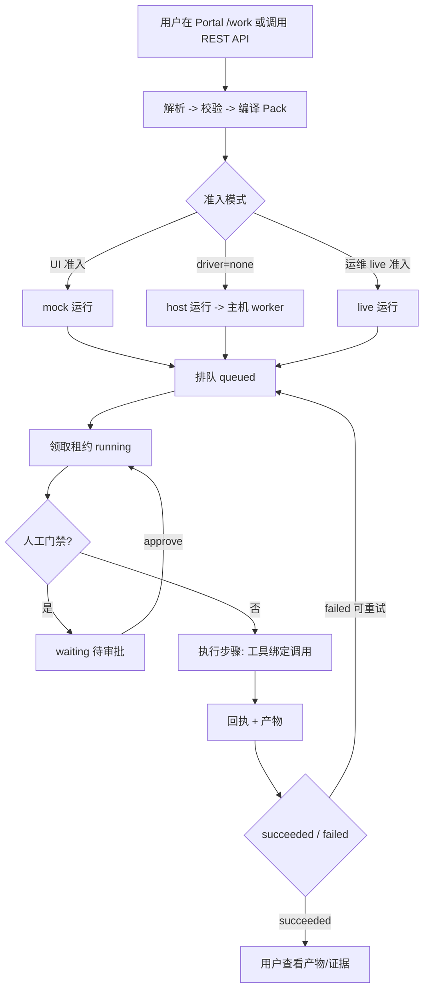
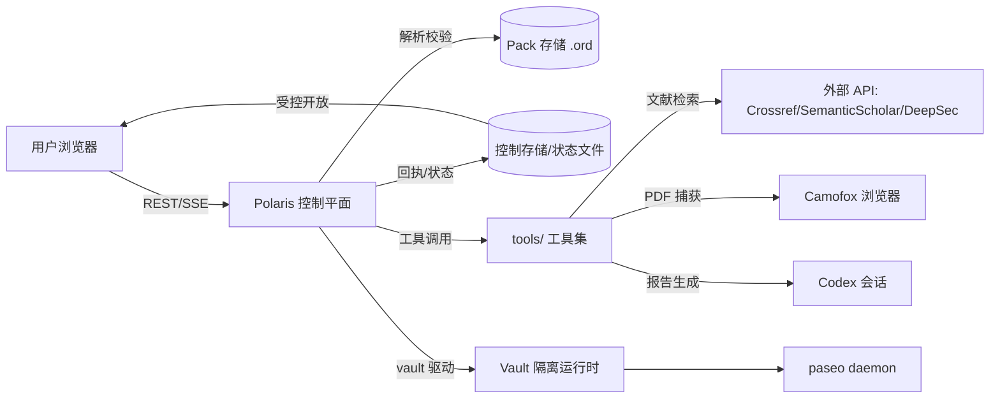
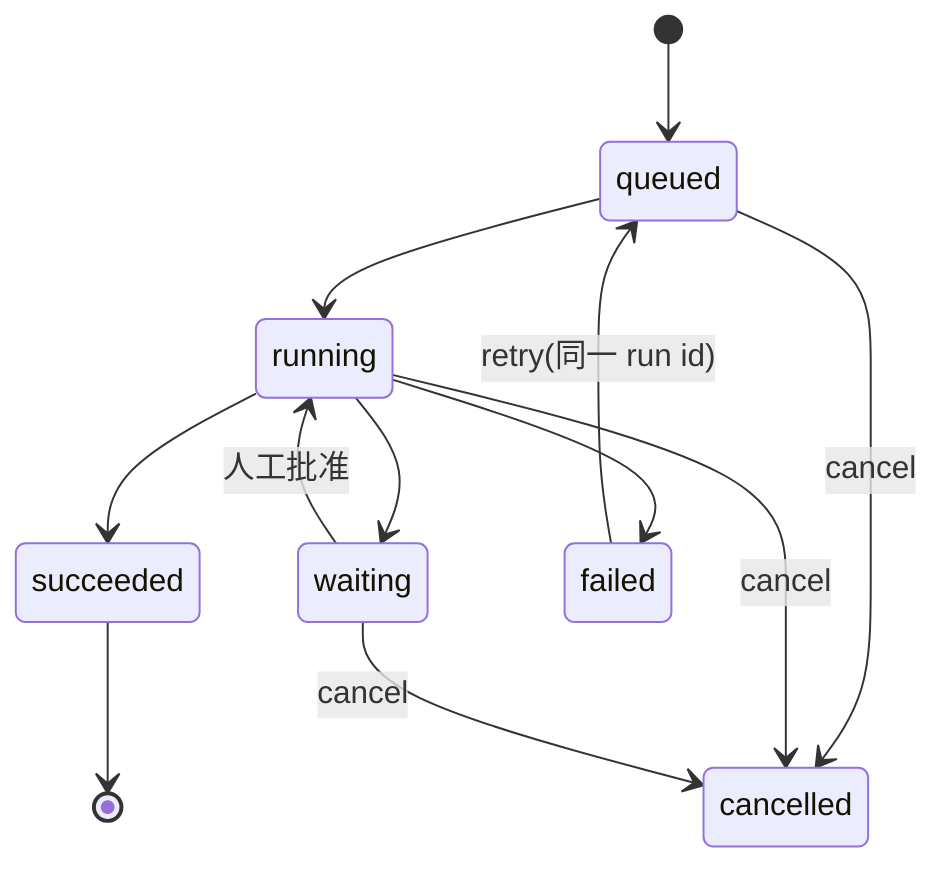
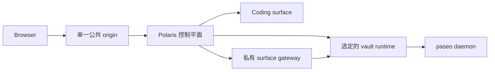

# Polaris 产品需求文档（PRD）

版本号：V2.0.0

| 版本   | 时间       | 修订人 | 备注                          |
|--------|-----------|--------|-------------------------------|
| V1.0.0 | 2026/10/16 | opencode | 基于代码库现状整理 |
| V1.1.0 | 2026/10/16 | opencode | 新增隔离执行器/沙箱 CLI 端口/步级重试需求 |
| V1.2.0 | 2026/10/16 | opencode | 移入 Development 分区；声明唯一 ground truth；移除固定版本承诺 |
| V1.3.0 | 2026/10/16 | opencode | 补充试验包契约：四原语沙箱、模块工具 dispatcher 协议、硬约束与验收 |
| V1.4.0 | 2026/10/16 | opencode | 评审修订：SQLite 现状、幂等键、沙箱边界声明、LLM 依赖口径、产物脱敏、污染断言可执行化 |
| V1.5.0 | 2026/10/16 | opencode | 裁决：北极星指标对齐替换成本三维；交付顺序改为 3.10 先行、沙箱为可选项 |
| V1.6.0 | 2026/10/16 | opencode | 新增产物发布护栏（final 门槛/深度门槛/provenance 完整性） |
| V1.7.0 | 2026/10/16 | opencode | 裁决：重试/预算/超时归步级策略（3.10）；模块工具只做单次尝试，不重复实现 attempt 循环 |
| V1.8.0 | 2026/10/16 | opencode | 裁决推广：平台横切能力（重试/隔离/回执/审计/编排/传递）工具一律不重复实现；新增 3.11.7 能力归属对照 |
| V2.0.0 | 2026/10/16 | opencode | DSL v2：`.ord` 升级为结构化编排（六构造，无界 while + 预算兜底）；移除"线性 DAG"约束；插队 M2 前 |

---

## 一、概述（为什么做）

### 1.1 产品概述及目标

#### 1.1.1 背景介绍

多智能体（multi-agent）系统正在成为团队的核心生产力工具，但把它交给
真实业务运行时，团队普遍缺少一个统一的控制平面：

- 把某个领域直接硬编码进产品，无法规模化复用；
- 把每个步骤写成命令和参数列表，领域包会退化成一个 shell 脚本，
  后续步骤无法校验输入，也没有"某一步允许触碰什么"的记录；
- 运行没有回执（receipt）和产物（artifact）留存，出错无法追溯；
- 身份、配额、生命周期、审计散落在各处，权限边界模糊。

Polaris 的答案是：用一门 DSL + 领域包（Domain Pack）承载"工作是什么"，
用一个自托管控制平面承载"谁能运行、如何运行、留什么证据"。

> 需求体检备注：本文档是 Polaris 产品的唯一 ground truth——范围、
> 流程、优先级以本文档为准，与其他文档冲突时以本文档为准；
> 不以固定版本号承诺交付。用户证据与量化成功指标缺失，已列入
> 「待确认项清单」首条。

#### 1.1.2 产品概述

Polaris 是面向隔离多智能体系统的自托管控制平面。用户通过 Portal
（浏览器应用）或 REST API 提交工作流运行；Polaris 引擎负责
解析、校验、编译领域包，执行准入（admission）、发放租约（lease）、
排队调度，并留存每一步的回执与产物。

#### 1.1.3 产品目标

北极星三指标，映射替换成本三维（学习/迁移/信任）——产品的价值 =
把新工作流领域的采纳成本降下来。

**业务目标**

| 目标 | 指标 | 目标值 | 达成时间 |
|------|------|--------|---------|
| 降低学习成本（北极星 1） | 新领域接入人日：从领域想法到 pack 转绿可执行 | 实测基线后定 [待确认]，方向：单调下降 | 持续 |
| 降低迁移成本（北极星 2） | 运行成功率：succeeded / 终态运行 | ≥ 90% [待确认]；旧方案基线：脚本崩了全重跑 | 持续 |
| 降低迁移成本（北极星 2） | 重试救回率：重试后最终成功 / 曾失败 | 实测基线后定 [待确认] | 持续 |
| 降低信任成本（北极星 3） | 追溯完整率：终态运行可回答"谁、何时、哪个版本、输入输出" | 100% | 已达成 |
| 权限最小化 | 执行者只能运行已钉住的定义且持有效租约 | 100% 强制 | 已达成 |

**用户目标**

| 目标用户 | 用户目标 | 衡量指标 |
|---------|---------|---------|
| 领域专家（打包者） | 新领域只写 pack + 工具，不学产品内部 | 新领域接入人日（北极星 1） |
| 提交者 | 偶发失败不拖垮运行，看到实时进度和产物 | 运行成功率 / 重试救回率（北极星 2）；时间线更新 |
| 审批者 | 在人工门禁处一键处理，操作留痕 | waiting → running 转换；审计完整 |
| 平台运维 | 环境缺口一次预检可见 | `ops tool-precheck` 必需项全绿 |

#### 1.1.4 目标用户

| 角色 | 描述 | 核心诉求 |
|------|------|---------|
| 平台工程师/运维 | 部署并维护 Polaris、管理领域包 | 部署简单、预检清晰、可恢复 |
| 领域专家（打包者） | 用 DSL 把某领域封装为 Pack | 表达力够、版本可管理 |
| 提交者/执行者 | 提交运行、在租约内执行定义 | 进度透明、产物可取 |
| 审批者 | 对人工门禁做批准/驳回 | 列表清晰、一键操作、留痕 |
| 观察者/对账者 | 查看证据、检查回执与失败 | 只读、范围受控 |

### 1.2 名词说明

| 名词 | 说明 |
|------|------|
| DSL | 描述"工作是什么、数据如何流动、允许使用哪些能力"的语言 |
| Domain Pack（领域包） | 一个版本化的领域：实体、流程（flow）、端口（port）、标签 |
| `.ord` | 领域包声明文件；一个 `.ord` 或一个含 `main.ord` 的目录 |
| Flow / Step | 一条工作流及其步骤 |
| Port（端口） | 工具 FFI 接口；由 Host 决定由谁实现、如何绑定 |
| Host worker | 主机侧执行器，接收 `driver=none` 的运行 |
| Vault | 隔离的运行时环境，`driver=vault` 时在其中执行 |
| Admission（准入） | 把一次运行请求变为受管运行对象的过程 |
| Lease（租约） | 执行者运行已钉住定义所需的凭证 |
| Receipt（回执） | 一步执行完成后的记录凭证 |
| Artifact（产物） | 运行产生并受控开放的输出文件 |
| 运行模式 | `mock`（普通 UI 准入）/ `host`（主机执行器）/ `live`（仅运维路径） |
| Portal | 浏览器端应用（`apps/polaris-portal`），React/Vite |
| Paseo | 内嵌 daemon，承载具体 agent 会话执行 |
| Surface / Gateway | 功能入口面 / 私有入口网关，负责准入、票据与限流 |

### 1.3 角色及权限

| 角色 | 权限范围 | 数据范围 |
|------|---------|---------|
| observer（观察者） | 读取 Pack 与范围内证据 | 被授权范围 |
| proposer（提议者） | 创建禁用态草稿 | 本人草稿 |
| approver（审批者） | 批准/驳回草稿或运行动作 | 范围内运行 |
| executor（执行者） | 运行已钉住的定义（需当前租约） | 已钉住定义 |
| reconciler（对账者） | 检查回执与失败 | 范围内运行 |
| operator（运维，产品外角色） | pack 安装/移除、live 元数据准入、预检 | 全系统 |

> 规则：成员身份不隐含执行权限（Membership does not imply execution）。

### 1.4 文档阅读对象

| 对象 | 关注内容 |
|------|---------|
| 研发 | 功能需求、数据字典、系统集成 |
| UI/UX | Portal 路由与交互、全局规则 |
| 测试 | 异常流程、验收标准 |
| 运维 | 版本规划、非功能需求、工具预检 |

---

## 二、产品描述（做什么）

### 2.1 产品需求描述

**做什么**：提供"声明式领域包 + 持久运行引擎 + Portal/API"三位一体的
控制平面，覆盖 安装 → 钉住 → 准入 → 排队 → 执行 → 回执/产物 → 审查。

**不做什么**：

- 不承载具体领域业务逻辑（由领域包与 tools 实现）；
- 不做公有云多租 SaaS（自托管优先）；
- 普通用户不可发起 live 模式运行（仅运维路径）。

**硬约束**：

- 单一公共 origin；浏览器永远接触不到 Docker 端口、内部服务地址或
  host 路径 URL；
- 运行全程钉住 pack 版本与摘要（digest）；
- `driver=none` 与 `vaultId` 互斥；`driver=vault` 必须提供 `vaultId`；
- `.ord` v2 表达结构化编排（sequence/parallel/choice/forEach/
  while/subflow，见 3.13）；编排模式进 DSL，attempt 内的领域收敛
  迭代仍在工具内；
- 平台已有的横切能力领域工具不重复实现：attempt 级重试、超时与
  预算止损归步级策略（3.10）；隔离环境与干净重试归隔离执行器
  （3.8）；回执、审计与产物留存归控制平面；模块工具只做领域逻辑
  的单次尝试（能力归属见 3.11.7）；
- exploit 代码绝不跑宿主机，只在隔离环境；
- fail-closed：工具不全时 pack 保持不可执行；
- 测试用合成 fixture，不用真实数据。

### 2.2 产品整体流程

#### 2.2.1 主流程



#### 2.2.2 子流程

- **审批子流程**：运行在人工门禁步骤进入 `waiting`，审批者批准后
  回到 `running`；流程状态由 Polaris 持有，审批留审计记录。
- **重试子流程**：`failed` 或 `cancelled` 的运行重入同一 run id 的
  队列，跳过已完成的步骤，继续未完成部分。
- **工具预检子流程**：`ops tool-precheck` 收集必需项（缺失则失败）
  与建议项（警告 + 下一步指引）；Portal `/settings/tools` 展示同一
  结果并支持 Recheck。

#### 2.2.3 数据流图（DFD）



#### 2.2.4 状态转换图（STD）



### 2.3 全局说明

#### 2.3.1 全局异常处理

| 异常场景 | 处理方式 | 提示文案 |
|---------|---------|---------|
| 网络异常 | 提示 + 重试 | "请检查网络连接" [待确认] |
| 服务不可用 | Portal 显示错误，SSE 自动重连 | "服务暂不可用，稍后重试" [待确认] |
| 权限不足 | 拒绝操作，记录审计 | "无操作权限" [待确认] |
| Pack 校验失败 | 准入前拦截，返回具体错误 | 展示 parse/validate 错误详情 |
| 工具依赖缺失 | 预检必需项标红并给下一步 | "必需项未满足，见下一步指引" |
| 数据不存在 | 空状态页 | "运行不存在或已被删除" [待确认] |

#### 2.3.2 普通列表规则

| 规则项 | 说明 |
|--------|------|
| 运行列表 | `/work` 以卡片呈现 host/Vault 运行 |
| 排序/分页 | [待确认]，建议默认按创建时间倒序 + 分页 |
| 空数据 | 空状态提示 [待确认] |
| 流程列表 | `/settings/workflows` 按 Pack 展示完整流程，可逐流程启停 |

#### 2.3.3 全局交互

| 场景 | 交互方式 |
|------|---------|
| 提交运行 | 异步操作，按钮防重复提交 [待确认] |
| 运行详情 | `/work/runs/:runId` 时间线（SSE 推送） |
| 审批/取消/重试 | 详情页操作控件，二次确认 [待确认] |
| 产物打开 | 受控预览（artifact preview），不留裸 URL |

### 2.4 产品版本规划

不以固定版本号承诺交付。范围与优先级以 2.6 功能清单为准（本文档是
唯一 ground truth）；交付节奏按需求信号滚动：新需求先进 2.6 功能
清单评审，再进入开发，完成一项从清单上看到一项。功能清单由产品
负责人维护：完成一项即在 2.6 标注完成。

### 2.5 产品框架



| 层 | 职责 |
|----|------|
| `apps/polaris-portal` | React 页面、卡片、导航、Zustand、SSE 客户端；不持有身份与授权权威 |
| `@polaris/polaris-shell` | 路由/产品线/宿主动作/用户契约 |
| `apps/polaris`（服务端） | 认证 API、Pack 投影、持久工作流控制、SSE、生命周期适配、静态产物服务 |
| `packages/polaris-workflow` | DSL 运行时（parse/resolve/validate/compile） |
| `tools/` | 约 25 个 Python 工具，实现 Port |
| `packages/vault-runtime` | Vault 隔离运行时 |
| Polaris Gateway | surface 准入、票据、限流、代理策略 |

### 2.6 功能清单

| 模块 | 功能 | 优先级 | 说明 |
|------|------|--------|------|
| 工作流定义 | Pack 安装/列表/移除 | P0 | CLI 走同一 parse→resolve→validate |
| 工作流定义 | 流程启停 | P0 | `/settings/workflows` |
| 运行 | Portal 提交（work desk） | P0 | 选场景 + 可选 Vault 目标 |
| 运行 | REST API 提交 | P0 | `/api/workflow-runs` |
| 运行 | host 持久运行 | P0 | `driver=none`，`mode:"host"` |
| 运行 | 同 run 重试 | P0 | 跳过已完成步骤 |
| 运行 | 步级重试与预算止损 | P0 | 已交付（2026/10/16）：maxAttempts / timeout / budget，默认 maxAttempts=1 行为不变 |
| 运行 | 隔离环境执行器（干净环境重试） | P1 | 可选项，3.10 之后按需交付 |
| 端口 | 沙箱 CLI 执行端口 | P1 | 可选项，与 3.8 配套 |
| 审批 | 人工门禁（manual review） | P0 | waiting/approve/审计 |
| 产物 | 受控预览与导出 | P0 | 原子导出 |
| 监控 | 运行时间线（SSE） | P0 | 范围内事件 |
| 用户 | 身份/角色/产品线访问 | P0 | Authing 可禁用模式 |
| 运维 | 工具预检 | P0 | CLI + `/settings/tools` |
| 运维 | live 元数据准入 | P1 | 唯一 live 路径 |
| 工具 | 领域模块工具与清单注册 | P0 | dispatcher 协议；注册后 pack 转绿（见 3.11） |
| 产物 | 发布护栏（final 门槛 + 深度门槛 + provenance） | P0 | 见 3.12 |
| 定义 | DSL v2 结构化编排（parallel/choice/forEach/while/subflow） | P0 | 见 3.13；插队 M2 前 |

---

## 三、功能需求（怎么做）

### 3.1 工作流定义管理（Domain Pack）

#### 3.1.1 描述
安装、查看、移除领域包；按包管理流程的启用/禁用。

#### 3.1.2 用户故事
```
作为运维，我希望通过 CLI 安装一个 .ord 包并看到校验结果，
以便只发布通过 parse→resolve→validate 的可信定义。
作为提交者，我希望在 /settings/workflows 看到某个 Pack 的全部流程并启停，
以便控制我的工作台可见的流程范围。
```

#### 3.1.3 前置条件

| 类型 | 条件 |
|------|------|
| 权限依赖 | 安装/移除需运维权限 |
| 数据依赖 | `.ord` 文件或含 `main.ord` 的目录 |

#### 3.1.4 后置条件
- pack 进入已安装清单并生成 manifest；pack 版本与摘要被后续运行钉住。

#### 3.1.5 界面及交互

| 元素 | 类型 | 必填 | 默认值 | 校验规则 | 操作反馈 |
|------|------|------|--------|---------|---------|
| pack add 目标 | CLI 参数 | 是 | - | 存在的 .ord/目录 | 校验失败输出错误详情 |
| 流程启用开关 | 开关控件 | 否 | 安装时默认值 [待确认] | - | 即时生效并记录 |

#### 3.1.6 业务流程
`pack add` → parse → resolve → validate → 原子安装（三步同引擎准入
前序一致）；一方包（`packs/`）与三方包（`third_party/`）自动发现。

#### 3.1.7 异常/分支流程

| 场景 | 触发条件 | 处理方式 | 提示文案 |
|------|---------|---------|---------|
| 校验失败 | DSL 语法/引用错误 | 拒绝安装，输出错误 | parse/validate 错误详情 |
| 重复安装 | 同 domain+版本已存在 | 幂等或拒绝 [待确认] | "该版本已安装" |
| 移除被引用包 | 有运行钉住该版本 | 拒绝或按版本移除 [待确认] | - |

#### 3.1.8 数据字典（Pack 安装清单）

| 字段名 | 类型 | 必填 | 说明 | 示例值 |
|--------|------|------|------|--------|
| packId | String | 是 | 领域标识 | "autoresearch" |
| version | String | 是 | 语义化版本 | "0.4.0" |
| digest | String | 是 | 内容摘要，运行钉住 | "sha256:..." [待确认] |
| source | Enum | 是 | first-party/third-party | "first-party" |
| installed_at | DateTime | 是 | 安装时间 | 2026-09-11 |

### 3.2 运行提交与准入

#### 3.2.1 描述
用户经 Portal 工作台或 REST API 提交运行；引擎完成准入并持久化。

#### 3.2.2 用户故事
```
作为提交者，我希望 POST /api/workflow-runs 提交一次文献综述运行，
以便稍后在详情页查看进度和产物。
作为提交者，我希望在 /work 选一个领域包作为工作场景并提交，
以便不写代码也能发起运行。
```

#### 3.2.3 前置条件

| 类型 | 条件 |
|------|------|
| 数据依赖 | 目标 Pack 已安装且流程已启用 |
| 权限依赖 | 用户具备执行权限（executor） |
| 约束依赖 | `driver=none` 不可与 `vaultId` 同用；`driver=vault` 必须带 `vaultId` |

#### 3.2.4 后置条件
- 生成持久运行对象（含钉住的 pack 版本/摘要），进入 `queued`；
- 普通界面准入产生 `mode:"mock"`，主机准入产生 `mode:"host"`。

#### 3.2.5 界面及交互（REST 请求体）

| 字段 | 类型 | 必填 | 默认值 | 校验规则 | 说明 |
|------|------|------|--------|---------|------|
| packId | String | 是 | - | 已安装的 pack | 领域包 |
| flowId | String | 是 | - | pack 内已启用流程 | 流程 |
| driver | Enum | 否 | none | none/vault | 执行目标 |
| vaultId | String | 条件 | - | driver=vault 时必填 | 隔离环境 |
| values | String | 是 | - | `key=value` 对 | 入参，如 question、audience |
| scenario | String | 否 | - | - | 场景（[待确认] 具体取值） |
| Idempotency-Key | String | 否 | - | 全局唯一 [待确认] | 重复提交返回同一 run |

#### 3.2.6 业务流程
见 2.2.1 主流程前半段。

#### 3.2.7 异常/分支流程

| 场景 | 触发条件 | 处理方式 | 提示文案 |
|------|---------|---------|---------|
| 流程被禁用 | flowId 未启用 | 拒绝准入 | "流程未启用" |
| 参数缺失 | values 缺关键字段 | 拒绝准入并列出缺失项 | 表单/错误详情 |
| driver 冲突 | none + vaultId | 拒绝准入 | "参数互斥" |
| 重复提交 | 同 Idempotency-Key 重复 POST | 返回同一 run，不建新运行 | 复用已有运行 |
| 未认证 | 会话缺失/过期 | 跳转 /welcome | 认证模式展示 |

#### 3.2.8 数据字典（workflow_run）

| 字段名 | 类型 | 必填 | 说明 | 示例值 |
|--------|------|------|------|--------|
| runId | String | 是 | 运行唯一标识 | "run-..." [待确认] |
| packId / flowId | String | 是 | 定义引用 | "autoresearch"/"LiteratureReview" |
| pinnedVersion / digest | String | 是 | 钉住的定义版本 | "0.4.0" |
| mode | Enum | 是 | mock/host/live | "host" |
| driver | Enum | 是 | none/vault | "none" |
| values | Object | 是 | 入参键值 | question=... |
| status | Enum | 是 | queued/running/waiting/succeeded/failed/cancelled | "queued" |
| createdAt / updatedAt | DateTime | 是 | 时间戳 | 2026-10-16 |

### 3.3 运行执行与监控

#### 3.3.1 描述
引擎按排队/租约调度执行步骤，产出回执与产物；Portal 经 SSE 呈现时间线。

#### 3.3.2 用户故事
```
作为提交者，我希望在 /work/runs/:runId 看到每步的时间线与回执，
以便知道运行卡在哪一步。
作为对账者，我希望检查失败的回执与证据，以便定位失败原因。
```

#### 3.3.3 前置条件
运行已准入并持久化；用户具备该运行范围的观察权限。

#### 3.3.4 后置条件
每步产生 receipt；产物进入受控产物区；状态机按 2.2.4 流转。

#### 3.3.5 界面及交互

| 元素 | 类型 | 必填 | 默认值 | 校验规则 | 操作反馈 |
|------|------|------|--------|---------|---------|
| 时间线 | 步骤列表（SSE） | 是 | 全量回放 + 增量 | - | 实时追加 |
| 历次尝试 | 步骤分组（attempt 序号） | 否 | 折叠 | - | 失败步展开历次尝试回执 |
| 操作区 | 按钮（approve/cancel/retry） | 是 | 按状态显隐 | 状态合法才可点 | 置灰防重复 |
| 产物入口 | 链接卡片 | 否 | - | 受控开放 | 打开预览 |

#### 3.3.6 业务流程
`queued` → worker 领取（lease）→ 逐步执行（工具绑定）→ 每步回执 →
终态。人工门禁步骤转 `waiting`。

#### 3.3.7 异常/分支流程

| 场景 | 触发条件 | 处理方式 | 提示文案 |
|------|---------|---------|---------|
| 步骤失败 | 工具返回失败 | 运行转 `failed`，保留回执 | 详情页展示失败步骤 |
| 租约失效 | lease 过期 | 停止执行 [待确认] | - |
| SSE 断开 | 网络中断 | 自动重连 + 全量对账 | 短暂提示 |
| 重复操作 | 连点 retry/cancel | 幂等处理 | 按钮置灰 |

#### 3.3.8 数据字典（receipt）

| 字段名 | 类型 | 必填 | 说明 | 示例值 |
|--------|------|------|------|--------|
| runId | String | 是 | 所属运行 | "run-..." |
| stepId | String | 是 | 步骤标识 | "literature.collection" |
| status | Enum | 是 | succeeded/partial/failed | "succeeded" |
| output | Object | 否 | 产出引用/摘要 | - |
| createdAt | DateTime | 是 | 完成时间 | 2026-10-16 |

### 3.4 人工审批（人工门禁）

#### 3.4.1 描述
流程在声明的人工门禁处暂停，审批者批准/驳回后继续或终止。

#### 3.4.2 用户故事
```
作为审批者，我希望看到待审批清单并一键批准，
以便流程在受控下继续。
```

#### 3.4.3 前置条件
用户具备 approver 角色；运行处于 `waiting`。

#### 3.4.4 后置条件
- 状态 `waiting → running`；写入审计（audit）记录；
- 审批身份稳定（review identity），支持续跑后追溯。

#### 3.4.5 界面及交互

| 元素 | 类型 | 必填 | 默认值 | 校验规则 | 操作反馈 |
|------|------|------|--------|---------|---------|
| 待审列表 | 列表页 | 是 | - | 仅范围内 | 空状态 |
| 批准/驳回 | 按钮 | 是 | - | 二次确认 [待确认] | 状态即时更新 |

#### 3.4.6 业务流程
`running` → 门禁步骤 → `waiting` → approver 操作 → `running`（批准）
或按流程定义终止/驳回 [待确认：驳回后行为]。

#### 3.4.7 异常/分支流程

| 场景 | 触发条件 | 处理方式 | 提示文案 |
|------|---------|---------|---------|
| 非审批者操作 | 权限不足 | 拒绝 + 审计 | "无操作权限" |
| 并发审批 | 两人同时操作 | 先到先得，后者幂等失败 | "已由他人处理" |
| 超时未审 | [待确认：是否有超时] | 保持 waiting | - |

#### 3.4.8 数据字典（review 审计）

| 字段名 | 类型 | 必填 | 说明 | 示例值 |
|--------|------|------|------|--------|
| reviewId | String | 是 | 稳定审批标识 | "rev-..." |
| runId | String | 是 | 所属运行 | "run-..." |
| reviewerId | String | 是 | 审批人 | 用户 ID |
| action | Enum | 是 | approve/reject | "approve" |
| at | DateTime | 是 | 操作时间 | 2026-10-16 |

### 3.5 产物查看与导出

#### 3.5.1 描述
运行产物（报告、图、PDF、BibTeX 等）经受控预览与原子导出开放给
有权限的用户。

#### 3.5.2 用户故事
```
作为提交者，我希望在详情页直接预览最终报告并导出，
以便离线使用和归档。
```

#### 3.5.3 前置条件
运行到达可开放产物的状态；用户在授权范围内。

#### 3.5.4 后置条件
产物视图记录访问；导出为原子操作（不产生半截文件）。

#### 3.5.5 界面及交互

| 元素 | 类型 | 必填 | 默认值 | 校验规则 | 操作反馈 |
|------|------|------|--------|---------|---------|
| 产物预览 | 内嵌预览组件 | 否 | - | 类型白名单 | 不支持类型给下载 |
| 导出 | 按钮 | 否 | - | 二次确认 [待确认] | 原子导出成功提示 |

#### 3.5.6 业务流程
产物服务（静态产物服务）校验权限 → 预览/导出；浏览器始终只见
公共 origin 路由，不见存储路径。

#### 3.5.7 异常/分支流程

| 场景 | 触发条件 | 处理方式 | 提示文案 |
|------|---------|---------|---------|
| 产物缺失 | 生成失败/被清理 | 空状态 | "产物不存在" |
| 无权限 | 范围外访问 | 拒绝 + 审计 | "无访问权限" |

#### 3.5.8 数据字典（artifact）

| 字段名 | 类型 | 必填 | 说明 | 示例值 |
|--------|------|------|------|--------|
| artifactId | String | 是 | 产物标识 | "art-..." [待确认] |
| runId | String | 是 | 所属运行 | "run-..." |
| kind | Enum | 是 | report/pdf/dot/bibtex/... | "report" |
| visibility | Enum | 是 | review-list/non-review 等 [待确认] | "review-list" |
| size / createdAt | - | 是 | 元信息 | - |

### 3.6 用户与权限管理

#### 3.6.1 描述
Authing 身份映射（可禁用模式）、租户与 Vault 所有权、角色与产品线
访问控制。

#### 3.6.2 用户故事
```
作为运维，我希望以 POLARIS_AUTH_MODE=disabled 快速起本地环境，
以便开发调试不依赖外部身份服务。
```

#### 3.6.3 前置条件 / 3.6.4 后置条件
本地禁用模式下使用 `POLARIS_AUTH_DEFAULT_USER_ID` 的默认用户；
正式模式经 `/auth/callback` 完成 code 交换。

#### 3.6.5 界面及交互
`/welcome`（展示当前认证模式）、`/auth/callback`、`/settings/user`
（基本信息 / 凭证 / 会话 三段并列）。

#### 3.6.6 异常/分支流程
会话过期 → 重定向 `/welcome`；身份映射失败 → 明确错误 [待确认]。

#### 3.6.7 数据字典
见 `apps/docs/site/polaris/user-management.md`（本文档不重复）。

### 3.7 工具接入与预检

#### 3.7.1 描述
工具（tools/）实现 Port；`ops tool-precheck` 与 `/settings/tools`
暴露同一 check-setup 结果，必需项缺失则失败，建议项给下一步指引。

#### 3.7.2 用户故事
```
作为运维，我希望启动前一键预检所有工具依赖，
以便快速发现缺 API Key、DISPLAY、Camofox 等环境缺口。
```

#### 3.7.3 界面及交互

| 元素 | 类型 | 必填 | 默认值 | 校验规则 | 操作反馈 |
|------|------|------|--------|---------|---------|
| 预检结果 | 分组列表 | 是 | - | 必需/建议两级 | 缺项标红 |
| Recheck | 按钮 | 否 | - | - | 重新运行 check-setup |

#### 3.7.4 异常/分支流程
单工具 check-setup 失败只影响该工具；必需项缺失时 Portal 启动仍会
记录并输出剩余缺口（不阻断启动）。

### 3.8 隔离环境执行器（Vault）

#### 3.8.1 描述
现状：Vault-target 运行只能 `mode:"mock"`——引擎对 Vault 运行不启用
工具执行器。目标：真 `mode:"vault"`——在隔离 Vault 运行时（内嵌
paseo daemon）中执行运行，每次 attempt 在全新隔离环境（写时复制）
中执行，支持"干净环境重试"，污染不跨 attempt 传播。

交付顺序：本功能与 3.9 为可选项（沙箱或无沙箱），在 3.10（步级
重试与预算止损）之后按需交付，见 2.4。

#### 3.8.2 用户故事
```
作为执行者，我希望失败步骤的重试在一个全新隔离环境中执行，
以便前一次尝试留下的环境污染不影响后续尝试。
作为运维，我希望长流程的中间产物随环境快照一并留存，
以便失败后从干净状态恢复。
```

#### 3.8.3 前置条件

| 类型 | 条件 |
|------|------|
| 权限依赖 | driver=vault 必须提供 vaultId |
| 功能依赖 | 3.2 运行提交与准入 |

#### 3.8.4 后置条件
- 运行在隔离环境内执行；尝试结束后环境快照与产物入库。

#### 3.8.5 界面及交互

| 元素 | 类型 | 必填 | 默认值 | 校验规则 | 操作反馈 |
|------|------|------|--------|---------|---------|
| vaultId | 选择控件 | 条件 | - | 归属当前用户 | 无权限时拒绝 |
| 重试 | 按钮 | 否 | - | 状态为 failed 才可点 | 新环境重试提示 |

#### 3.8.6 业务流程
failed → retry → 新建隔离环境（干净副本）→ 从已完成步骤续跑 →
失败步骤重新执行。

#### 3.8.7 异常/分支流程

| 场景 | 触发条件 | 处理方式 | 提示文案 |
|------|---------|---------|---------|
| 环境创建失败 | 资源不足/镜像缺失 | 运行转 failed，保留回执 | "隔离环境创建失败" |
| 环境超时 | 超过步级预算 | 步失败，触发重试策略 | "执行超时" |

#### 3.8.8 数据字典（隔离环境）

| 字段名 | 类型 | 必填 | 说明 | 示例值 |
|--------|------|------|------|--------|
| vaultId | String | 是 | 隔离环境标识 | "vault-..." |
| baseImage | String | 是 | 基础镜像 | "ubuntu-22.04" [待确认] |
| envState | Enum | 是 | fresh/dirty/snapshotted | "fresh" |
| snapshotRef | String | 否 | 环境快照引用 | "snap-..." [待确认] |

### 3.9 沙箱 CLI 执行端口

#### 3.9.1 描述
Agent 与隔离环境交互的唯一通道，四原语：exec / get_file /
write_file / list_dir。以 Port 声明、由 Host 绑定实现
（binary/timeoutMs/workdir），命令级回执（exitCode/stdoutRef/costUsd）；
领域包不硬编码实现细节。

受控的唯一边界：沙箱环境 scrub（进程环境不含宿主凭据）+ 路径禁闭
（任何路径解析拒绝逃逸环境根）+ 单命令 timeoutMs。

交付顺序：本功能为可选项（沙箱或无沙箱），与 3.8 配套，在 3.10
之后按需交付，见 2.4。

#### 3.9.2 用户故事
```
作为打包者，我希望声明一个沙箱 CLI 端口，让流程步骤能在隔离
环境内执行受控命令，以便领域逻辑不进产品代码。
作为运维，我希望限制端口可执行的命令与超时，以便控制风险。
```

#### 3.9.3 前置条件

| 类型 | 条件 |
|------|------|
| 数据依赖 | 3.8 隔离环境可用 |
| 权限依赖 | Port 由 Pack 声明、Host 绑定 |

#### 3.9.4 后置条件
- 每次命令执行产生回执（命令、退出码、时长）。

#### 3.9.5 界面及交互（Port 声明字段）

| 字段 | 类型 | 必填 | 默认值 | 校验规则 | 说明 |
|------|------|------|--------|---------|------|
| portId | String | 是 | - | 唯一 | 端口标识 |
| kind | Enum | 是 | - | cli-sandbox | 端口类型 |
| binary | String | 是 | - | 存在的可执行文件 | 绑定实现 |
| timeoutMs | Number | 否 | 600000 [待确认] | > 0 | 单命令超时 |
| workdir | String | 否 | 环境内默认目录 | 沙箱内路径 | 工作目录 |

> 能力边界：端口不设命令白名单；受控语义由沙箱边界保证（环境
> scrub + 路径禁闭 + timeoutMs），越权路径拒绝并留审计。

#### 3.9.6 业务流程
步骤调用端口 → 隔离环境内执行 → 回执（stdout/stderr/退出码）→
产物落共享目录。

#### 3.9.7 异常/分支流程

| 场景 | 触发条件 | 处理方式 | 提示文案 |
|------|---------|---------|---------|
| 命令超时 | 超过 timeoutMs | 终止命令，回执记失败 | "命令超时" |
| 非零退出 | 命令失败 | 回执记录，由步骤策略处理 | 展示 stderr |
| 越权路径 | 访问沙箱外路径 | 拒绝并记录审计 | "路径不可访问" |

#### 3.9.8 数据字典（命令执行回执）

| 字段名 | 类型 | 必填 | 说明 | 示例值 |
|--------|------|------|------|--------|
| runId / stepId | String | 是 | 归属运行与步骤 | "run-..." |
| command | String | 是 | 执行的命令 | "pip install ..." |
| exitCode | Number | 是 | 退出码 | 0 |
| stdoutRef / stderrRef | String | 否 | 输出产物引用 | "art-..." |
| durationMs / costUsd | Number | 否 | 时长与成本 [待确认] | 3000 / 0.02 |

> stdoutRef/stderrRef 产物默认脱敏：环境凭据类内容不落产物（见 4.1）。

### 3.10 步级重试与预算止损

#### 3.10.1 描述
每步可配置 maxAttempts + timeoutMs + budgetUsd；连续失败或预算
超限后步级终止，交由运行级状态机处理。现状只有运行级重试（失败/
取消重入同一 run id，跳过已完成步骤），没有步级策略——LLM 类
步骤的偶发失败会直接拖垮整个运行。

#### 3.10.2 用户故事
```
作为提交者，我希望为不稳定步骤配置最大尝试次数与预算上限，
以便 LLM 类步骤的偶发失败不拖垮整个运行。
```

#### 3.10.3 前置条件 / 3.10.4 后置条件
- 依赖 3.3 运行执行与监控；达到上限后步失败并保留全部尝试回执。

#### 3.10.5 界面及交互（步级策略字段）

| 字段 | 类型 | 必填 | 默认值 | 校验规则 | 说明 |
|------|------|------|--------|---------|------|
| maxAttempts | Number | 否 | 1 [待确认] | >= 1 | 最大尝试次数 |
| timeoutMs | Number | 否 | - | > 0 | 单次尝试超时 |
| budgetUsd | Number | 否 | - | > 0 | 步级成本预算 [待确认] |

#### 3.10.6 业务流程
尝试失败 → 尝试次数 < maxAttempts → 重新执行该步（可选干净环境，
见 3.8）→ 达到上限或预算超限 → 步失败 → 运行转 failed。

#### 3.10.7 异常/分支流程

| 场景 | 触发条件 | 处理方式 | 提示文案 |
|------|---------|---------|---------|
| 尝试耗尽 | 失败次数达 maxAttempts | 步失败，保留尝试回执 | 详情页展示历次尝试 |
| 预算超限 | costUsd 超 budgetUsd | 立即止损，步失败 | "步级预算超限" |

#### 3.10.8 数据字典（步级策略）

| 字段名 | 类型 | 必填 | 说明 | 示例值 |
|--------|------|------|------|--------|
| stepId | String | 是 | 策略归属步骤 | "build.env" |
| maxAttempts | Number | 否 | 最大尝试次数 | 5 |
| timeoutMs | Number | 否 | 单次尝试超时 | 2700000 |
| budgetUsd | Number | 否 | 步级成本预算 | 1.0 [待确认] |

### 3.11 领域模块工具与清单注册（dispatcher 协议）

#### 3.11.1 描述
领域模块以通用工具实现；注册进工具清单后 pack 转绿可执行。产品
只认协议与清单，不认具体领域。工具调用协议：
`tools/<entrypoint> workflow <command> --input <in.json> --output
<out.json>`；输入 JSON 信封：
`{runId, tenantId, flowId, stepId, outputFields, workspaceRoot,
input:{...uses}}`；非零退出即步失败（fail-closed）。

#### 3.11.2 用户故事
```
作为打包者，我希望按 dispatcher 协议实现模块工具并注册进工具清单，
以便 pack 从不可执行转绿。
```

#### 3.11.3 模块与命令

以当前试验包的四个模块为契约示例（产品按协议执行，不绑领域）：

| 模块 | 命令 | 职责 |
|------|------|------|
| cve.processor | fetch | 定位源码、提取受影响版本 |
| cve.processor | build-knowledge | 结构化知识库（摘要/根因/利用细节） |
| cve.builder | plan | 环境搭建计划 |
| cve.builder | setup | 沙箱内执行计划 + critic 纠错循环 |
| cve.exploiter | exploit | 单次尝试：内部只做 dev+critic 收敛迭代；attempt 级重试（maxAttempts=5）、timeoutMs、budgetUsd 由步级策略（3.10）承担；每次重试的全新隔离环境（3.8 可选项生效时）由步级重试提供 |
| cve.verifier | verify | weak/strong CTF verifier，按成功判据检查 |

#### 3.11.4 LLM 依赖与成本口径
- 模块工具调用 LLM 经 env 注入的二进制与模型（如
  `POLARIS_CVE_CODEX_BIN`、模型名 [待确认]）；进程环境经沙箱
  scrub，不继承宿主凭据；
- 凭据缺失时模块 fail-closed：返回非零退出并注明
  "LLM provider 不可用"，交由 3.10 步级策略处理；
- costUsd 口径：优先回读 LLM wrapper 的计费输出；无计费输出时按
  固定估算计入回执 [待确认]；
- 公开参考实现（如 CVE-Genie）仅作方法与 prompt 对照，自带基础
  设施不移植（能力归属见 3.11.7）。

#### 3.11.5 注册与转绿
- 注册进 `tools/tool-inventory.json`（entrypoint + commands）；
- 清单校验（E_FFI_TOOL / E_FFI_COMMAND）通过后，catalog warnings
  清空，pack 转绿可执行。

#### 3.11.6 异常/分支流程

| 场景 | 触发条件 | 处理方式 | 提示文案 |
|------|---------|---------|---------|
| 工具缺失 | port 引用的工具不在清单 | catalog 警告；执行 fail-closed | "工具未安装" |
| 命令缺失 | step command 未提供 | 校验期拒绝 | "命令未定义" |
| 工具退出非零 | 模块执行失败 | 步失败，保留回执，交由 3.10 步级策略 | 展示 stderr |

#### 3.11.7 平台能力归属（工具不重复实现）

平台已有的横切能力，领域工具一律不重复实现；工具只做领域逻辑的
单次尝试。attempt 内的领域收敛（如 critic 纠错迭代）是模块自身
逻辑，不属于平台重试。公开参考实现（如 CVE-Genie）仅作方法与
prompt 对照，下表右列一律不移植：

| 平台能力 | 归属 | 参考实现中不移植的部分 |
|----------|------|------------------------|
| attempt 重试/超时/预算 | 步级策略（3.10） | exploiter 主循环的 attempt 计数、预算判断、退避 |
| 干净环境（快照/重建） | 隔离执行器（3.8，可选项） | vm_library 的 QEMU 快照管理与环境复用 |
| 回执/审计/日志 | 控制平面（receipts/时间线/审计） | log.txt、conversations/*.json 自建日志 |
| LLM 调用与凭据 | env 注入 + fail-closed（3.11.4） | agentlib 的 llm_api 重试与选型逻辑 |
| 编排与续跑 | `.ord` v2 结构化编排 + 同 run 重试（跳过已完成步） | main.py 的 pipeline 编排、checkpoint 续跑 |
| 步间数据传递 | artifacts（outputFields/uses） | shared directory 自建约定 |

### 3.12 产物发布护栏（final 门槛）

#### 3.12.1 描述
终态产物的发布护栏：`final` 有前置条件（证据 registry 非空 + 最少
篇幅 + provenance 可复现）；不满足时标 `degraded` 并给排查指引。
上游失败（如 provider 限流解出 0 条 claim）不得级联成空洞终稿照常
发布。

#### 3.12.2 用户故事
```
作为提交者，我希望空 registry 或篇幅不达标的产物不被标记为 final，
以便上游失败不级联成空洞终稿。
作为对账者，我希望终稿的 provenance（输入配置、摘要、re-run 命令）
完整可复现，以便排查"为什么短"有入口。
```

#### 3.12.3 护栏口径

| # | 护栏 | 口径 | 挡的失败 |
|---|------|------|---------|
| R-1 | final 前置检查 | registry 非空 + 最少字数；registry 为空时评审 fail（堵"无点可查=空真通过"漏洞） | 限流 → 0 claim → 骨架照常 final |
| R-2 | 深度门槛 | 段落数/字数进 revise 触发器（软门槛，触发修订而非 fail）；评审加深度维 | 每 claim 一句的清单式报告 |
| R-3 | provenance 完整性 | source tasks 回写、input digest、re-run command 记录；缺失即 degraded | 排查入口本身不可复现 |

#### 3.12.4 异常/分支流程

| 场景 | 触发条件 | 处理方式 | 提示文案 |
|------|---------|---------|---------|
| registry 为空 | 解出 0 条 claim | 评审 fail；终稿标 degraded + 排查指引 | "证据不足，见排查指引" |
| 字数不达标 | 低于最少篇幅 | 触发 revise（软门槛） | 展开修订轮次 |
| provenance 缺失 | 输入配置/摘要/命令未记录 | 补录；degraded 标记 | "配置未记录" |

#### 3.12.5 数据字典（发布状态）

| 字段名 | 类型 | 必填 | 说明 | 示例值 |
|--------|------|------|------|--------|
| status | Enum | 是 | final/degraded/short-report | "final" |
| registryCount | Number | 是 | 证据 registry 条数 | 35 |
| bodyWords | Number | 否 | 终稿正文字数 [待确认] | 1240 |
| provenanceComplete | Boolean | 是 | 输入配置/摘要/命令是否齐全 | true |
| degradedReason | String | 条件 | status != final 时必填 | "empty-registry" |

### 3.13 DSL v2（结构化编排表达力）

#### 3.13.1 描述
`.ord` v2 把编排表达力从线性步序升级为结构化控制流：sequence、
parallel（fork-join）、choice（条件分支）、forEach（按列表产物逐项）、
while（条件循环）、subflow（flow 组合）。裁决依据：线性链表达不了
分支/并行/条件编排，编排被迫漏回工具内部，与 3.11.7 能力归属
矛盾。目标不是 Turing complete，而是结构化表达力——编排模式进
DSL，计算留在工具。

#### 3.13.2 构造语义

| 构造 | 语义 | 终止性 |
|------|------|--------|
| sequence | 线性步序（v1 已有） | 静态保证 |
| parallel | 分支并发，全部到齐（join）才继续 | 静态 DAG 检查 |
| choice | 按步输出/输入字段条件分支 | 谓词静态校验 |
| forEach | 按列表产物逐项执行，maxInFlight 并发上限 | 数据有界 |
| while | 条件循环，无静态迭代上限 | 步级预算/超时止损兜底 |
| subflow | 调用另一 flow，DAG 展开复用 | 展开检查 |

#### 3.13.3 while 语义（裁决 2026/10/16）
while 不设静态迭代上限（放弃静态终止检查）；止损归平台：循环内
每步执行带步级 timeoutMs/budgetUsd（3.10），超限即步失败并终止
循环；while 条件只读输入与已完成步的输出字段。

#### 3.13.4 用户故事
```
作为打包者，我希望在 .ord 里直接表达分支、并行与循环编排，
以便编排不被迫写进工具内部（与 3.11.7 能力归属一致）。
```

#### 3.13.5 配套改动
- interpreter：线性 for 循环 → 拓扑执行 + join 语义；
- validator：环检测、join 完备性、choice 谓词、subflow 展开检查；
  不做 while 终止检查；
- 步级策略（3.10）按分支/迭代各自生效；parallel 分支共享 run 预算；
- 时间线与图视图渲染并行分支、choice 走向与迭代分组；
- v1 线性 pack 向后兼容（线性是 v2 的子集）。

---

## 四、非功能需求（注意事项）

### 4.1 安全与合规

| 需求 | 说明 |
|------|------|
| 单一公共 origin | 浏览器不可见内部端口/host 路径；编码与垂直入口同源经 Gateway 准入 |
| 权限模型 | 角色五分 + 成员身份不隐含执行；live 仅运维路径 |
| 定义完整性 | 运行钉住 pack 版本与摘要，跨状态转换不变 |
| 审计 | 审批、生命周期动作留审计记录 |
| 密钥管理 | Provider 凭证经环境文件/env 注入，不入库不入前端 |
| 产物脱敏 | 命令输出产物默认脱敏；凭据类字段不落产物；产物查看走授权 |
| 隔离 | Vault 隔离运行时承载不可信执行 |

### 4.2 统计需求（埋点）

| 事件名 | 触发时机 | 属性 | 说明 |
|--------|---------|------|------|
| page_view | Portal 页面加载 | route, user_id | 访问统计 |
| run_submit | 运行提交成功 | packId, flowId, driver, mode | 提交行为 |
| run_action | approve/cancel/retry | runId, action, role | 审批与生命周期 |
| run_finished | 运行到终态 | runId, status, duration | 成功率/时长 |
| error_occur | 异常发生 | error_code, route | 异常监控 |

> [待确认] 埋点上报通道与留存策略（产品文档未定义上报端）。

### 4.3 性能需求

| 指标 | 要求 |
|------|------|
| Portal 首屏 | < 2s [待确认] |
| 运行提交接口 | P99 < 500ms [待确认] |
| SSE 事件延迟 | < 1s [待确认] |
| 可用性 | 自托管单机基线，99.5% [待确认] |
| 回滚 | pack 版本钉住支持回退；自托管经版本回滚恢复 |

### 4.4 数据库设计

现状：控制存储为 SQLite——`workflow_runs`、`workflow_outbox`、
capability leases、run 事件（见 workflow.md）。运行/回执/产物/审计
均落该存储。

隔离执行器（3.8）与步级策略（3.10）需新增表：沙箱环境（env spec、
快照引用）与步级尝试回执；新增表的索引与保留/清理策略需评审。 [待确认]

### 4.5 系统集成

| 对接系统 | 接口方向 | 协议 | 说明 |
|---------|---------|------|------|
| Crossref / Semantic Scholar / DeepSec | 调用 | HTTP | 文献检索与扩展 |
| Camofox 浏览器 | 调用 | HTTP | PDF/页面捕获（可代理） |
| Codex | 调用 | CLI 进程 | 分析与报告生成会话 |
| Authing | 调用 | OAuth code 交换 | 身份（可禁用） |
| paseo daemon | 内嵌 | 进程/FS | agent 会话执行 |
| Vault runtime | 内嵌 | - | 隔离执行 |

> 降级策略：外部文献 API 不可用时保留缓存与部分成功（partial）状态；
> 身份服务不可用时本地禁用模式兜底（仅开发环境）。

---

## 五、附录

### 5.1 验收标准与测试要点

| 功能 | 验收条件 | 优先级 |
|------|---------|--------|
| Pack 安装 | 合法 .ord 安装成功；非法 DSL 被拒绝并输出错误 | P0 |
| 运行提交 | REST 提交后产生 queued 运行，钉住版本与摘要 | P0 |
| 状态机 | queued→running→succeeded/failed/waiting 转换符合 2.2.4 | P0 |
| 同 run 重试 | failed 重试后 runId 不变且跳过已完成步骤 | P0 |
| 人工门禁 | waiting 批准后回 running，留审计记录 | P0 |
| 产物导出 | 导出为原子操作，半途失败不产生残缺文件 | P0 |
| 工具预检 | 必需项缺失时命令失败；建议项只警告并给下一步 | P1 |
| 权限 | observer 只读；成员身份不隐含执行 | P0 |
| live 准入 | 非运维路径无法产生 live 运行 | P0 |
| 本地 CI | `bash ./scripts/ci-local.sh` 通过 | P0 |
| 隔离执行器 | driver=vault 运行每次 attempt 使用全新隔离环境：attempt N 在沙箱内写入标记文件后失败，attempt N+1 的沙箱内不存在该标记文件 | P0 |
| 沙箱端口 | 命令级回执含 exitCode/stdoutRef；越权路径被拒绝并留审计 | P0 |
| 步级策略 | maxAttempts 耗尽后步失败且保留历次尝试回执；预算超限立即止损 | P0 |
| 模块工具 | 四模块注册后 `pack list` 无 warnings；缺失任一工具时 pack 不可执行 | P0 |
| 发布护栏 | 空 registry 时评审 fail、终稿标 degraded；`final` 仅在 registry 非空且 provenance 齐全时可达 | P0 |
| DSL v2 | parallel 全分支到齐才继续；choice 按谓词走向；while 超步级预算即终止循环；v1 线性 pack 安装不回归 | P0 |

---

## 待确认项清单

### 必须确认（阻塞开发/评审）

（当前无：北极星指标与交付顺序均已裁决，见 1.1.3 与 2.6。）

### 建议确认（影响完整度）

1. [待确认] 指标目标值：接入人日、成功率、救回率的基线与目标值
   待 receipts 数据实测后回填。→ 建议：先测基线再定目标。
   影响：1.1.3 验收、后续复盘基准。
2. [待确认] 全局提示文案未定义（网络异常/权限不足等）。→ 建议：
   沿用现有 Portal i18n 文案表（`apps/polaris-portal/src/i18n`）。
   影响：3.2/3.3 异常分支测试断言。
3. [待确认] 人工门禁"驳回"后的行为（终止 or 回退重做）。→ 建议：
   终止并允许 re-submit。影响：3.4.6 流程图与状态机。
4. [待确认] 审批是否需要超时机制。→ 建议：当前不做超时。影响：3.4.7。
5. [待确认] Pack 重复安装/被引用移除的策略。→ 建议：幂等安装 +
   禁止移除被钉住版本。影响：3.1.7。
6. [待确认] 埋点上报通道。→ 建议：先落 Portal 本地事件日志，后续接
   `pm-tracking-spec-writer` 输出正式方案。影响：4.2。

### 可后续补充

7. [待确认] 性能指标建议值（4.3 全部）。→ 建议：以本地 CI 基准
   实测后回填。影响：验收标准。
8. [待确认] 运行数据保留与清理策略（4.4）。→ 建议：随隔离执行器
   存储方案一并评审。影响：运维手册。
