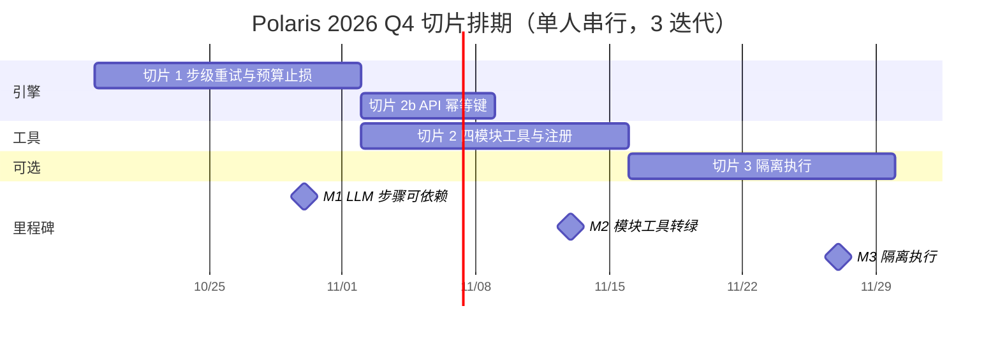

# Polaris 2026 Q4 路线图

版本号：V1.0.0

| 版本   | 时间       | 修订人    | 备注                                |
|--------|-----------|-----------|-------------------------------------|
| V1.0.0 | 2026/10/16 | opencode | 依据 PRD V1.5.0 切片与排期；M1 先行 |

周期：2026/10/19 ~ 2026/11/27（6 周，3 个迭代）。
负责人：Qiang Liu（单人维护）。
依据：[Polaris PRD](./prd) V1.5.0（唯一 ground truth）。

---

## 1. 目标（北极星映射替换成本三维，见 PRD 1.1.3）

| # | 目标（O） | 关键结果（KR） | 优先级 | 切片 |
|---|----------|---------------|--------|------|
| O1 | 让 LLM 类步骤可依赖（降低迁移成本，北极星 2） | KR1: 每步支持 maxAttempts + timeoutMs + budgetUsd | P0 | 切片 1 |
| O1 | | KR2: 运行成功率 ≥ 90% [待确认] | P0 | 切片 1, 2 |
| O1 | | KR3: 救回率可测且有基线 | P0 | 切片 1 |
| O2 | 领域接入成本下降（降低学习成本，北极星 1） | KR1: 四模块工具注册后 pack list 无 warnings | P0 | 切片 2 |
| O2 | | KR2: API 幂等键（重复 POST 返回同一 run） | P0 | 切片 2b |
| O3 | 可信隔离执行（降低信任成本，北极星 3） | KR1: 污染断言通过 | P1 可选 | 切片 3 |

---

## 2. 故事地图（骨架 + 横切切片）

Backbone（用户旅程："一个工作流领域从想法到长期运行"）：

```text
声明领域 → 接入工具 → 预检环境 → 提交运行 → 执行监控
        → 审批门禁 → 取产物 → 失败恢复 → 对账追溯
```

| 活动 | 已有 ✓ | 缺 ⬜ |
|------|--------|-------|
| 声明领域 | Pack 安装/移除、流程启停 | — |
| 接入工具 | dispatcher 协议契约 | 领域模块工具+清单注册（P0） |
| 预检环境 | tool-precheck | — |
| 提交运行 | Portal/API 提交、driver 约束 | API 幂等键 |
| 执行监控 | host 持久运行、时间线 SSE | 步级重试+预算止损（P0 先行）；live 准入（P1） |
| 审批门禁 | 人工门禁+审计 | — |
| 取产物 | 受控预览/原子导出 | — |
| 失败恢复 | 同 run 重试（跳过已完成步骤） | 干净重试（P1 可选） |
| 对账追溯 | SQLite 控制存储、回执/审计 | — |

横切切片：每条横跨 backbone 端到端可验证，不纵切单模块。

| 切片 | 横跨活动 | 端到端验证 | 估 | 状态 |
|------|---------|-----------|-----|------|
| 0 walking skeleton | 全链 | AutoResearch host run（已交付） | — | 已完成 |
| 1 LLM 步骤可依赖（PRD 3.10） | 提交/监控/恢复/追溯 | 不稳定步骤偶发失败不拖垮运行；救回率可测 | 3~5 人天 | 未开始 |
| 2 模块工具转绿（PRD 3.11） | 声明/接入/提交/执行/产物 | 四模块注册后 pack list 无 warnings，端到端全绿 | 5~7 人天 | 未开始 |
| 3 隔离执行（PRD 3.8/3.9，可选） | 接入/执行/恢复 | 污染断言通过；干净重试可测 | 3~5 人天 | 可选 |
| 4 丰满层（远期） | live UX/性能基线 | — | — | 远期 |

---

## 3. 甘特图



---

## 4. 里程碑

| 里程碑 | 日期 | 交付物 | 成功指标 | 状态 |
|--------|------|--------|----------|------|
| M1 LLM 步骤可依赖 | W2 2026/10/30 | 步级策略引擎（maxAttempts/timeoutMs/budgetUsd）、历次尝试回执与时间线 attempt 分组、合成 fixture 测试、全量回归通过 | 北极星：救回率可测且有基线；护栏：既有 15 个 workflow-control 测试不回归 | 🔵 |
| M2 模块工具转绿 | W4 2026/11/13 | cve.processor/builder/exploiter/verifier 四模块工具、tool-inventory.json 注册、API 幂等键、test:domain-packs 通过 | 北极星：pack list 显示 CveGenieTrial 无 warnings；护栏：缺失任一工具时 pack 保持不可执行（fail-closed） | 🔵 |
| M3 可信隔离执行（可选） | W6 2026/11/27 | 沙箱 CLI 通道（四原语+命令级回执）、真 mode:"vault" 执行器、干净环境重试、污染断言测试 | 北极星：污染断言通过、干净重试可测；护栏：无沙箱配置时流程仍可运行 | 🔵 |

---

## 5. 依赖关系与关键路径

| 泳道 | 链路 |
|------|------|
| 引擎 | 切片 1 步级策略 → 切片 2b 幂等键 |
| 工具 | 切片 2 四模块+注册 → 切片 3 隔离执行（可选，依赖切片 2 的工具协议） |

关键路径：切片 1（引擎，先行——已裁决）→ 切片 2（工具+注册）→
切片 3（可选）。单人维护即瓶颈：任何插队需求必须等量砍掉同级切片。

---

## 6. 产能分配

| 参数 | 值 | 说明 |
|------|-----|------|
| 团队人数 | 1 | 单人维护者（全栈） |
| 迭代周期 | 2 周 | 3 个迭代 |
| 有效工作日 | 8 天/迭代 | 扣除杂务 |
| 产能系数 | 0.7 | 上下文切换/回归修复/技术债 |
| 迭代产能 | ≈ 5.6 人天 | 1 × 8 × 0.7 |
| 6 周总产能 | ≈ 17 人天 | 5.6 × 3 |
| 已分配（确定性：切片 1+2b+2） | ≈ 10 人天 | 60% |
| 弹性（切片 3，可砍） | ≈ 3.4 人天 | 20% |
| 缓冲预留 | ≈ 3.4 人天 | 20% |

> 产能利用率约 80%。切片 3 是功能缓冲：有余力就做，没余力推迟——
> 不许占用缓冲。

---

## 7. 风险矩阵

| 风险 | 概率 | 影响 | 等级 | 缓解措施 | 预案 B | 负责人 |
|------|------|------|------|---------|--------|--------|
| 步级策略触碰引擎核心，既有 workflow 测试回归 | 中 | 高 | 🔴 高 | 默认 maxAttempts=1 保持现行为；策略在 dispatcher 调用点包一层，不进 interpreter；每步跑全量回归 test:full-minus-infra | 策略只挂 host 驱动，Vault 运行暂不启用 | Qiang Liu |
| 单人带宽被杂务/回归修复挤占，里程碑滑动 | 高 | 中 | 🔴 高 | 20% 产能缓冲；切片 3 划为功能缓冲可砍；P0 插队需等量砍同级 | 推迟切片 3，M3 移出本周期 | Qiang Liu |
| 四模块工具的 LLM 依赖（codex bin/凭据）本地不可用 | 中 | 中 | 🟡 中 | fail-closed 语义明确（非零退出注明 provider 不可用）；测试用 stub 二进制合成 fixture | 先交付协议与注册，LLM 接线单独切片 | Qiang Liu |
| host 模式沙箱隔离强度有限（目录级，非容器级） | 低 | 中 | 🟢 低 | 污染断言明确定义并测试；路径禁闭 + 环境 scrub + timeout 三重边界 | 启用 docker 后端 | Qiang Liu |

---

## 8. 缓冲策略

| 缓冲类型 | 占比 | 人天 | 用途 |
|----------|------|------|------|
| 风险应对 | 10% | 1.7 | 引擎回归修复、fail-closed 调试 |
| 突发需求 | 10% | 1.7 | 应急插队（等量砍同级） |
| 弹性需求（切片 3） | 20% | 3.4 | 有余力就做，没余力推迟 |

---

## 9. 变更记录

| 版本 | 日期 | 变更 | 影响 |
|------|------|------|------|
| V1.0.0 | 2026/10/16 | 初始版本：依据 PRD V1.5.0 切片与排期；交付顺序裁决（切片 1 先行、沙箱可选）已纳入 | — |
