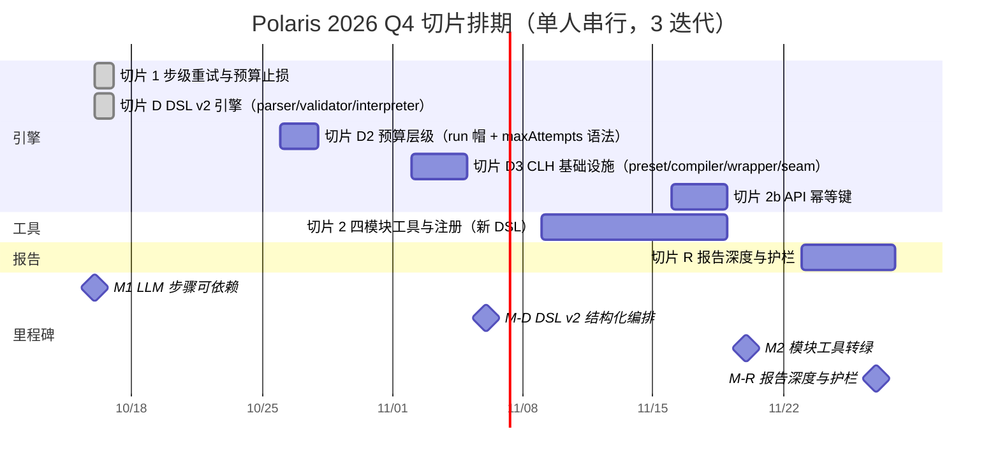

# Polaris 2026 Q4 路线图

版本号：V1.5.0

| 版本   | 时间       | 修订人    | 备注                                |
|--------|-----------|-----------|-------------------------------------|
| V1.0.0 | 2026/10/16 | opencode | 依据 PRD V1.5.0 切片与排期；M1 先行 |
| V1.1.0 | 2026/10/16 | opencode | 依据 PRD V1.6.0 新增切片 R（报告深度与护栏）；切片 3 移出本周期 |
| V1.2.0 | 2026/10/16 | opencode | 依据 PRD V2.0.0 新增切片 D（DSL v2 结构化编排），插队 M2 前；M2 顺延 W5、M-R 保留 W6 |
| V1.3.0 | 2026/10/16 | opencode | 依据 PRD V2.1.0 新增切片 D2（预算层级：run 级预算帽 + 步级 maxAttempts 语法），插队 M2 前；对账 M-D 翻绿 |
| V1.4.0 | 2026/10/16 | opencode | 依据 PRD V2.2.0 D2 范围扩上 flow 级预算声明；对账 D2 已交付部分 |
| V1.5.0 | 2026/10/17 | opencode | 依据 PRD V2.3.0 新增切片 D3（LLM 调用运行时 CLH 基础设施），插队 M2 前；M2 改为薄工具跑在 CLH 上 |

周期：2026/10/19 ~ 2026/11/27（6 周，3 个迭代）。
负责人：Qiang Liu（单人维护）。
依据：[Polaris PRD](./prd) V2.3.0（唯一 ground truth）。

---

## 1. 目标（北极星映射替换成本三维，见 PRD 1.1.3）

| # | 目标（O） | 关键结果（KR） | 优先级 | 切片 |
|---|----------|---------------|--------|------|
| O1 | 让 LLM 类步骤可依赖（降低迁移成本，北极星 2） | KR1: 每步支持 maxAttempts + timeoutMs + budgetUsd | P0 | 切片 1 |
| O1 | | KR2: 运行成功率 ≥ 90% [待确认] | P0 | 切片 1, 2 |
| O1 | | KR3: 救回率可测且有基线 | P0 | 切片 1 |
| O2 | 领域接入成本下降（降低学习成本，北极星 1） | KR1: 四模块工具注册后 pack list 无 warnings | P0 | 切片 2 |
| O2 | | KR2: API 幂等键（重复 POST 返回同一 run） | P0 | 切片 2b |
| O2 | | KR3: 模块工具零手写 LLM 调用逻辑（CLH preset 化，PRD 3.14） | P0 | 切片 D3 |
| O3 | 可信隔离执行（降低信任成本，北极星 3） | KR1: 污染断言通过 | P1 可选 | 切片 3 |

---

## 2. 故事地图（骨架 + 横切切片）

Backbone（用户旅程："一个工作流领域从想法到长期运行"）：

```text
声明领域 → 接入工具 → 预检环境 → 提交运行 → 执行监控
        → 审批门禁 → 取产物 → 失败恢复 → 对账追溯
```

| 活动 | 已有 ✓ | 缺 ⬜ |
|------|--------|-------|
| 声明领域 | Pack 安装/移除、流程启停 | — |
| 接入工具 | dispatcher 协议契约 | 领域模块工具+清单注册（P0） |
| 预检环境 | tool-precheck | — |
| 提交运行 | Portal/API 提交、driver 约束 | API 幂等键 |
| 执行监控 | host 持久运行、时间线 SSE、步级重试+预算止损（M1 已交付） | live 准入（P1） |
| 审批门禁 | 人工门禁+审计 | — |
| 取产物 | 受控预览/原子导出 | — |
| 失败恢复 | 同 run 重试（跳过已完成步骤） | 干净重试（P1 可选） |
| 对账追溯 | SQLite 控制存储、回执/审计 | — |

横切切片：每条横跨 backbone 端到端可验证，不纵切单模块。

| 切片 | 横跨活动 | 端到端验证 | 估 | 状态 |
|------|---------|-----------|-----|------|
| 0 walking skeleton | 全链 | AutoResearch host run（已交付） | — | 已完成 |
| 1 LLM 步骤可依赖（PRD 3.10） | 提交/监控/恢复/追溯 | 不稳定步骤偶发失败不拖垮运行；救回率可测 | 3~5 人天 | 已完成（2026/10/16 提前交付，9d8c9035） |
| D DSL v2 结构化编排（PRD 3.13） | 声明/接入/提交/执行（全链编排面） | parallel 全分支到齐才继续；choice 按谓词走向；while 超步级预算即终止；v1 线性 pack 不回归 | 8~11 人天 | 已完成（2026/10/16 提前交付：1a9e4cac 引擎 + aa69f4c9 试验包重写） |
| D2 预算层级（PRD 3.10.9） | 全链（run 级止损 + 步级/flow 级预算配置） | run 级预算超帽即止损整个运行（跨分支累计可测）；`.ord` 步级 maxAttempts 与 flow 级 budgetUsd/timeoutMs 被 parser 接受，flow 声明 > env 兜底 | 2~3 人天 | 已完成（2026/10/16 提前交付：179d43d2） |
| D3 LLM 调用运行时（PRD 3.14） | 接入/执行/追溯（CLH 基础设施） | 非法 preset 被拒；compiler 产物对 dsh schema 校验通过；wrapper 解析会话日志产出回执；api 后端单 call 计费回读；凭据缺失 fail-closed；8 份 preset（CVE-Genie 映射）编译干净 | 2~3 人天 | 未开始（插队 M2 前；M2 改为薄工具跑在 CLH 上） |
| 2 模块工具转绿（PRD 3.11） | 声明/接入/提交/执行/产物 | 四模块注册后 pack list 无 warnings，端到端全绿 | 5~7 人天 | 未开始（顺延至切片 D 后） |
| R 报告深度与护栏（PRD 3.12） | 分析/报告/评审 | 空 registry 不再空洞通过；终稿篇幅可辨识；provenance 可复现 | ≈ 3.5 人天 | 未开始（本周期插入，占用切片 3 缓冲位） |
| 3 隔离执行（PRD 3.8/3.9，可选） | 接入/执行/恢复 | 污染断言通过；干净重试可测 | 3~5 人天 | 移出本周期 |
| 4 丰满层（远期） | live UX/性能基线 | — | — | 远期 |

切片 R 的三个修复项（PRD 3.12 护栏口径）：

| # | 修复项 | 挡的失败 | 估 |
|---|--------|---------|-----|
| R-1 final 前置护栏 | claims=0 或字数不达标时评审 fail、终稿标 degraded，不得 final | 429 → 0 claims → 骨架照常 final | ~1 人天 |
| R-2 深度门槛 | 段落数/字数进 revise 触发器；评审加深度维 | 每 claim 一句的清单式报告 | ~1.5 人天 |
| R-3 provenance 修复 | source tasks 回写、input digest、re-run command | 排查入口本身不可复现 | ~1 人天 |

---

## 3. 甘特图



> M3（可信隔离执行，可选项）移出本周期，连同切片 3 推迟到下一
> 切片窗口。
> 切片 R 依据 PRD 第 3.12 节：报告质量是当前活跃问题，插队占用
> 切片 3 的功能缓冲位（等量置换，不扩产能）。
> 切片 D 依据 PRD 第 3.13 节：DSL 表达力不足使编排被迫漏回工具
> （与 3.11.7 矛盾），插队 M2 前以免工具写完再迁移。
> 切片 D3 依据 PRD 第 3.14 节：LLM 调用逻辑每工具重搭是横切缺口
> （文献管线裸撞 429 教训），插队 M2 前——M2 的四个模块工具改为
> 薄工具跑在 CLH 上，agentlib 式循环由 dsh 引擎接管。

---

## 4. 里程碑

| 里程碑 | 日期 | 交付物 | 成功指标 | 状态 |
|--------|------|--------|----------|------|
| M1 LLM 步骤可依赖 | 2026/10/16（提前） | 步级策略引擎（maxAttempts/timeoutMs/budgetUsd）、历次尝试回执与时间线 attempt 分组、合成 fixture 测试、全量回归通过 | 北极星：救回率可测且有基线；护栏：既有 15 个 workflow-control 测试不回归 | 🟢 已交付（9d8c9035）；22/22 测试（7 新 step-policy + 15 既有零回归），救回率可测 |
| M-D DSL v2 结构化编排 | W3 2026/11/06 | 六构造（sequence/parallel/choice/forEach/while/subflow）、拓扑执行 interpreter、DAG 校验、步级策略按分支生效、时间线/图渲染、v1 线性兼容 | 北极星：编排不再被迫漏回工具；护栏：v1 线性 pack 安装/运行不回归 | 🟢 2026/10/16 提前交付（1a9e4cac 引擎 22/22 + aa69f4c9 试验包重写；surfaces 45/45） |
| M-D2 预算层级 | W3 2026/11/06 | run 级预算帽（跨步骤/分支累计止损）+ `.ord` 步级 maxAttempts 语法与步级策略接线 | 北极星：run 级止损可测；护栏：无 run 帽配置时行为不变 | 🟢 2026/10/16 提前交付（179d43d2；workflow 26/26 + apps 31/31） |
| M-D3 CLH 基础设施 | W3 2026/11/06 | `packages/llm-harness`（preset schema + compiler + wrapper + api 后端 + dispatcher seam）、8 份 preset（CVE-Genie 映射，prompts Apache-2.0 注明出处）、合成 fixture 测试 | 北极星：模块工具零手写 LLM 调用逻辑；护栏：凭据缺失 fail-closed，既有测试零回归 | 🔵 |
| M2 模块工具转绿 | W5 2026/11/20 | cve.processor/builder/exploiter/verifier 四模块工具（写在新 DSL 上）、tool-inventory.json 注册、API 幂等键、test:domain-packs 通过；工具不重复实现平台横切能力（PRD 3.11.7） | 北极星：pack list 显示 CveGenieTrial 无 warnings；护栏：缺失任一工具时 pack 保持不可执行（fail-closed） | 🔵 |
| M-R 报告深度与护栏（插入，占用切片 3 缓冲位） | W6 2026/11/27 | R-1 final 前置护栏（claims=0 评审 fail、终稿标 degraded）；R-2 深度门槛（段落/字数进 revise 触发器 + 评审深度维）；R-3 provenance 修复（source tasks/digest/re-run command）——口径见 PRD 3.12 | 北极星：空 registry 不再空洞通过；护栏：无沙箱不阻塞（可选项不进本周期） | 🔵 |

---

## 5. 依赖关系与关键路径

| 泳道 | 链路 |
|------|------|
| 引擎 | 切片 1 步级策略（已交付）→ 切片 D DSL v2 → 切片 D3 CLH → 切片 2b 幂等键 |
| 工具 | 切片 D3 CLH（先行）→ 切片 2 四模块薄工具+注册（跑在 CLH 上）→ 切片 3 隔离执行（可选，下窗口） |

关键路径：切片 D3（CLH，先行——M2 薄工具直接跑在 CLH 上，避免
agentlib 式循环写完再迁移）→ 切片 2（薄工具+注册）→ 切片 R
（护栏）。单人维护即瓶颈：任何插队需求必须等量砍掉同级切片。

---

## 6. 产能分配

| 参数 | 值 | 说明 |
|------|-----|------|
| 团队人数 | 1 | 单人维护者（全栈） |
| 迭代周期 | 2 周 | 3 个迭代 |
| 有效工作日 | 8 天/迭代 | 扣除杂务 |
| 产能系数 | 0.7 | 上下文切换/回归修复/技术债 |
| 迭代产能 | ≈ 5.6 人天 | 1 × 8 × 0.7 |
| 6 周总产能 | ≈ 17 人天 | 5.6 × 3 |
| 已分配（确定性：切片 D+2+D3+2b+R-1） | ≈ 15~16 人天 | 88~94% |
| 弹性（切片 R-2/R-3，可顺延） | ≈ 2 人天 | 12% |
| 缓冲预留 | ≈ 2 人天 | 12% |

> 产能超订风险：D（8~11，实际 1）+ D3（2~3）+ M2（5~7，薄工具后
> 趋下沿）+ R（3.5）≈ 18.5~24.5 人天（按上沿估），对 6 周总产能
> ≈17 人天贴满。M1/D/D2 提前交付回填约 10 人天；切片 3 已移出。
> 止损规则：W4 末（11/13）D3 未收尾则 R-2/R-3 顺延下窗口（R-1
> 保留——final 护栏是防漏底线）。降级预案：CLH seam 注入机制超估
> → dispatcher adapter 降级为 sandbox-policy 限制，seam 另立任务。

---

## 7. 风险矩阵

| 风险 | 概率 | 影响 | 等级 | 缓解措施 | 预案 B | 负责人 |
|------|------|------|------|---------|--------|--------|
| 步级策略触碰引擎核心，既有 workflow 测试回归 | 中 | 高 | 🔴 高 | 默认 maxAttempts=1 保持现行为；策略在 dispatcher 调用点包一层，不进 interpreter；每步跑全量回归 test:full-minus-infra | 策略只挂 host 驱动，Vault 运行暂不启用 | Qiang Liu |
| DSL v2 引擎复杂度（拓扑执行/join/分支步级策略）超估 | 中 | 高 | 🔴 高 | v1 线性兼容是护栏（不回归即可收）；先交 parallel/choice/forEach，subflow 可降级 | subflow/while 移下一窗口，本周期保 parallel/choice/forEach | Qiang Liu |
| 插入切片 D 后总需求（≈16.5~21.5 人天）贴满 6 周产能（≈17） | 高 | 中 | 🔴 高 | M1 提前交付回填约 3 人天；R-2/R-3 划为可顺延缓冲；W4 末止损规则 | M2 顺延下窗口，本周期保 D + R-1 | Qiang Liu |
| 单人带宽被杂务/回归修复挤占，里程碑滑动 | 高 | 中 | 🔴 高 | 20% 产能缓冲；切片 3 划为功能缓冲可砍；P0 插队需等量砍同级 | 推迟切片 3，M3 移出本周期 | Qiang Liu |
| 四模块工具的 LLM 依赖（codex bin/凭据）本地不可用 | 中 | 中 | 🟡 中 | fail-closed 语义明确（非零退出注明 provider 不可用）；测试用 stub 二进制合成 fixture | 先交付协议与注册，LLM 接线单独切片 | Qiang Liu |
| dsh 开发者预览有破坏性变更承诺；seam 注入机制（自定义插件）不可行 | 中 | 中 | 🟡 中 | CLH compiler 层隔离（preset 不动，换后端重编译）；dsh 版本钉死；schema 校验对齐 dump-config-schema | 换 opencode/codex 后端；seam 降级为 sandbox-policy 限制另立任务 | Qiang Liu |
| host 模式沙箱隔离强度有限（目录级，非容器级） | 低 | 中 | 🟢 低 | 污染断言明确定义并测试；路径禁闭 + 环境 scrub + timeout 三重边界 | 启用 docker 后端 | Qiang Liu |

---

## 8. 缓冲策略

| 缓冲类型 | 占比 | 人天 | 用途 |
|----------|------|------|------|
| 风险应对 | 10% | 1.7 | 引擎回归修复、DSL v2 join/分支调试 |
| 突发需求 | 10% | 1.7 | 应急插队（等量砍同级） |
| 弹性需求（切片 R-2/R-3） | 20% | 2 | W4 末 D 未收尾则顺延下窗口；切片 3 已移出 |

---

## 9. 变更记录

| 版本 | 日期 | 变更 | 影响 |
|------|------|------|------|
| V1.0.0 | 2026/10/16 | 初始版本：依据 PRD V1.5.0 切片与排期；交付顺序裁决（切片 1 先行、沙箱可选）已纳入 | — |
| V1.1.0 | 2026/10/16 | 依据 PRD V1.6.0 新增切片 R（报告深度与护栏）；切片 3 移出本周期 | M-R 占用切片 3 缓冲位 |
| V1.2.0 | 2026/10/16 | 依据 PRD V2.0.0 新增切片 D（DSL v2 结构化编排），插队 M2 前；M2 顺延 W5、M-R 保留 W6；M1 翻绿与切片 1 状态对账 | 产能超订风险入矩阵；W4 末止损规则生效 |
| V1.3.0 | 2026/10/16 | 依据 PRD V2.1.0 新增切片 D2（预算层级），插队 M2 前；M-D 翻绿对账 | 产能超订略缓解（D 实际 1 人天交付，回填约 8 人天） |
| V1.4.0 | 2026/10/16 | 依据 PRD V2.2.0 D2 范围扩上 flow 级预算声明；D2 对账翻绿 | D2 实际 1 人天交付 |
| V1.5.0 | 2026/10/17 | 依据 PRD V2.3.0 新增切片 D3（CLH 基础设施），插队 M2 前；M2 改为薄工具跑在 CLH 上；新增 dsh 后端风险行 | M2 交付形态变化；产能上沿 88~94%；W4 末止损规则覆盖 D3 |
