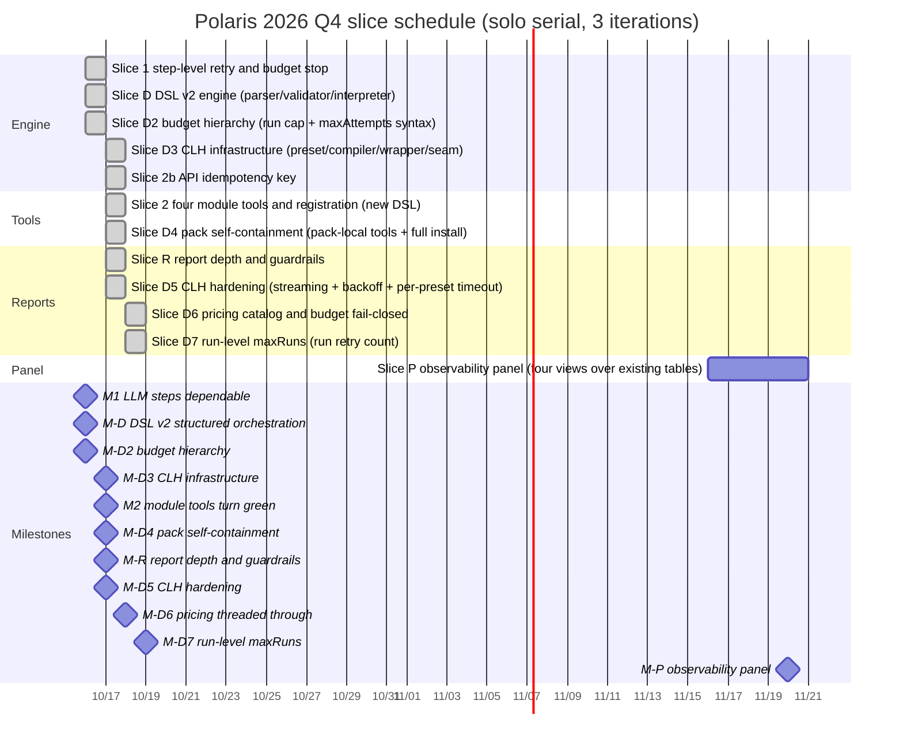

# Polaris 2026 Q4 Roadmap

Version: V2.0.0

| Version | Date       | Author    | Notes |
|---------|-----------|-----------|-------|
| V1.0.0 | 2026/10/16 | opencode | Sliced and scheduled per PRD V1.5.0; M1 first |
| V1.1.0 | 2026/10/16 | opencode | Added slice R (report depth and guardrails) per PRD V1.6.0; slice 3 moved out of this cycle |
| V1.2.0 | 2026/10/16 | opencode | Added slice D (DSL v2 structured orchestration) per PRD V2.0.0, cut ahead of M2; M2 shifted to W5, M-R kept at W6 |
| V1.3.0 | 2026/10/16 | opencode | Added slice D2 (budget hierarchy: run-level budget cap + step-level maxAttempts syntax) per PRD V2.1.0, cut ahead of M2; reconciled M-D turns green |
| V1.4.0 | 2026/10/16 | opencode | D2 scope widened to flow-level budget declarations per PRD V2.2.0; reconciled D2's delivered portion |
| V1.5.0 | 2026/10/17 | opencode | Added slice D3 (LLM invocation runtime CLH infrastructure) per PRD V2.3.0, cut ahead of M2; M2 changed to thin tools on CLH |
| V1.6.0 | 2026/10/17 | opencode | Added slice D4 (pack self-containment: pack-local tools + full install) per PRD V2.4.0, executed after M2; M2/2b reconciled green |
| V1.7.0 | 2026/10/17 | opencode | Added slice D5 (CLH hardening: streaming + backoff + per-preset timeoutMs + error-value threading) per PRD V2.5.0 — first CVE comparison run proved four defects; R reconciled green |
| V1.8.0 | 2026/10/18 | opencode | Added slice D6 (pricing catalog + budget fail-closed) per PRD V2.6.0 — second comparison run proved the budget cap silently inert; D5 reconciled green |
| V1.9.0 | 2026/10/18 | opencode | Added slice D7 (run-level maxRuns — run retry count) per PRD 3.10.9; evaluation calibration (1 CVE × 3 runs) starts; version 0.5.0 released |
| V2.0.0 | 2026/10/19 | opencode | Added slice P (observability panel — cost / reliability / quality / evaluation views) per PRD V3.0.0's third pillar, next window's main piece alongside 3.8; D7 reconciled pending review |

Cycle: 2026/10/19 ~ 2026/11/27 (6 weeks, 3 iterations).
Owner: Qiang Liu (solo maintainer).
Basis: [Polaris PRD](./prd) V3.0.0 (sole ground truth).

---

## 1. Goals (north star mapped to switching-cost dimensions, see PRD 1.1.3)

| # | Goal (O) | Key results (KR) | Priority | Slices |
|---|----------|------------------|----------|--------|
| O1 | Make LLM-like steps dependable (lower migration cost, north star 2) | KR1: every step supports maxAttempts + timeoutMs + budgetUsd | P0 | Slice 1 |
| O1 | | KR2: run success rate ≥ 90% [TBD] | P0 | Slices 1, 2 |
| O1 | | KR3: rescue rate measurable with a baseline | P0 | Slice 1 |
| O1 | | KR4: LLM calls dependable under a real gateway (streaming + call-level backoff, PRD 3.14 V2.5.0) | P0 | Slice D5 |
| O2 | Domain onboarding cost falls (lower learning cost, north star 1) | KR1: after the four module tools register, pack list shows no warnings | P0 | Slice 2 |
| O2 | | KR2: API idempotency key (duplicate POST returns the same run) | P0 | Slice 2b |
| O2 | | KR3: module tools with zero hand-written LLM calling logic (CLH presets, PRD 3.14) | P0 | Slice D3 |
| O2 | | KR4: pack self-containment — domain-specific tools ship with the pack, global tools/ stops growing (PRD 3.11.8) | P0 | Slice D4 |
| O3 | Trusted isolated execution (lower trust cost, north star 3) | KR1: pollution assertion passes | P1 optional | Slice 3 |

---

## 2. Story map (skeleton + cross-cutting slices)

Backbone (user journey: "a workflow domain from idea to long-running
operation"):

```text
Declare domain → integrate tools → precheck environment → submit run →
        execute and monitor → approval gate → collect artifacts →
        failure recovery → reconcile and trace
```

| Activity | Have ✓ | Missing ⬜ |
|----------|--------|-----------|
| Declare domain | Pack install/remove, flow enable/disable | — |
| Integrate tools | Dispatcher protocol contract, domain module tools + inventory registration (delivered in M2), pack-local tools (delivered in D4) | — |
| Precheck environment | tool-precheck | — |
| Submit run | Portal/API submission, driver constraints, API idempotency key (delivered in M2) | — |
| Execute and monitor | Persistent host runs, timeline SSE, step-level retry + budget stop (delivered in M1) | live admission (P1) |
| Approval gate | Manual gate + audit | — |
| Collect artifacts | Controlled preview / atomic export | — |
| Failure recovery | Same-run retry (skips completed steps) | Clean retry (P1 optional) |
| Reconcile and trace | SQLite control store, receipts / audit | — |

Cross-cutting slices: each spans the backbone end to end and is
verifiable, never a vertical cut through a single module.

| Slice | Activities spanned | End-to-end verification | Est. | Status |
|-------|--------------------|-------------------------|------|--------|
| 0 walking skeleton | Full chain | AutoResearch host run (delivered) | — | Done |
| 1 LLM steps dependable (PRD 3.10) | Submit / monitor / recover / trace | Occasional failures of unstable steps do not sink the run; rescue rate measurable | 3~5 person-days | Done (delivered early 2026/10/16, 9d8c9035) |
| D DSL v2 structured orchestration (PRD 3.13) | Declare / integrate / submit / execute (full orchestration surface) | parallel continues only when all branches arrive; choice follows predicates; while terminates when the step-level budget is exceeded; v1 linear pack no regression | 8~11 person-days | Done (delivered early 2026/10/16: 1a9e4cac engine + aa69f4c9 trial pack rewrite) |
| D2 budget hierarchy (PRD 3.10.9) | Full chain (run-level stop-loss + step/flow budget configuration) | Run-level budget over its cap stops the entire run (cross-branch accrual measurable); `.ord` step-level maxAttempts and flow-level budgetUsd/timeoutMs accepted by the parser, flow declaration > env fallback | 2~3 person-days | Done (delivered early 2026/10/16: 179d43d2) |
| D3 LLM invocation runtime (PRD 3.14) | Integrate / execute / trace (CLH infrastructure) | Invalid presets rejected; compiler output validates against the dsh schema; the wrapper parses session logs into receipts; api backend single-call billing readback; missing credentials fail closed; 8 presets (CVE-Genie mapping) compile cleanly | 2~3 person-days | Done (delivered early 2026/10/17, eaad6ebd) |
| 2 module tools turn green (PRD 3.11) | Declare / integrate / submit / execute / artifacts | After the four modules register, pack list shows no warnings, end to end all green | 5~7 person-days | Done (delivered early 2026/10/17, 90fcf6df: four thin tools on CLH) |
| D4 pack self-containment (PRD 3.11.8) | Declare / integrate / execute (distribution surface) | The four cve tools move into pack-local `tools/`; pack-local-first resolution with global fallback; the install contains tools/ + harness/; removing the pack removes local tools; autoresearch no regression | 1~2 person-days | Done (delivered early 2026/10/17, c931ac89) |
| R report depth and guardrails (PRD 3.12) | Analysis / report / review | Empty registry no longer passes hollow; final report length distinguishable; provenance reproducible | ≈ 3.5 person-days | Done (delivered early 2026/10/17, 6d22d71d) |
| D5 CLH hardening (PRD 3.14 V2.5.0) | Integrate / execute / trace | api backend streams (minute-scale long generations complete); 429/transient bounded backoff; per-preset timeoutMs in presets with env fallback; step-failure error values enter the run record; the CVE-2024-4340 rerun passes build-knowledge end to end | 1~2 person-days | Done (delivered early 2026/10/17; rerun all 6 steps green, verified=true + flag) |
| D6 pricing catalog and budget fail-closed (PRD 3.14.8) | Integrate / execute / trace | Built-in official price catalog (family → per-MTok, source+as-of); env > catalog > none; declared budget + unresolvable pricing → `CLH_PRICING_UNRESOLVED`; cached reads counted in billing; the rerun verifies the budget cap truly accrues | ~1 person-day | Done (delivered early 2026/10/18; live run costUsd ≈$1.11 accrued + verified=true) |
| D7 run-level maxRuns (PRD 3.10.9) | Execute / recover | Flow-level `maxRuns <n>` enters the `.ord` grammar; after a run fails the whole run reruns (default 1 behavior unchanged; a brand-new environment each round when 3.8 is active); over-limit `run-retries-exhausted`; the rerun verifies retry rescue | ~0.5 person-day | Delivered in the working tree (pending review; the live eval run's round-1 setup failure was rescued by the run-level retry) |
| P observability panel (PRD 3.15) | Full chain (evidence → decisions) | Four views (cost vs budget cap with cached-read share; reliability with success/rescue rates and a failure taxonomy; PoC quality rubric; cross-run evaluation) render from existing tables; role scoping respected | 3~5 person-days | Not started (next window's main piece, alongside 3.8) |
| 3 isolated execution (PRD 3.8/3.9, optional) | Integrate / execute / recover | Pollution assertion passes; clean retry measurable | 3~5 person-days | Moved out of this cycle |
| 4 flesh-out layer (long term) | live UX / performance baseline | — | — | Long term |

The three fixes of slice R (PRD 3.12 guardrail definitions):

| # | Fix | Failure blocked | Est. |
|---|-----|-----------------|------|
| R-1 final precondition guardrail | Review fails and the final report is marked degraded when claims=0 or length falls short; never final | 429 → 0 claims → skeleton published as final | ~1 person-day |
| R-2 depth gate | Paragraph/word counts feed the revise trigger; the review adds a depth dimension | Checklist-style report with one sentence per claim | ~1.5 person-days |
| R-3 provenance fix | Source tasks written back, input digest, re-run command | The troubleshooting entry itself is not reproducible | ~1 person-day |

---

## 3. Gantt chart



> M3 (trusted isolated execution, optional) moves out of this cycle,
> together with slice 3, into the next slice window.
> Slice R follows PRD section 3.12: report quality is the current
> active problem, cut ahead into slice 3's feature buffer slot
> (equal-size swap, no capacity added).
> Slice D follows PRD section 3.13: DSL expressiveness gaps force
> orchestration to leak into tools (contradicting 3.11.7), so it cuts
> ahead of M2 to avoid migrating tools after they are written.
> Slice D3 follows PRD section 3.14: per-tool rebuilds of LLM calling
> logic are a cross-cutting gap (the literature pipeline hitting 429
> raw), so it cuts ahead of M2 — M2's four module tools become thin
> tools on CLH, with agentlib-style loops taken over by the dsh engine.

---

## 4. Milestones

| Milestone | Date | Deliverables | Success metrics | Status |
|-----------|------|--------------|-----------------|--------|
| M1 LLM steps dependable | 2026/10/16 (early) | Step policy engine (maxAttempts/timeoutMs/budgetUsd), per-attempt receipts and timeline attempt grouping, synthetic fixture tests, full regression passing | North star: rescue rate measurable with a baseline; guardrail: existing 15 workflow-control tests no regression | 🟢 Delivered (9d8c9035); 22/22 tests (7 new step-policy + 15 existing zero regression), rescue rate measurable |
| M-D DSL v2 structured orchestration | W3 2026/11/06 | Six constructs (sequence/parallel/choice/forEach/while/subflow), topological interpreter, DAG validation, step policy per branch, timeline/graph rendering, v1 linear compatibility | North star: orchestration no longer forced into tools; guardrail: v1 linear pack install/run no regression | 🟢 Delivered early 2026/10/16 (1a9e4cac engine 22/22 + aa69f4c9 trial pack rewrite; surfaces 45/45) |
| M-D2 budget hierarchy | W3 2026/11/06 | Run-level budget cap (cross-step/branch accrual stop-loss) + `.ord` step-level maxAttempts syntax wired into step policy | North star: run-level stop-loss measurable; guardrail: behavior unchanged without a run cap configured | 🟢 Delivered early 2026/10/16 (179d43d2; workflow 26/26 + apps 31/31) |
| M-D3 CLH infrastructure | W3 2026/11/06 | `packages/llm-harness` (preset schema + compiler + wrapper + api backend + dispatcher seam), 8 presets (CVE-Genie mapping, prompts Apache-2.0 with attribution), synthetic fixture tests | North star: module tools with zero hand-written LLM calling logic; guardrail: missing credentials fail closed, existing tests zero regression | 🟢 Delivered early 2026/10/17 (eaad6ebd; llm-harness 43/43 + existing 26/31 zero regression, 8 presets compile 8/8) |
| M2 module tools turn green | W5 2026/11/20 | cve.processor/builder/exploiter/verifier four module tools (thin tools on CLH), tool-inventory.json registration, API idempotency key, test:domain-packs passing; tools never re-implement platform cross-cutting capabilities (PRD 3.11.7/3.14.4) | North star: pack list shows CveGenieTrial with no warnings; guardrail: missing any tool keeps the pack non-executable (fail-closed) | 🟢 Delivered early 2026/10/17 (90fcf6df; 39 new tests + existing 26/31 zero regression, domain-packs 12/12) |
| M-R report depth and guardrails (inserted, occupies slice 3's buffer slot) | 2026/10/17 (early) | R-1 final precondition guardrail (registry gate in reviews + 0-claims reviewed degraded + troubleshooting guidance); R-2 depth gate (fifth review dimension + word/paragraph soft floors); R-3 provenance (digest/re-run command/write-back) — definitions in PRD 3.12 | North star: empty registry no longer passes hollow; guardrail: final reachable only when checks pass | 🟢 Delivered early 2026/10/17 (6d22d71d; 35/35 Python + 6 new guard tests + existing 26/31/14 zero regression) |
| M-D5 CLH hardening | W1 2026/10/18 | api backend streaming (SSE), 429/transient bounded backoff, per-preset timeoutMs (preset > env fallback), step-failure error-value threading; the CVE-2024-4340 comparison-run rerun passes build-knowledge (PRD 3.14 V2.5.0) | North star: LLM calls dependable under a real gateway; guardrail: existing 43/43 CLH tests zero regression | 🟢 Delivered early 2026/10/17 (rerun full flow all 6 steps green: verified=true + flag, streaming/backoff/error-value threading battle-tested) |
| M-D6 pricing threaded through | W1 2026/10/18 | Built-in official price catalog (family → per-MTok input/cached/output, source+as-of), env > catalog > none, declared budget + unresolvable pricing → `CLH_PRICING_UNRESOLVED`, cached-read billing (PRD 3.14.8) | North star: budget cap truly effective (the CVE rerun shows costUsd accruing); guardrail: behavior unchanged without a budget declaration | 🟢 Delivered early 2026/10/18 (live run succeeded + verified=true, costUsd ≈$1.11 accrued, cached 556K/857K/661K at catalog prices; 70/70 CLH + 41 cve zero regression) |
| M-D7 run-level maxRuns | W2 2026/10/19 | Flow-level `maxRuns <n>` grammar + parser/validator + host run retry loop (a fresh attempt record each round), `run-retries-exhausted`, synthetic tests (PRD 3.10.9) | North star: run-level failure recovery measurable; guardrail: default 1 behavior unchanged | 🔵 Delivered in the working tree, pending review |
| M-P observability panel | W5 2026/11/20 | Four views (cost vs budget cap with cached-read share; reliability with success/rescue rates and failure taxonomy; PoC quality rubric; cross-run evaluation) over existing tables; role scoping (PRD 3.15) | North star: success rate and rescue rate become measurable and visible; guardrail: no new collection, existing suites zero regression | 🔵 |
| M-D4 pack self-containment | 2026/10/17 (early) | The four cve tools move into pack-local `tools/`, pack-local-first resolution with global fallback, the install contains `tools/` + `harness/`, removing the pack removes local tools (PRD 3.11.8) | North star: reproduction no longer bloats global `tools/`; guardrail: existing autoresearch pack install/run no regression | 🟢 Delivered early 2026/10/17 (c931ac89; 39+4 new tests + existing 26/31/14 zero regression, autoresearch untouched) |

---

## 5. Dependencies and critical path

| Swimlane | Chain |
|----------|-------|
| Engine | Slice 1 step policy (delivered) → Slice D DSL v2 (delivered) → Slice D3 CLH (delivered) → Slice 2b idempotency key (delivered) |
| Tools | Slice 2 four thin module tools + registration (delivered, on CLH) → Slice D4 pack self-containment (delivered) → Slice 3 isolated execution (optional, next window) |

Critical path: the remaining **slice R (guardrails)** — all engine/tool
slices were delivered early; R is this cycle's last P0 chain. Solo
maintenance is the bottleneck: any inserted requirement must cut an
equal amount of a same-tier slice.

---

## 6. Capacity allocation

| Parameter | Value | Notes |
|-----------|-------|-------|
| Team size | 1 | Solo maintainer (full stack) |
| Iteration length | 2 weeks | 3 iterations |
| Effective workdays | 8 days/iteration | Chores deducted |
| Capacity factor | 0.7 | Context switching / regression fixes / tech debt |
| Iteration capacity | ≈ 5.6 person-days | 1 × 8 × 0.7 |
| 6-week total capacity | ≈ 17 person-days | 5.6 × 3 |
| Delivered (slices 1/D/D2/D3/2b/2/D4, all early) | Actual consumption ≈ 8 person-days | Well under the estimate ceiling |
| Remaining allocation (slice R: R-1/R-2/R-3) | ≈ 3.5 person-days | Comfortable against remaining capacity |
| Optional (slice 3 isolated execution, next window) | 3~5 person-days | Moved out of this cycle |

> Capacity status: all engine/tool slices were delivered early with
> actual consumption well below estimates — the remaining R (≈3.5
> person-days) is comfortable against remaining capacity. The stop-loss
> rule is lifted (D3 closed on 10/17). The downgrade fallback plan
> stays: if the CLH seam injection mechanism is over-estimated → the
> dispatcher adapter degrades to sandbox-policy limits and the seam
> becomes a separate task.

---

## 7. Risk matrix

| Risk | Probability | Impact | Level | Mitigation | Fallback plan | Owner |
|------|-------------|--------|-------|------------|---------------|-------|
| Step policy touches the engine core; existing workflow tests regress | Medium | High | 🔴 High | Default maxAttempts=1 keeps current behavior; the policy wraps the dispatcher call site, never the interpreter; full regression test:full-minus-infra per step | Policy attaches to the host driver only; Vault runs not enabled for now | Qiang Liu |
| DSL v2 engine complexity (topological execution/join/branch step policy) over-estimated | Medium | High | 🔴 High | v1 linear compatibility is the guardrail (no regression is enough to land); deliver parallel/choice/forEach first, subflow can degrade | subflow/while move to the next window; this cycle keeps parallel/choice/forEach | Qiang Liu |
| After inserting slice D, total demand (≈16.5~21.5 person-days) fills the 6-week capacity (≈17) | High | Medium | 🔴 High | M1 delivered early backfills ~3 person-days; R-2/R-3 marked as deferrable buffer; stop-loss rule at end of W4 | M2 shifts to the next window; this cycle keeps D + R-1 | Qiang Liu |
| Solo bandwidth squeezed by chores/regression fixes, milestones slip | High | Medium | 🔴 High | 20% capacity buffer; slice 3 marked as a cuttable feature buffer; P0 insertions must cut same-tier work equally | Defer slice 3, M3 moves out of this cycle | Qiang Liu |
| The four module tools' LLM dependency (codex bin/credentials) unavailable locally | Medium | Medium | 🟡 Medium | fail-closed semantics explicit (non-zero exit noting provider unavailable); tests use stub binaries with synthetic fixtures | Deliver the protocol and registration first; LLM wiring gets its own slice | Qiang Liu |
| dsh developer preview promises breaking changes; the seam injection mechanism (custom plugins) may not work | Medium | Medium | 🟡 Medium | CLH compiler layer isolation (preset untouched, recompile with a new backend); dsh version pinned; schema validation aligned with dump-config-schema | Switch to opencode/codex backends; the seam degrades to sandbox-policy limits as a separate task | Qiang Liu |
| host-mode sandbox isolation strength limited (directory-level, not container-level) | Low | Medium | 🟢 Low | Pollution assertion explicitly defined and tested; path confinement + environment scrub + timeout triple boundary | Enable the docker backend | Qiang Liu |

---

## 8. Buffer strategy

| Buffer type | Share | Person-days | Purpose |
|-------------|-------|-------------|---------|
| Risk response | 10% | 1.7 | Engine regression fixes, slice R debugging |
| Ad-hoc requests | 10% | 1.7 | Emergency insertions (equal same-tier cut) |
| Elastic demand (slices R-2/R-3) | 20% | 2 | Engine/tool slices delivered early, stop-loss rule lifted; slice 3 moved out |

