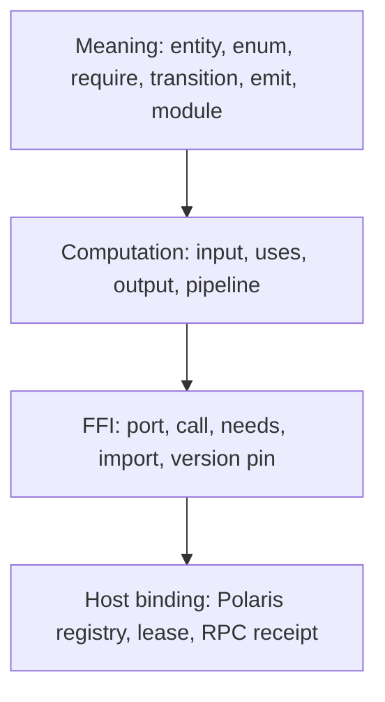

# Polaris DSL

Hardcoding one domain into the product does not scale. Writing each step as
a command and argument list also fails: the pack becomes a shell script,
later steps cannot check their inputs, and there is no record of what a
step may touch. Polaris DSL is the Domain Pack language in
`packages/polaris-workflow`. It keeps a small industry-agnostic kernel:
`entity`, `flow`, `port`, `call`, and the rest of the forms below. The
language package does not own UI, tenants, Vaults, or scheduling. Polaris
owns admission, leases, receipts, and the Host.

The split is:

```text
DSL    -> what the work means, how data moves, which capabilities it may use
Pack   -> one versioned domain: entities, flows, ports, labels
Host   -> who implements a port, where artifacts land, how a call is bound
Polaris -> who may install, pin, lease, run, approve, and keep evidence
```

That is the customization-versus-generality contract. Customize by publishing
a pack. Stay general by using one DSL for every pack.

## Design

### Three worlds

A durable business system moves value across three worlds. The language
answers a different question in each:



| World | Language answers | Language does not answer |
| --- | --- | --- |
| Meaning | What exists, what is legal, how state moves | Where binaries live, which UI framework renders |
| Computation | Where data comes from and goes, whether uses close | Disk paths, MIME types, container mounts |
| FFI | Which capabilities may be called, and with what types | Concrete adapters, secrets, retry policy |

`port` is a contract, not an implementation. A step's `call` names the port
the Host must resolve. `needs` declares the flow's required capability ports.
The compiler keeps the symbol and version. It does not inline a CLI or tool
path.

A Domain Pack is outside every Vault. It is immutable `.ord` source plus a
manifest and content digest. A workflow in that pack is reusable across
Vaults. The run is the object that selects an execution target and receives a
capability lease.

```text
Domain Pack (.ord) outside Vault
    -> parse / resolve imports / validate / compile
    -> Portal displays pack and internal flows
    -> Polaris pins id + version + digest for a run
    -> run receives tenant + Vault or host capability lease
    -> Host invokes workflow-declared FFI calls
```

### Kernel grammar

The kernel keeps a small set of orthogonal forms. Industry words stay in pack
content. They do not become keywords.

Identifiers are Unicode. `ReserveStock`, `任务单`, and `分拣臂` are all
valid.

| Construct | World | Role |
| --- | --- | --- |
| `domain` | Pack | Versioned business universe |
| `module` | Meaning | Portal workflow group / role grouping |
| `enum` / `entity` | Meaning | Vocabulary and record shape |
| `port` | FFI | Capability contract with `in`, `out`, and `effect` |
| `flow` | Meaning + computation | One selectable business transaction |
| `input` / `output` | Computation | Flow contract and Portal form schema |
| `require` | Meaning | Guard before a run advances |
| `needs` | FFI | Capability ports the Host must provide |
| `steps` | Computation | Named context transforms; optional `call` |
| `transition` / `emit` | Meaning | State change and domain event |
| `pipeline` | Computation | Optional metadata for a main path of flows |
| `import` | Pack | Cross-pack enum, entity, and port reuse |
| `ui` | Presentation | Optional form projection; not semantic core |
| `trial` | v0.4-trial | Bounded durable control graph |

A file is one Domain Pack. The header names the pack and, optionally, the
language surface:

```text
dsl version "0.3"          # optional; this is the default
domain Example version "1.0.0"
title "Example"
description "..."
category "Operations"
accent "green"
```

Optional pack metadata is `title`, `description`, `category`, and
`accent "green|blue|amber"`. Flow inputs may add `control text` or
`control textarea`, plus `label` and `placeholder`.

The language surface defaults to **v0.3**. Ordinary packs use `domain`,
`flow`, `port`, `import`, and `pipeline`. A source file must declare
`dsl version "0.4-trial"` to use `trial`, `nodes`, `edges`, retry budgets, or
feedback routing. The parser rejects an unknown language version. A `trial`
graph without that declaration is a parse error. `domain.version` is the pack
version and is separate from the language version.

These forms stay out of the kernel:

- executable paths, Docker, and environment names;
- prompt text (that is port input or a Host template);
- file hashes and concrete artifact paths (adapter addressing); and
- renderer names (Portal UI is a projection, not language).

### Flow and step

A flow is a typed transaction, not a shell stage list:

```text
flow = require + input + steps + transition/emit + output
```

A step is a named context transform:

```text
step = uses + optional call + output
```

Rules:

- no `call` means a pure computation or built-in primitive;
- a `call` is an effect step: `uses` map to `port.in`, `output` comes from
  `port.out`;
- reading the outside world requires a port; implicit global files are not
  allowed.

`pipeline` is sugar. It records a flow sequence. It does not replace the
single-flow transaction.

The Portal mapping is:

```text
domain pack             -> immutable installed pack
module                  -> Portal workflow group / role grouping
flow                    -> selectable internal workflow
entity + transition     -> deterministic document state semantics
input                   -> Portal form schema and run input
steps.uses/output       -> typed dataflow in the compiled Program
needs                   -> capability declaration checked by Host
port + version          -> generic FFI/RPC call contract
call Port@version       -> one effect invocation and receipt
```

The Portal first selects a Domain Pack as the work scene. It then shows the
flows inside that pack, grouped by module metadata. The Portal does not
hardcode domain IDs, flow IDs, role names, or pack-specific execution code.

The DSL does not hardcode role names either. A pack may provide module
metadata for catalogs. Polaris decides what the current user can see,
suggest, approve, or execute:

```text
observer   -> read pack and scoped evidence
proposer   -> create a disabled draft
approver   -> approve or reject a draft or run action
executor   -> run an already pinned definition with a current lease
reconciler -> inspect receipts and failures
```

Membership does not imply execution.

### Ports, effects, and imports

A port declares a typed capability. Effects are `pure`, `read`, `write`,
`ffi`, `human`, or `time`.

A port may bind a Polaris built-in or a Host tool-inventory ID. Those names
are still symbols. The Host decides how the call runs.

```text
port ReviewPlan version "1.0.0" {
  builtin manual.review
  in { title: String, instructions: String, context: String? }
  out { approved: Boolean, reviewId: ID, notes: String? }
  effect human
}
```

Built-ins are generic Polaris interfaces, not domain-specific tool bodies:

| Built-in | Effect | Pack responsibility | Polaris responsibility |
| --- | --- | --- | --- |
| `manual.review@1.0.0` | human | Declare port, fields, labels, and call location | Approval request, lease check, waiting/resume state, receipt |

A new built-in needs a versioned input and output contract, risk class,
policy requirement, receipt model, and mock implementation. A pack cannot
bind a built-in to an arbitrary executable or endpoint.

`import` composes packs without merging their flows:

```text
import Inventory version "^1.2"
import Notify version "1.0" as N

flow Place {
  needs { ReserveStock@2.0.0, N.PushMessage }
  steps {
    reserve {
      uses { sku, qty }
      call ReserveStock@2.0.0
      output { reservationId: String }
    }
  }
}
```

Rules:

- import merges the other pack's enums, entities, and ports, not its flows;
- `as Alias` qualifies symbols as `Alias.Name`;
- the same port name may exist at more than one version; a bare name selects
  the highest installed version;
- version constraints are exact, `1.2` (treated as `^`), or `^1.2.0`;
- a capability pack may declare only ports; and
- imported packs must already be installed.

### v0.4-trial

`v0.4-trial` is a separately gated experiment for bounded Agent graphs. It
does not replace v0.3 flow semantics and is not wired to the ordinary Portal
worker.

Extra forms are:

- `nodes` with `uses`, `call`, `output`, `retry`, `timeout`, and
  `maxActions`;
- `edges` with `when`, `feedback`, `feedbackAs`, and `reset`;
- `budget` for timeout, cost, and transition limits;
- `execution` for class, isolation, and network intent; and
- artifact metadata for references, digest, size, and redaction.

Condition expressions are a restricted boolean language: `&&`, `||`, field
and literal `==` / `!=`, and numeric `<` / `<=` / `>` / `>=`. They do not
execute JavaScript or shell.

AI-assisted workflow generation is not implemented. A model may later propose
a fragment or AST, but Polaris must still validate, dry-run, require human
publication, and issue a new immutable pack version before any run can use
it.

## Implementation

The language package exposes
`parse -> resolve -> validate -> compile/interpret` plus the Host and RPC
contracts. Polaris or another surface supplies the Host.

```text
source
  -> parse
  -> resolve imports
  -> validate
  -> compile Program
       |
       +-> interpret (walk AST, same Host)
       +-> Program.run(flow, input)
              -> FfiHost.invoke(port, version, input)
              -> RPC request + capability lease
              -> receipt -> event -> artifact projection
```

`runPipeline` in `packages/polaris-workflow/src/dsl/pipeline.ts` is the
supported entry. `pack add` runs the same sequence before the atomic install.

| Stage | Module | Responsibility |
| --- | --- | --- |
| Parse | `packages/polaris-workflow/src/dsl/parser.ts` | Comments, Unicode identifiers, v0.3 and trial syntax |
| AST | `packages/polaris-workflow/src/dsl/ast.ts` | Domain, module, entity, port, flow, trial types |
| Resolve | `packages/polaris-workflow/src/dsl/resolve.ts` | Expand `import`, merge symbols, pin port versions |
| Validate | `packages/polaris-workflow/src/dsl/validator.ts` | Closed uses/output, known ports, Host tool inventory |
| Compile | `packages/polaris-workflow/src/dsl/compiler.ts` | Bake a `Program` that still calls Host by port symbol |
| Interpret | `packages/polaris-workflow/src/dsl/interpreter.ts` | Walk the AST through the same Host |
| Runtime | `packages/polaris-workflow/src/dsl/runtime.ts` | Context, require guards, step I/O |
| Host | `packages/polaris-workflow/src/dsl/host.ts` | Port table and `invoke` |
| RPC | `packages/polaris-workflow/src/dsl/rpc.ts` | Versioned request, lease check, receipt |
| Trial | `packages/polaris-workflow/src/dsl/trial.ts` | Bounded graph compile and checkpoint runtime |
| Visualize | `packages/polaris-workflow/src/dsl/visualize.ts` | Deterministic Graphviz DOT for trial graphs |
| UI model | `packages/polaris-workflow/src/dsl/ui-model.ts` | Flow and module projections for a renderer |

A compiled Program still carries port symbols. That is the real compilation
boundary. Inlining a CLI path would weld deployment detail into the pack.

Polaris stores verified installations outside every Vault:

```text
$POLARIS_DATA_ROOT/control/domain-packs/<domain>/<version>/
    main.ord
    manifest.json
```

`manifest.json` records pack identity, version, install time, and the SHA-256
of `main.ord`. `pack list` recomputes the digest and reports `verified` or
`drifted`. A drifted installation is omitted from the Portal catalog and is
not used as an import. Install, list, and remove commands live on the
[CLI](./cli.md) page.

| Component | Where | Must not do |
| --- | --- | --- |
| DSL declarations | Domain Pack repository | Own scheduling, identity, or Vault paths |
| Parser, compiler, RPC | `packages/polaris-workflow` | Call live external tools directly |
| Pack installation and digest pin | Polaris app | Accept a mutable `latest` fallback |
| Built-in registry and mock Host | Polaris app | Implement pack-specific business policy |
| Workflow queue and state | Polaris app / control store | Move authority to Portal or a private surface |
| Surface presentation | Portal, Paseo | Publish direct ports or schedule runs |
| Live execution adapter | Future Polaris / Vault boundary | Bypass pack pin or capability lease |

The current Polaris execution path uses a deterministic
`MockWorkflowRpcHost` and a fresh in-memory document store per run. The
control store remains the source of run, event, receipt, and artifact state.
No Domain Pack code is loaded into a Vault, and no package manager is invoked
by a workflow run.

The RPC wire contract is exported by `packages/polaris-workflow`:

```ts
type FfiRpcRequest = {
  protocolVersion: "1.0";
  requestId: string;
  idempotencyKey: string;
  runId: string;
  tenantId: string;
  vaultId: string;
  pack: { id: string; version: string; digest: string };
  capabilityLease: {
    id: string;
    packDigest: string;
    vaultId: string;
    expiresAt: string;
  };
  call: {
    port: string;
    version: string;
    effect: string;
    builtin?: string;
  };
  input: Record<string, string | number | boolean | undefined>;
  mode: "mock" | "live";
  traceId?: string;
};
```

The response repeats the request ID and adds status, output, receipt, and a
bounded error when denied or failed. `checkFfiAdmission` rejects a missing
pack digest, missing lease, pack/lease digest mismatch, Vault mismatch, or
expired lease. Every Host, including a future live Host, must repeat this
check.

Every call produces an effect receipt with request ID, port/version, effect,
status, timestamps, and output digest. Polaris persists the receipt using the
request ID as the idempotency boundary.

`compileTrial` returns a `TrialProgram`. Durable state is a
`TrialStateStore` snapshot: current node, definition digest, global
transitions, per-node attempts, context, inflight request, receipts,
artifacts, and error. Request IDs use the run-level transition ordinal, so
resetting a node's local attempt does not reuse an old receipt. A production
Host must supply its own store and bind events to a Polaris tenant, Vault,
and run.

### Verification

Verification is part of the implementation, not a later ops checklist. Pack
installation and run admission enforce:

- the source parses and validates before installation;
- imports resolve only to installed compatible packs;
- flow calls resolve to known port symbols and versions;
- `needs` is checked against the Host port table;
- required inputs and deterministic guards are checked before a run
  advances;
- a run loads exactly the installed bytes named by its digest; and
- no definition can widen tenant, Vault, capability, or policy scope.

The trial runtime also rejects undeclared ports, missing inputs, type errors,
node timeouts, action or attempt limits, trial timeout/cost/transition
limits, network without `allow`, and AI trials that are not disposable.

Language and RPC checks:

```text
pnpm --filter polaris-workflow run typecheck
pnpm --filter polaris-workflow test
```

Polaris pack and workflow-control checks:

```text
pnpm --filter polaris exec tsc --noEmit
pnpm --filter polaris run test:domain-packs
pnpm --filter polaris exec tsx --test tests/polaris-workflow-control.test.ts
```

The package also generates and stresses synthetic packs:

```text
pnpm --filter polaris-workflow gen:packs
pnpm --filter polaris-workflow stress:packs
pnpm --filter polaris-workflow gen:adv
pnpm --filter polaris-workflow stress:adv
```

Passing these checks proves the declaration and control boundaries. It does
not prove a live tool, Agent, private-surface mutation, or external side
effect.

## Examples

A Domain Pack file is one `.ord`, or a directory whose `main.ord` is the
declaration. First-party packs live in `packs/`.

### Minimum first-party pack

`packs/vault-knowledge-health/main.ord` is the smallest
installed business domain. It keeps Vault operations in the pack, not in the
kernel. The flow calls `ArtifactMetadata@1.0.0`. Polaris maps that port to
the Common tool `vault.artifact.metadata.read`. Ordinary Portal runs still
use mock policy.

```text
domain VaultKnowledgeHealth version "1.0.0"
title "Vault Knowledge Health"

port ArtifactMetadata version "1.0.0" {
  in { artifactScope: String? }
  out {
    artifactCount: Number
    latestTitles: String
    pendingMemoryChanges: Number
  }
  effect read
}

flow ReviewKnowledgeHealth title "Review knowledge health" create {
  needs { ArtifactMetadata }
  input {
    artifactScope: String control text label "Artifact scope"
  }
  steps {
    metadata "Read Vault metadata" {
      uses { artifactScope }
      call ArtifactMetadata
      output {
        artifactCount: Number
        latestTitles: String
        pendingMemoryChanges: Number
      }
    }
  }
  output {
    artifactCount: Number from artifactCount
    latestTitles: String from latestTitles
    pendingMemoryChanges: Number from pendingMemoryChanges
  }
  ui { layout form primary "Review" }
}
```

### Research pack

`packs/autoresearch/main.ord` is a larger v0.3 pack. Collection, analysis,
and report production are pack ports, not language features. Bindings such as
`literature.collection` remain Host symbols.

```text
dsl version "0.3"
domain AutoResearch version "0.1.0"
title "autoresearch"

port literature.collection version "1.0.0" {
  in { question: String, keywordPlanRef: String }
  out { collectionOutputRef: String, collectionCount: Number }
  effect ffi
  binding { tool "literature.collection" }
}
```

### Human review as a generic built-in

The pack owns the review fields and labels. Polaris owns the approval state
machine. The current mock Host returns deterministic synthetic values and a
`waiting` receipt. It does not perform a real review.

```text
flow ReviewBrief title "Review brief" create {
  needs { ReviewPlan }
  input { subject: String required }
  steps {
    review "Manual review" {
      uses { subject }
      call ReviewPlan
      output { approved: Boolean, reviewId: ID }
    }
  }
  output { approved: Boolean from approved, reviewId: ID from reviewId }
  ui { layout form primary "Submit" }
}
```

### Cross-pack composition

A sales pack can import an inventory capability pack. The kernel does not
grow an `inventory` keyword.

```text
domain Inventory version "1.2.0"
port ReserveStock version "2.0.0" {
  in { sku: String, qty: Number }
  out { reservationId: String }
  effect ffi
}

domain SalesFulfillment version "1.0.0"
import Inventory version "^1.2"

flow Place {
  needs { ReserveStock@2.0.0 }
  steps {
    reserve {
      uses { sku, qty }
      call ReserveStock@2.0.0
      output { reservationId: String }
    }
  }
}
```

### Bounded trial graph

`packs/cve-genie-trial/main.ord` is the bounded CVE-Genie fixture. It does
not widen the Portal worker or enable live Agent execution. The smaller
surface looks like this:

```text
dsl version "0.4-trial"
domain Example version "1.0.0"

port Work version "1.0.0" {
  in { inputRef: String }
  out { resultRef: String, accepted: Boolean }
  effect ffi
}

trial Main title "Bounded trial" {
  input { inputRef: String required }
  budget { timeout 60s cost 1 maxTransitions 12 }
  execution { class ai isolation disposable network deny }
  start work
  terminal { done }

  nodes {
    work "Work" {
      uses { inputRef }
      call Work
      output { resultRef: String, accepted: Boolean }
      retry { max 2 backoff 1s }
    }
    done "Done" {
      uses { resultRef }
      call Work
      output { resultRef: String, accepted: Boolean }
      retry { max 1 }
    }
  }

  edges {
    edge work -> done when "accepted == true"
    edge work -> work when "accepted == false"
  }
}
```

`packs/vision-kernel/main.ord` is a design sketch of the same kernel with
orders and stock ports. It is a target-state drawing, not a claim that
every form in that file is product-wired.

Source-local design notes remain under `packages/polaris-workflow/docs/`.
This page is the product reference.

## Related

- [Polaris Portal](./polaris-portal.md)
- [Polaris CLI](./cli.md)
- [Polaris 0.4.0](../operations/polaris-0.4.0/)
- [WorkEnvelope and workflow plan][work-envelope]
- [Dynamic workflow runtime][dynamic-runtime]

[work-envelope]: ../operations/polaris-0.4.0/work-envelope-and-workflow-plan.md
[dynamic-runtime]: ../operations/polaris-0.4.0/dynamic-workflow-runtime.md
