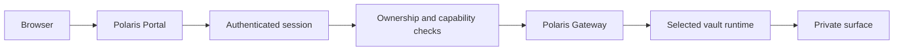

# Polaris Gateway

The Polaris Gateway is the single same-origin ingress for admitted private
surfaces. It is a policy boundary, not a second control plane. The public work
entry is `/work`; runtime-specific routes are created only after Polaris has
resolved the current session, ownership, and capability.

## Ownership

Polaris owns identity, tenant and vault ownership, role capabilities, quotas,
lifecycle, durable jobs, audit, ingress, and release policy. A selected runtime
may implement local UI and filesystem behavior only after Polaris admits it.

The browser never receives a container port, private service name, host path,
or direct runtime URL. A route identifier is a lookup key, not an
authorization grant.

## Request Path



Every protected request repeats the relevant checks at the boundary that uses
it. Browser state and gateway cookies are transport state; neither is an
authorization cache.

## Public Routes

| Route | Purpose |
| --- | --- |
| `/work` | Work desk and scoped run views |
| `/hosts` | User-scoped runtime directory and lifecycle actions |
| `/v/:serverId/coding` | Admitted coding entry |
| `POST /api/g/:serverId/launch` | Create one short-lived surface session |
| `/g`, `/g/`, `/g/*` | Same-origin transport for an admitted surface |

The launch action resolves the current user, tenant, vault, product line,
capability, selected driver, and readiness. It then persists a one-time ticket
before returning a gateway redirect. Ticket redemption is atomic and produces
an HttpOnly cookie scoped to `/g`.

## Proxy Rules

- The public origin is the only browser origin for Portal and surface traffic.
- The target is selected server-side and cannot be replaced by request input.
- Browser credentials are not forwarded to the private runtime.
- Upstream `Set-Cookie` and redirect headers are not exposed as public session
  state.
- Each request checks current access, selected-driver state, readiness, route
  binding, rate limits, and request scope.
- Missing, stale, conflicting, or failed state returns an unavailable result;
  it never falls back to a retained runtime configuration.

## Runtime Boundary

The selected runtime receives only its declared vault attachment and the
capability-limited request scope. The control store, credentials, host paths,
and other tenants remain outside the runtime. Private implementation ports are
reachable only from the server-side network path.

Surface-local parsing, asset handling, child-process limits, and filesystem
safety protect availability. They do not create a second identity, quota,
lifecycle, job, or audit authority.

## Recovery And Idempotency

Launch, mutation admission, and durable operations use explicit serialization
points. Retries reconcile by request or operation identity. A process restart
must preserve committed control state and must not create a direct-route
fallback. A changed driver, revoked capability, or changed tenant scope
requires a fresh admission decision.

## Invariants

1. Polaris owns the public origin and every admission decision.
2. The Portal exposes only user-scoped projections.
3. Runtime routes are opaque lookup keys, never grants.
4. Private surfaces are reachable only through the Gateway.
5. Every proxied request carries an exact, short-lived scope.
6. Direct implementation ports and host paths never become browser routes.
7. Durable state has one explicit serialization owner.

## Focused Checks

```bash
cd <polaris-repository>
pnpm --filter polaris run check
pnpm --filter polaris exec tsx --test \
  apps/polaris/tests/polaris-portal-security.test.ts
```
