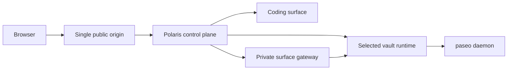

# Polaris

Polaris is the control plane for isolated multi-agent systems.

## Start Here

Clone-to-first-run setup and repository-specific commands belong in the Polaris
repository root README. This page intentionally stays focused on the product
boundary and the cross-repository references that are useful after setup.

- [User Management](./user-management.md)
- [Usage](./usage.md)
- [Polaris Portal](./polaris-portal.md)
- [Polaris Workflow](./workflow.md)
- [Vault Management](./vault-management.md)
- [Polaris Gateway](./gateway.md)
- [Paseo Management](./paseo.md)
- [CLI](./cli.md)
- [Operations](/operations/)

## Architecture Snapshot

Polaris owns identity, ownership, capability checks, sessions, quotas,
lifecycle, durable jobs, audit, and ingress. The functional contracts are
organized as
[User Management](./user-management.md),
[Vault Management](./vault-management.md), and
[Polaris Gateway](./gateway.md), with the coding implementation documented in
[Paseo Management](./paseo.md).
