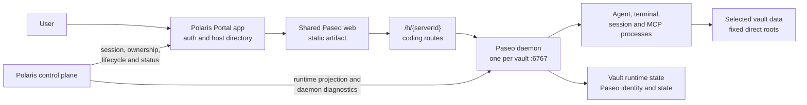
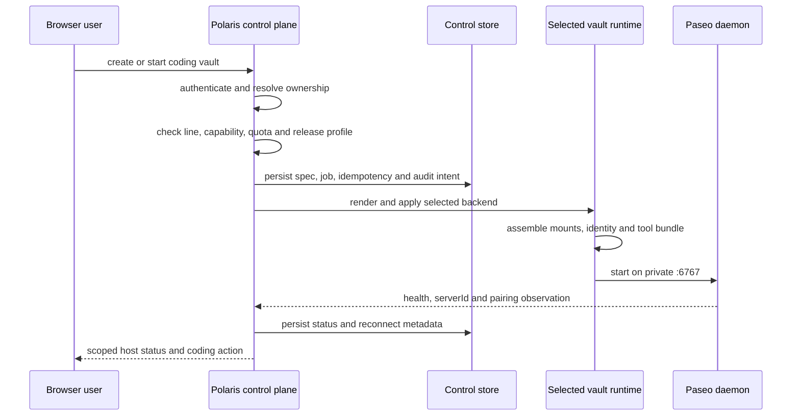
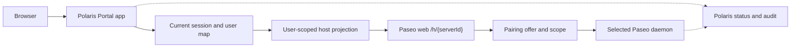
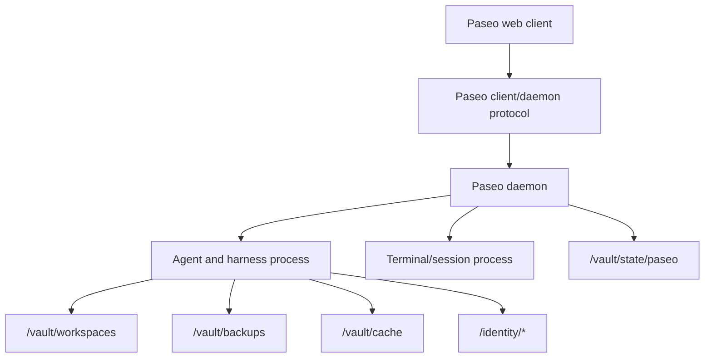
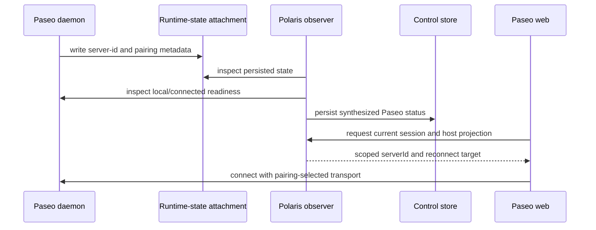

# Paseo Management

This is the canonical Polaris reference for the Paseo coding surface. It
describes the in-vault Paseo daemon, the shared Paseo web artifact, their
Polaris integration, and the replacement boundary.

The former `Paseo surface patches for Polaris` page is incorporated here. Its
patch layout and reproducible build workflow are maintained in the
[Development View](#5-development-view), while route lookup remains in
[Polaris Gateway](./gateway.md).

Paseo is a coding surface, not a control plane. Polaris owns identity,
user-to-vault mapping, capability checks, vault lifecycle, runtime selection,
public ingress, and release policy. Paseo owns the coding interaction and the
agent processes inside the selected vault runtime. The browser never receives
a direct daemon port or a caller-selected workspace root.

The system is intentionally split into two deployable pieces:

1. **Paseo daemon** runs once inside each selected vault runtime. It manages
   agent processes, terminal/session state, the daemon protocol, and the local
   MCP surface.
2. **Paseo web** is one shared browser artifact outside the vault runtimes. It
   renders the coding UI and connects to the selected daemon using the scoped
   connection state supplied by Polaris and the daemon.

## 1. Static Model

### 1.1 Two Pieces, One Coding Surface



The Portal app and the coding surface are different layers:

| Layer | Responsibility | Non-responsibility |
| --- | --- | --- |
| Polaris Portal | Session, users, hosts, product line | Agent UI and terminal |
| Paseo web | Coding UI, route, daemon client | Identity or lifecycle |
| Paseo daemon | Agent, terminal, session, MCP | Identity, policy, ingress |
| Vault runtime | Isolation, mounts, limits | Browser and release policy |

The web artifact may be served by the `paseo-app` container and fronted by
the deployment's nginx. It is shared because the UI is not the storage or
process isolation boundary. The daemon is per vault because agent processes,
terminals, credentials, and runtime state must not cross tenant or vault
boundaries.

### 1.2 Durable Objects And Ownership

| Object | Canonical owner | Durable source of truth |
| --- | --- | --- |
| User identity and product line | Polaris/Authing | Polaris control store |
| Tenant/vault ownership | Polaris | Control store and `VaultSpec` |
| Selected backend | Polaris lifecycle policy | `status.driver.selected` |
| Paseo daemon process | Selected vault runtime | Backend state and probes |
| Daemon identity | Daemon; Polaris observes | `paseo/server-id` |
| Pairing metadata | Daemon plus Polaris | `paseo/pairing.json` |
| Coding workspace files | Selected vault runtime | `/vault/workspaces` |
| Agent and daemon state | Selected vault runtime | `/vault/state/paseo` |
| Web source and patches | Polaris | Source checkout and patches |
| Built web artifact | Polaris release build | `dist-build` or image layer |
| Browser session and view state | Browser | Ephemeral client state |

`serverId` identifies a daemon connection. It is a route key, not an
authorization grant. A pairing offer is transport metadata, not a tenant
decision. Polaris must resolve the current user, vault, product line, and
selected runtime again when it exposes a surface or handles a control action.

### 1.3 Deployment Topology

```text
Public origin
  -> Polaris Portal and API
  -> controlled paseo-app web artifact

Selected vault runtime
  -> Paseo daemon :6767 (private implementation port)
  -> agent and harness processes
  -> /vault/workspaces
  -> /vault/backups
  -> /vault/cache
  -> /vault/state/paseo
  -> /identity/*
```

The normal single-host deployment binds the web app and the Polaris server to
loopback and exposes one nginx origin. Blue/green deployment changes the
inactive `paseo-app` and `polaris-server` stack together. The local development
stack may bind the web development server for LAN testing, but that is a
development convenience and not the production perimeter.

For Docker, Pod, and KubeVirt, the daemon is created as part of the selected
vault runtime. The runtime renderer may use a private container network,
private Service, or private VM path. No deployment may turn `:6767` into a
public NodePort or a browser-provided direct endpoint.

### 1.4 Routes, Scope, And Identifiers

The Portal app's coding deep link is `/v/{serverId}/coding`. The Portal app resolves it
to the Paseo web coding root `/h/{serverId}`. The route and gateway ownership
table is maintained in [Polaris Gateway](./gateway.md); this page owns the
process and data contract behind those routes.

The route relationship is:

```text
host directory action
  -> /v/{serverId}/coding       outer Portal deep link
  -> /h/{serverId}              Paseo web host root
  -> /h/{serverId}/workspace/* workspace view
  -> /h/{serverId}/agent/*     agent stream view
  -> scoped daemon connection   selected vault runtime
```

The Portal app exposes a coding action only when the current session is allowed to
use the coding product line, the host is running, and a daemon `serverId` is
available. A web route with a different `serverId` does not select another
user's host. A vertical surface has a separate opaque route identity and must not reuse a
Paseo daemon identifier.

## 2. Control Flow

Control flow is the sequence of policy decisions, durable runtime actions,
daemon observations, and browser navigation. Paseo does not make the first or
last authorization decision in this sequence.

### 2.1 Provision And Start



The ordered decision is:

```text
current session
  -> user map and product line
  -> tenant/vault ownership
  -> role capability and quota
  -> selected backend
  -> runtime projection
  -> daemon readiness
  -> scoped web route
```

The backend does not infer the user from a request, choose a workspace root,
or enable Paseo because an old runtime configuration happens to exist. The
selected-driver rule from [Vault Management](./vault-management.md) applies
to Paseo exactly as it applies to every other runtime process.

### 2.2 Daemon Readiness And Pairing

Paseo readiness has more than one condition. A running container is not the
same thing as a usable coding surface:

| Observation | Meaning |
| --- | --- |
| Backend running | The selected vault runtime exists and is alive |
| Local daemon ready | A Paseo daemon process is present |
| Connected daemon reachable | The client/relay path can reach that daemon |
| Persisted `serverId` matches the daemon | The connection identity is stable |
| Persisted pairing offer exists | The web client has transport metadata |
| Web base URL is configured | A reconnect target can be built |

Polaris reports the combined result as `paseo.daemon`, `paseo.web`, and
`paseo.reconnectMode`. The meaningful states are:

```text
running + matching serverId + pairing + web base
  -> daemon=ready, web=connectable, reconnectMode=reconnectable

running + pairing but no stable serverId or web target
  -> daemon=pending or unknown, web=pairing-required or unavailable

stopped, missing, or failed runtime
  -> daemon=absent, web=unavailable
```

These states are observations, not permissions. A `ready` status never allows
the browser to skip the current Polaris ownership and capability check.

### 2.3 Open Coding And Reconnect

Opening coding is a scoped navigation flow:

1. The Portal app loads the current Polaris session and the current host directory.
2. The host action checks the user's allowed product line and the host's
   running status.
3. Polaris supplies the `serverId`, pairing metadata, scope, and configured
   web base URL.
4. The Portal app maps `/v/{serverId}/coding` to `/h/{serverId}` in the shared web
   artifact.
5. The patched web client synchronizes the current user's host list and keeps
   the active `serverId` selected.
6. The web client uses the pairing offer and daemon protocol to connect to the
   selected daemon.
7. Workspace, terminal, agent, and session operations stay within that
   daemon's vault runtime.

On reconnect, Polaris reconstructs a target from the persisted `serverId`,
pairing offer, scope, and `POLARIS_PASEO_APP_BASE_URL`. It may preserve the
offer fragment and query scope, but it must never preserve authorization from
an old browser cookie or an old selected backend.

### 2.4 Restart, Rebuild, And Failure

The control-plane lifecycle and the in-runtime process lifecycle are separate:

| Action | Owner | Paseo effect |
| --- | --- | --- |
| Start/stop/rebuild/switch | Polaris job | Replaces daemon runtime |
| Check daemon status | Polaris observer | Reads state and `serverId` |
| Restart daemon in a vault | Polaris operation | Restarts and checks pairing |
| Build web artifact | Polaris release pipeline | Replaces static assets only |
| Roll back web deployment | Blue/green release | Restores web/server stack |
| Recover coding state | Runtime attachments | Reuses state after scope checks |

If the daemon is down, the web surface must show an unavailable or reconnect
state. It must not silently choose another host, call a direct port, use a
stale pairing as authority, or switch to an old backend configuration.

### 2.5 Authority Boundary

| Concern | Polaris | Paseo daemon/web |
| --- | --- | --- |
| Identity and session | Authing and Polaris | Consumes scoped session state |
| User mapping | Polaris user map | No user directory |
| Tenant/vault ownership | Store and capability policy | No ownership decision |
| Product line | User/session line | Renders the allowed surface |
| Vault lifecycle | Jobs and selected backend | Starts in the runtime |
| Resource and logical quota | Profile and admission | Local safety only |
| Agent orchestration | Runtime/lifecycle contract | Local agent and MCP |
| Workspace files | Mount and vault-data contract | Uses fixed runtime roots |
| Pairing transport | Scope and exposure policy | Metadata generation/use |
| Public ingress | Origin, nginx, release policy | No public listener |
| Audit and recovery | Polaris jobs and audit | Local logs and process state |

## 3. Data Flow

Control flow establishes whether the operation is allowed. Data flow explains
which control and business data move through the web and daemon boundaries.

### 3.1 Browser And Session Data Flow



The browser receives a user-scoped host projection, not the complete runtime
registry. The projection can contain a `serverId` and reconnect target only
after Polaris has resolved the current user and vault. The web client may use
the daemon's own connection transport, including a relay when the pairing
offer selects one; that transport does not become a second Polaris authority.

### 3.2 Coding Data Flow



The coding surface can carry editor state, terminal input, agent events,
workspace operations, and session updates. Those bytes are handled by the
daemon and the selected vault runtime. They do not turn the web artifact into
a storage owner, and they do not make `/vault/state`, `/identity`, or the
Polaris control store browser-readable.

Paseo's business-data mounts are the fixed direct roots from
[Vault Management](./vault-management.md): `/vault/workspaces`,
`/vault/backups`, and `/vault/cache`. Runtime state and user identity are
separate attachments. The web artifact has no vault-data mount.

### 3.3 Identity And Reconnect Data Flow



The `serverId` is stable runtime identity for reconnect and diagnostics. A
changed daemon identity is a state transition that needs re-pairing and
verification; it is not a reason to try another vault. A pairing file can be
missing, malformed, stale, or scoped to another user/vault. Each case is an
observable failure, not a fallback opportunity.

### 3.4 Trust And Failure Boundaries

| Boundary | Accepted authority | Rejected or non-authoritative input |
| --- | --- | --- |
| Polaris Portal | Session and host projection | Client identity or claims |
| Host route | Product line, status, `serverId` | Route ID as an auth grant |
| Web client | Host sync and matching pairing | Global registry or caller root |
| Daemon connection | Pairing transport | Public `:6767` or target |
| Runtime renderer | Runtime spec and driver | Retained backend config |
| Workspace access | Fixed `/vault/*` mounts | Host path or control-store path |
| Recovery | Runtime state and Polaris action | Scope-changing browser retry |
| Release artifact | Ref, digest, base path | Mutable or unverified build |

When a check fails, the surface should be unavailable and Polaris should retain
the diagnostic. It should not open a neighboring host, reuse an old route, or
publish a private implementation endpoint.

## 4. Runtime And Isolation

### 4.1 Paseo Web Artifact

The release web artifact is built from the upstream Paseo source checkout at
`POLARIS_PASEO_SOURCE_REF`. `Dockerfile.artifact` applies the Polaris patch
stack, runs the web build for `@getpaseo/app`, and exports a static directory.
The deployment image serves that directory as `paseo-app` on port `8082`.

The artifact is shared across vaults. It contains UI code and the daemon
client, but no tenant data, user credentials, control database, or private
runtime mount. Its base URL is supplied through
`POLARIS_PASEO_APP_BASE_URL`; the web build may rewrite the Expo export to the
same `/paseo` path used by the release origin.

The web artifact has two important isolation properties:

1. Portal routes such as login, user settings, and the global host directory
   remain Polaris-owned.
2. The coding route is bound to one `serverId` and the patched client syncs
   only the current user's host projection.

### 4.2 Paseo Daemon Runtime

`Dockerfile.tool-bundle` builds the upstream server, protocol, client, relay,
CLI, and related packages, then exports an installable bundle. The bundle is
copied into the vault base image so every selected runtime can start the
`paseo` CLI and daemon without rebuilding the web artifact.

At runtime, the daemon is started inside the selected Docker container, Pod,
or KubeVirt VM. The KubeVirt bootstrap explicitly configures
`PASEO_HOME` through `/vault/state/paseo`, starts the daemon on `:6767`, and
syncs its durable runtime state through the private
`vault-runtime-state` attachment. The same separation applies to other
renderers even when their bootstrap implementation differs.

The daemon may supervise processes that use:

- `/vault/workspaces` for coding projects and workspace files;
- `/vault/backups` and `/vault/cache` for their fixed business-data roles;
- `/vault/state/paseo` for daemon, evolution, and session state;
- `/identity/*` for user-scoped credentials and tool configuration.

The daemon cannot mount or infer Polaris `control/`. It receives runtime
configuration through the generated runtime projection, not through a
browser-supplied path.

### 4.3 Network And Resource Boundary

There are two separate network objects:

| Object | Placement | Exposure |
| --- | --- | --- |
| Paseo web | Shared host deployment | nginx or local development origin |
| Paseo daemon `:6767` | Per-vault runtime | Private runtime/relay path |

Production blue/green compose binds the web app to host loopback and puts
nginx in front of it. The daemon port is an implementation detail of the
selected runtime. A local development server can use LAN binding to support
Fast Refresh, but this does not authorize a production direct-port route.

The daemon consumes the selected vault's CPU, memory, PID, storage, and
network budget. The shared web artifact consumes host web resources and is
not counted as one active vault. Capacity claims still come from
`config/release-profiles/0.3.0-single-host.json`; changing a Paseo setting
cannot raise the 0.3 profile.

### 4.4 Backend Projection

Polaris projects one runtime contract into each supported backend:

| Backend | Daemon placement | Required proof |
| --- | --- | --- |
| Docker | Private container | Port, mounts, health, reconnect |
| Pod | Private pod process | private Service, mounts, health and reconnect |
| KubeVirt VM | Guest process, private service | Bootstrap, mounts, health |

The active backend is always `status.driver.selected`. A retained Docker,
Pod, or KubeVirt configuration cannot be used as a Paseo fallback after a
switch or restart.

## 5. Development View

### 5.1 Repository Responsibilities

`packages/paseo` is the Polaris-owned integration package boundary. It contains
the nested upstream Paseo checkout, the reviewed patch stack, and the Docker
inputs for the shared web artifact and in-vault daemon bundle. The nested
`source` directory remains its own upstream npm workspace; Polaris packages
consume its built outputs and do not import that workspace directly.

| Component | Owns | Does not own |
| --- | --- | --- |
| `apps/polaris` | Projection, lifecycle, policy | Paseo UI or agent logic |
| `apps/polaris-portal` | React Portal UI and surface entry cards | Agent panes |
| `packages/polaris-shell` | Shared route/product/host contracts | Browser Portal rendering |
| `packages/surface-coding` | Stable `/h` routes | Expo UI, identity |
| `packages/paseo-embed` | Framework-independent embed bridge | Control-plane policy |
| `packages/paseo/patches` | Reproducible upstream changes | Control-plane jobs |
| `packages/paseo/Dockerfile.artifact` | Shared static web | Vault process startup |
| `packages/paseo/Dockerfile.tool-bundle` | In-vault daemon/CLI | Browser assets |
| `packages/vault-runtime` | Mount, resource, probe, command | Web auth |
| Documentation site | Architecture and release decision | Runtime behavior |

The stable package boundary is what makes replacement possible. Polaris can
keep the Portal app, vault runtime, and route contract while swapping the
implementation behind the coding client or daemon. The replacement must not
move agent execution, credentials, or workspace data into the Polaris control
plane.

### 5.2 The Polaris Patch Stack

The patch stack is a build input, not a second application source tree. The
current files are:

| Patch | Purpose in the Polaris surface |
| --- | --- |
| `paseo-web-authing-package.patch` | Adds the Authing client workspace and lock entry. |
| `paseo-web-authing-core.patch` | Redirects welcome and callback entry points to Polaris auth. |
| `paseo-web-polaris-branding.patch` | Applies Polaris branding and favicon. |
| `paseo-web-settings-auth-visibility.patch` | Hides host management without a session. |
| `paseo-web-host-account-isolation.patch` | Syncs current-user hosts and preserves the active scope. |
| `paseo-web-embed-mode.patch` | Adds embedded-Portal behavior and host bootstrap. |
| `paseo-web-auth-disabled-clean.patch` | Keeps local disabled-auth startup scoped. |
| `paseo-web-surface-only.patch` | Removes Portal routes and leaves coding routes. |

Together these patches turn upstream Paseo web into a Polaris coding surface:
the Portal app owns the door, while Paseo owns the IDE experience after a
host is selected. They do not grant the web app a second user directory or a
second host registry.

### 5.2.1 Patch Review And Reduction

The current patch stack was reviewed against the production route contract.
Polaris Portal opens `/v/{serverId}/coding`, which resolves to the Paseo web
surface at `/h/{serverId}`. There is no Polaris production caller for the
Paseo `/embed` route or for the standalone `@paseo/embed` package; those are
limited to the embed demo and tests.

The review result is:

| Area | Decision | Required treatment |
| --- | --- | --- |
| Authing client and session gate | Keep | Preserve the Authing client workspace, session subscription, disabled-auth local mode, and route gate. |
| Host account isolation | Keep and fix | Reconcile the in-memory registry on account or vault changes, clear old hosts before sync, require the API `serverId`, and reject pairing data that does not match it. |
| Host identity fallback | Remove | Delete pairing-URL `serverId` fallback, legacy global registry fallback, unused `scope` sync input, and unused `resolvePostLoginHref`. The API host projection is canonical. |
| Embedded Paseo feature | Remove | Delete `/embed`, its postMessage protocol, external-context attachments, embedded agent panel, direct endpoint probing, and workspace creation. Keep only the host-sync and web route-gate hunk from the mixed layout patch, moved into the host/auth patch. |
| Portal-owned entry routes | Remove | Delete the `paseo.tsx`, `welcome.tsx`, and `settings/user.tsx` compatibility redirects when the no-compatibility policy is applied. Polaris Portal owns login, user management, and the global host directory. |
| Settings auth helper | Remove | `settings-screen-auth.ts` and its test have no production import; `useHosts()` already applies session and route visibility. |
| Surface-only boundary | Keep selectively | Keep removal of add-host, QR, and direct-connection UI, host-local settings routing, and `/paseo` route parsing. Remove the unused Portal auto-project transfer and the singleton disabled host-picker plumbing. |
| Authing lockfile | Minimize | Keep workspace/package entries, but regenerate the lockfile without unrelated Rollup peer metadata, eslint, and nested semver churn. |
| Polaris branding | Optional | Keep only the favicon asset and config if branding is a product requirement. The unused SVG, hard-coded cache-busting script, and dynamic favicon rewrite are not part of the integration contract. |

Two host-isolation checks are release blockers rather than cleanup items. The
sync code currently upserts returned hosts without removing hosts that are no
longer authorized, and the declared `resetPolarisHostsForCurrentUser` method
has no production caller. A changed Authing subject or revoked vault can
therefore leave stale runtime profiles in memory. The sync must first clear or
reconcile the current user and then accept only a host whose API
`serverId` exactly matches the requested route and the pairing result.

The embedded feature is also a security boundary regression, not merely extra
UI. Accepting an `endpoint` query parameter and calling
`probeAndUpsertDirectConnection` reintroduces caller-selected daemon
discovery. Integrated Paseo must receive only the reviewed, user-scoped host
projection from Polaris and must fail closed when that projection is absent.

Focused review checks passed:

- `pnpm test:surfaces`: 37 Portal-contract and surface tests passed.
- Paseo app targeted tests: 6 test files and 62 tests passed.

The full web artifact build remains a separate verification step after the
reduced patch stack is regenerated. The patch inventory and its tests must be
updated together so removed features do not remain documented as supported.

### 5.3 Reproducible Source And Build Workflow

The source checkout is prepared at the declared upstream ref and must contain
usable Git metadata. The reproducible workflow is:

1. Prepare or refresh `packages/paseo/source` at `POLARIS_PASEO_SOURCE_REF`.
2. Make the source change in that checkout and regenerate the focused patch
   with `scripts/update-paseo-patch.sh`.
3. Apply the package and web patches in `Dockerfile.artifact` and verify the
   `/paseo` base path.
4. Apply the same patch stack in `Dockerfile.tool-bundle` and build the server
   and CLI packages used by vault runtimes.
5. Build the web artifact and tool bundle independently; changing one must not
   silently change the other.
6. Record source ref, patch digest, artifact digest, and focused checks in the
   release record.

The two release commands are:

```bash
bash ./scripts/build-paseo-web-artifact.sh
bash ./scripts/build-paseo-tool-bundle.sh
```

Local stack development is different by design. The stack runs the Expo web
development server with Fast Refresh from `packages/paseo/source`, while the
Polaris Portal and surface packages are built separately. A local Fast Refresh
process is not evidence that the Docker artifact or the in-vault daemon bundle
is reproducible.

### 5.4 Test Ownership

| Test layer | Location | Proves |
| --- | --- | --- |
| Route contract | `packages/surface-coding` | `/h` normalization |
| Portal contract | `packages/polaris-shell` | Route, product-line, host, and user contracts |
| Embed protocol | `packages/paseo-embed` | Origin, nonce, messages, requests |
| Runtime integration | `apps/polaris/tests` | Status, pairing, isolation |
| Artifact workflow | `paseo-local.test.mjs` | Source, digest, base |
| Deployment contract | `scripts/tests` | Loopback and blue/green wiring |
| Upstream patch behavior | Applied tests | Sync, auth, embed, surface-only |
| Documentation | `docs/` checks | VitePress and Mermaid output |

Focused checks for a surface change should include:

```bash
pnpm run build:surfaces
pnpm run test:surfaces
node --test scripts/tests/paseo-local.test.mjs
pnpm --filter polaris run check
```

Run the artifact and tool-bundle builds when Docker, source, patch, base-path,
or runtime bootstrap behavior changes. Unit tests do not prove that a remote
daemon is reachable or that a live vault has the intended pairing metadata.

## 6. Operations View

### 6.1 Preflight

Before a release or host cutover, verify all of the following:

- the upstream source ref is explicit and resolvable;
- every patch applies to the same source ref in both Dockerfiles;
- the web artifact contains `index.html`, `manifest.json`, and the intended
  `/paseo` asset base;
- the tool bundle contains the `paseo` CLI and server packages;
- `POLARIS_PASEO_APP_BASE_URL` points to the intended shared web artifact;
- the web service is loopback-bound in the production/test-host stack;
- the selected vault renderer keeps daemon `:6767` private;
- the active release manifest binds the candidate to `POLARIS_RELEASE_ID`;
- no patch, artifact, or runtime image is selected from retained state;
- the 0.3 capacity profile remains unchanged unless new evidence is recorded.

An artifact may be served successfully and still be unusable if its base path
or `/api/session` origin is wrong. Check both the static asset paths and the
authenticated Portal/API path.

### 6.2 Deployment And Cutover

The normal deployment order is:

```text
local CI and focused tests
  -> build web artifact and daemon tool bundle
  -> sync replaceable application inputs
  -> run release preflight
  -> build inactive paseo-app and Polaris server stack
  -> verify health and asset base path
  -> switch nginx to the inactive color
  -> verify session, host list, coding route and daemon status
  -> retain rollback state until evidence is recorded
```

The web cutover is independent of vault-data migration. Replacing a static
web artifact must not copy, rewrite, or delete `control/`, `vault-data/`,
credentials, or runtime-state attachments. A daemon/tool-bundle cutover may
require runtime process restart, but it still must preserve the selected
vault's fixed mounts and separately verified runtime state.

### 6.3 Daemon Diagnostics And Recovery

For a running vault, verify in this order:

1. `status.driver.selected` identifies the active backend.
2. The selected runtime exists and its health/readiness probes pass.
3. The daemon process is running and the local port is reachable from inside
   the runtime.
4. The daemon status reports a reachable connection and a valid `serverId`.
5. The persisted `server-id` and `pairing.json` exist below the scoped
   runtime-state directory.
6. Polaris reports `paseo.daemon` and `paseo.web` consistently.
7. The current user can open only the selected `/h/{serverId}` route.
8. One synthetic workspace read, terminal action, and agent stream check
   succeeds without crossing the vault boundary.

A daemon restart is a Polaris operation against one selected vault. After the
restart, re-observe the identity and pairing state. Do not restart a global
Paseo process, reset every vault, or make the web app search for another
server ID.

For a missing or mismatched pairing file, mark the surface as pairing-required
and re-pair the same vault. Preserve existing workspace files; pairing repair
is not a data migration. For a changed daemon identity, record the transition
and require a new scoped connection before exposing coding.

### 6.4 Web Artifact Failure

| Symptom | First checks | Correct response |
| --- | --- | --- |
| Blank coding page | Files and base path | Fail inactive; keep active |
| Portal auth loop | `/api/session`, cookies | Reject; keep Polaris auth |
| Wrong host appears | Session, sync, `serverId` | Clear state; fail closed |
| Daemon unavailable | Driver, status, pairing | Unavailable; no host switch |
| Direct `:6767` reachable | Runtime/network binding | Block; remove it |
| Old web behavior | Source ref, patch order, digest | Rebuild and retest |

Web rollback restores the prior static artifact and application stack. It does
not roll back workspace files, daemon state, credentials, or vault selection.
Those require their own Polaris lifecycle or data operation and evidence.

### 6.5 Migration And Release Evidence

Paseo runtime state is not part of the `vault-data` business-data archive. The
control/vault-data migration keeps the following concerns separate:

| Data | Migration treatment |
| --- | --- |
| Workspace files | Migrate to the fixed `vault-data` leaf and direct roots |
| Daemon identity and pairing | Preserve or explicitly re-pair in scoped state |
| Evolution/session state | Preserve under `vault-runtime-state/paseo` |
| User credentials | Keep in the separate `user-identity-state` attachment |
| Web artifact | Rebuild from source ref and patches; never copy from a vault |

When replacing Paseo, choose one release boundary and migrate once. Do not
retain an old daemon root, old web route, or old pairing lookup as a runtime
compatibility fallback. The migration must have a dry run, explicit state
mapping, fingerprints where durable files move, restart verification, and a
rollback record before old artifacts are archived.

## 7. Invariants

The Paseo integration is internally consistent when all of these statements
are true:

1. One shared web artifact is outside the vault runtimes; one daemon belongs
   to each selected vault runtime.
2. Polaris owns the current identity, product line, capability, ownership,
   selected backend, lifecycle, ingress, and release decision.
3. A `serverId` maps to one observed daemon scope and is never treated as
   authorization.
4. Polaris Portal owns login, user management, and the global host directory; the
   coding surface owns only the active host's IDE routes.
5. The daemon uses fixed `/vault/workspaces`, `/vault/backups`, and
   `/vault/cache` roots, with Paseo runtime state and user identity separate.
6. Browser traffic does not receive a direct daemon port or a host path.
7. Missing, stale, or mismatched status and pairing metadata fail closed; no
   retained host or backend becomes a fallback.
8. The same source ref and patch stack reproduce the web artifact and the
   in-vault tool bundle.
9. Web rollback cannot change vault data, and daemon restart cannot change
   tenant ownership.
10. A replacement is accepted only after route, protocol, data, isolation,
    operational, and release evidence pass together.

If one invariant is false, keep the coding surface unavailable and retain the
diagnostic. Do not make a best-effort connection to another vault or expose a
private implementation path.

## 8. Replacement Assessment

### 8.1 Is Replacement Possible?

Yes. Paseo is replaceable because Polaris already owns the outer control
boundary and the selected vault runtime. The replaceable implementation is
the pair of:

```text
coding web client <-> daemon protocol <-> in-vault coding daemon
```

The following pieces should remain stable during a replacement:

- the Polaris Portal session and user-scoped host projection;
- the product-line and capability decision;
- the `/v/{serverId}/coding` entry and `/h/{serverId}` surface boundary, or a
  deliberately versioned successor chosen at the release boundary;
- the selected-driver and vault lifecycle contract;
- fixed vault-data and runtime-state attachments;
- daemon readiness, identity, pairing, status, and reconnect semantics;
- private runtime networking and release-profile enforcement.

The current patch stack is therefore replaceable implementation work, not a
Polaris authority boundary. Removing it is feasible once a replacement
implements the contracts above and the old source is no longer selected by a
live runtime.

### 8.2 Replacement Options

| Option | Scope | Benefit | Main cost and risk |
| --- | --- | --- | --- |
| Web only | New client, current daemon protocol | Lowest risk; UI remains |
| Daemon only | New daemon, current protocol | Large state/protocol migration |
| Polaris fork | Controlled Paseo fork | Less patch drift; still upstream debt |
| Web and daemon | New surface and worker | Highest implementation cost |

The lowest-risk first candidate is a web-only replacement behind the existing
daemon client contract. It removes most web patch maintenance while leaving
vault data, daemon state, agent behavior, and runtime isolation unchanged. It
is viable only if the current client protocol is treated as an explicit
contract rather than copied accidentally from upstream code.

The strongest long-term candidate is a new Polaris coding surface paired with
a small in-vault worker/daemon. The worker should remain outside the control
plane and expose only a capability-scoped protocol for workspace, terminal,
agent, and session operations. This removes the current web patch stack and
the dependency on Paseo-specific pairing/relay semantics, but it is a new
product/runtime project, not a refactor of Polaris Portal.

### 8.3 Conformance Gate

A replacement cannot be accepted because its page renders. It must pass this
contract matrix:

| Contract | Required evidence |
| --- | --- |
| Auth and user scope | Authing/session checks and scoped host projection |
| Route ownership | Portal routes and coding routes stay separate |
| Runtime identity | Stable per-vault identity and explicit re-pair |
| Connection security | No public port, arbitrary target, or cross-vault path |
| Workspace boundary | Fixed roots; no control-store or host-path access |
| Agent behavior | Start/stream, terminal, session and MCP checks |
| State migration | Explicit daemon, pairing and evolution mapping |
| Backend coverage | Docker, Pod and KubeVirt render/probe checks |
| Operations | Health, restart, recovery and blue/green rollback |
| Release provenance | Source, artifact digest and focused test record |
| Capacity | The existing 0.3 profile remains enforced and measured |

### 8.4 Recommended Decision And Cutover

Do not replace Paseo inside the 0.3.4 release. Treat replacement as a
separately evidenced 0.4 design and make the first experiment web-only. The
sequence should be:

1. Freeze the Portal, route, status, mount, and runtime-state contracts.
2. Write a protocol conformance test suite using synthetic users and vaults.
3. Build a candidate web client against the existing daemon without changing
   vault data or the control plane.
4. Exercise auth, host isolation, pairing loss, daemon restart, workspace
   reads/writes, terminal streams, and rollback on all supported backends.
5. If daemon replacement is still justified, define the new in-vault protocol
   and a one-time runtime-state migration for each vault.
6. Cut over at a release boundary, stop the old implementation, verify every
   selected vault, and archive the old source only after rollback evidence.

This is a one-time migration plan, not a compatibility mode. During the
cutover, a vault has one selected coding implementation. A failed candidate
must be rolled back by the release or migration procedure, never by silently
falling back per request.

### 8.5 Reasons To Replace

Replacement is justified only by evidence such as:

- the patch stack repeatedly breaks on upstream changes;
- the upstream web and daemon release cadence cannot provide reproducible
  provenance or security response;
- relay or pairing behavior cannot meet the private-transport contract;
- the current client exposes more global host behavior than Polaris can safely
  constrain;
- daemon resource, recovery, or observability behavior misses the release
  profile;
- a narrower worker protocol materially reduces the control and operational
  surface.

Without one of those signals, keeping Paseo and reducing the patch stack is
cheaper than replacing a working coding runtime. The decision belongs in a
release record with measured evidence, not in a product-line environment
variable.

## Related Docs

- [Polaris overview](./index.md)
- [Vault Management](./vault-management.md)
- [Polaris Gateway](./gateway.md)
- [User Management](./user-management.md)
- [Polaris 0.3.4 current state](/operations/polaris-0.3.4/)
- [Polaris 0.3.3 archived record][archived-release]
- [Remote Deploy](/operations/remote-deploy)

[archived-release]: ../operations/polaris-0.3.3/
