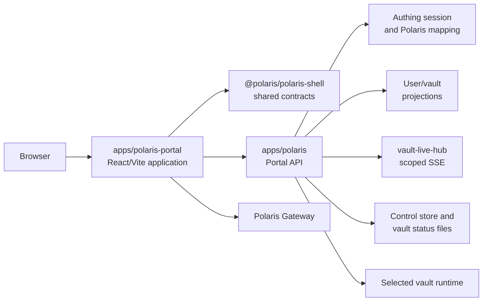
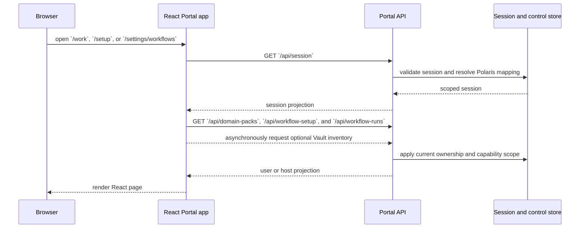
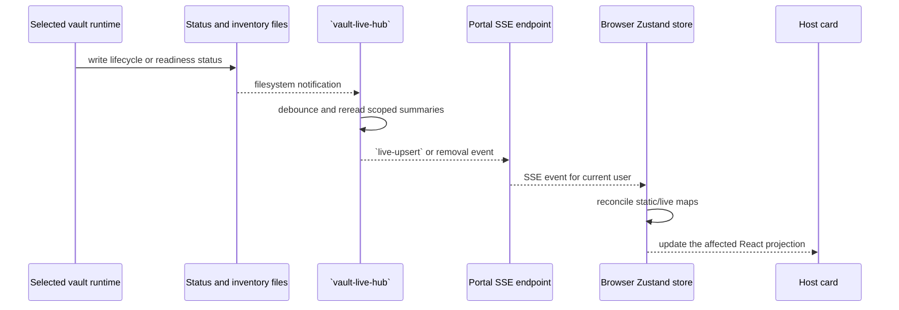

# Polaris Portal

Polaris Portal is the browser application for the Polaris control plane. It
presents the authenticated user's profile, owned vaults, lifecycle actions,
credentials, and admitted surface entry points. It is a surface adapter, not
a second control plane.

The implementation is an independent React/Vite application at
`apps/polaris-portal`. It uses shadcn/ui-style local components and Zustand for
ephemeral browser state. `@polaris/polaris-shell` supplies shared route,
product-line, host-action, and user contracts; it does not render the Portal.

Polaris remains authoritative for Authing identity mapping, tenant and vault
ownership, role and capability checks, lifecycle, status, gateway admission,
durable jobs, and audit. The browser renders scoped projections and sends user
intent back to the Portal API.

The Portal contract is used together with [User Management](./user-management.md),
[Vault Management](./vault-management.md), and [Polaris Gateway](./gateway.md).
Coding-surface behavior is documented in [Paseo Management](./paseo.md).
The operator sequence is documented in [Polaris Usage](./usage.md).

## 1. Static Model

### 1.1 Ownership And Runtime Shape



| Component | Owns | Does not own |
| --- | --- | --- |
| `apps/polaris-portal` | React pages, cards, navigation, Zustand state, SSE client, browser actions | Identity, ownership, capability authority, durable state |
| `@polaris/polaris-shell` | Route, product-line, host-action, and user contracts | Portal UI, session authority, authorization |
| `apps/polaris/scripts/portal` | Authenticated API, verified Domain Pack and workflow projections, durable workflow control, host Literature Review adapter, compatibility FFI host, SSE endpoint, lifecycle adapters, Gateway transport, static-artifact serving | Browser rendering |
| Polaris Domain Pack store | CLI-managed verified [Polaris DSL](./dsl.md) installations and manifests outside Vaults | Flow execution, scheduling, Agent adapters |
| `vault-live-hub.ts` | Per-user filesystem observation, reconciliation, and scoped events | Durable authorization or audit authority |
| User Management | Authing mapping, ownership, roles, and product-line access | Portal layout |
| Vault Management | Runtime, data, status, jobs, recovery, and capacity | Browser state |
| Polaris Gateway | Surface admission, tickets, assertions, rate limits, and proxy policy | Surface-internal UI behavior |
| Browser Zustand store | Ephemeral session, host, user, and connection projections | Canonical vault status or permission decisions |

The Portal has one public Polaris origin. The browser does not receive a
Docker port, Pod or KubeVirt Service, Paseo daemon address, vertical runtime
port, or host-path URL. Coding and vertical-surface entry actions remain
same-origin Polaris routes and are admitted by the Gateway.

### 1.2 Browser Routes And API Contract

| Surface | Route | Responsibility |
| --- | --- | --- |
| Welcome/sign-in | `/welcome` | Show the active authentication mode and begin sign-in |
| Auth callback | `/auth/callback` | Complete the Authing authorization-code exchange |
| Host directory | `/hosts` | List owned vaults, create/delete vaults, and start/stop them |
| Work desk | `/work` | Show host or Vault run cards and open their scoped detail views |
| Provisioning | `/setup` | Choose one Domain Pack as the work scene and optionally configure a Vault execution target |
| Workflow settings | `/settings/workflows` | Select one Domain Pack and show its complete flow list; enable or disable individual flows |
| Run detail | `/work/runs/:runId` | Observe, approve, cancel, retry, and open controlled artifacts |
| User page | `/settings/user` | Show Basic Information, Credentials, and Session as peer sections |
| Coding surface | `/v/:serverId/coding` | Enter the admitted coding surface |
| Vertical surface | `/v/:surfaceId/vertical` | Enter the admitted vertical surface |
| Session | `GET /api/session` | Return the current authenticated session projection |
| Auth configuration | `GET /api/authing-config` | Return public Portal authentication configuration |
| User projection | `GET /api/polaris-user` | Return profile, session, and credential summaries |
| Host projection | `GET /api/polaris-hosts` | Return the current user's vault summaries |
| Domain Pack projection | `GET /api/domain-packs` | Return verified CLI-installed packs, flow metadata, inputs, capabilities, and approval requirements |
| Workflow Vault projection | `GET /api/workflow-vaults` | Return the current user's Vaults with canonical driver status and server-derived run availability |
| Workflow setup | `GET/PUT /api/workflow-setup` | Read or persist the tenant's selected pack, optional Vault, and enabled flows |
| Workflow runs | `GET/POST /api/workflow-runs` | List or submit tenant-owned durable runs for host or Vault execution |
| Run projection | `GET /api/workflow-runs/:runId` | Return one tenant-owned run projection |
| Run events | `GET /api/workflow-runs/:runId/events?after=:cursor` | Return replayable ordered events for one run using the tenant-global cursor |
| Run actions | `POST /api/workflow-runs/:runId/{approve,cancel,retry}` | Apply server-side durable transitions |
| Workflow suggestions | `GET/POST /api/workflow-suggestions` | List or create non-executable deterministic drafts from successful runs |
| Host lifecycle | `POST /api/polaris-hosts` | Queue creation of an owned vault |
| Host lifecycle | `POST /api/polaris-hosts/:name` | Start or stop an owned vault |
| Host deletion | `DELETE /api/polaris-hosts/:name` | Delete an owned vault through the lifecycle policy |
| Static vault state | `GET /api/users/:userId/vaults/static` | Return scoped inventory and driver metadata |
| Live vault stream | `GET /api/users/:userId/vaults/live` | Stream the scoped snapshot and status events as SSE |
| Surface launch | `POST /api/g/:serverId/launch` | Admit and prepare a vertical-surface Gateway session |

The browser sends credentials only to same-origin `/api` requests. The SSE
connection uses the same authenticated origin and the server checks the route
user ID against the current session before subscribing.

### 1.3 Static, Live, And View State

The Portal keeps three explicit state classes:

| State class | Examples | Authority | Lifetime |
| --- | --- | --- | --- |
| Static inventory | Vault name, available drivers, route IDs, ownership projection | Polaris API and control store | Until inventory or admission changes |
| Domain Pack catalog | Verified pack version/digest, flow list, input fields, capabilities | Polaris CLI store and authenticated Portal API | Until an installation changes |
| Live observation | Driver status, Paseo status, credential-live status, evolution summary | Vault status files and selected-backend probes | Until the next authoritative observation |
| Workflow run projection | Run status, progress, pinned pack digest, selected Vault, artifacts, ordered events, replay cursor | Authenticated Polaris workflow service | Until the next server projection |
| View state | Current page, loading state, selected card, pending action, stream status | Browser Zustand store | Process or page lifetime |

`hostsByName`, `staticByName`, and `liveByName` are separate maps in the
browser store. A live event changes the visible status while retaining static
route identity. A static removal removes the corresponding host and live
projection. The card displays the latest observed status and identifies a
pending or disconnected stream instead of inventing a final backend state.

Workflow Vault availability is deliberately smaller than Vault lifecycle
state. `status` is the canonical `VaultStatus.driver.status` string from
Polaris; `canRun` is true only when Polaris has a selected driver and reports
`running`; `availabilityReason` explains a false value. `stopped`, `absent`,
`deleting`, and `archiving` remain their canonical values and are never mapped
to a Portal-owned `ready` or `failed` state. The server re-reads this
projection before accepting a run, and the browser never starts or repairs a
Vault implicitly.

### 1.4 Domain Pack Catalog

Polaris discovers first-party packs from `packs/` and extra versions from
the control-store install root after the [Polaris DSL](./dsl.md) pipeline:
parse, import resolution, validation, and compilation. Extra versions
installed with `pack add` keep an immutable source and manifest under the
control data root, outside every Vault. The Portal API reads that combined
catalog on each authenticated request and exposes only verified
installations. A source whose digest no longer matches its manifest is
omitted from the catalog.

The projection is descriptive. It carries the pack version and digest, flow
titles and summaries, input controls, capabilities, and whether a flow reaches
a human approval port. It carries no prompt, command, path, credential, or
execution binding. The current Portal binds the selected projection to a
durable Polaris run. `driver=none` uses the Polaris host adapter and persists
`mode: "host"`. The first-party Literature Review flow is
`AutoResearch/LiteratureReview`. A concrete Vault target uses the
compatibility mock path and persists `mode: "mock"`. Real `mode: "vault"`
execution is postponed to [Polaris 0.5.0](/operations/polaris-0.5.0/).

The browser keeps the hierarchy explicit: `domainPackId` is the selected work
scene, while `enabledWorkflowKeys` contains individual `packId:flowId` entries.
Provisioning selects the pack before enabling its flows. Workflow settings
selects one pack tab and renders that pack's complete flow list; `全部`、`已启用`
and `可添加` filter the flows within the selected pack.

### 1.5 Application Boundary

`apps/polaris-portal` builds a static artifact in
`apps/polaris-portal/dist`. Vite emits the application under `/shell/`; the
Portal API serves the artifact from the integrated Polaris origin. The Portal
routes, `/api`, and `/g/*` therefore remain same-origin even though the React
application has its own repository application boundary.

The application boundary does not move server authority into React. The
backend under `apps/polaris/scripts/portal` remains responsible for:

| Backend module | Responsibility |
| --- | --- |
| `server.ts` | Authenticated HTTP API, SSE, route handling, CSRF checks, and Gateway transport |
| `auth.ts` and `user-map.ts` | Authing session validation and Polaris user mapping |
| `service.ts` | Lifecycle adapters, credentials, skills, and durable-job adapters |
| `control-store.ts` | Durable control state, idempotency, leases, quotas, and audit-adjacent records |
| `vault-live-hub.ts` | Filesystem observation, debounce, reconciliation, and per-user event fan-out |
| `gateway*.ts` | Tickets, signed assertions, mutation admission, quota, and proxy policy |
| `portal-assets.ts` | Static artifact lookup and SPA document fallback |

Paseo integration follows the same ownership rule. Polaris-owned route and
embed contracts live in `packages/surface-coding` and `packages/paseo-embed`.
The `packages/paseo` tree remains the upstream source checkout, reviewed patch
stack, Docker artifact input, and in-vault tool-bundle input.

## 2. Browser Implementation

### 2.1 React Application

`apps/polaris-portal/src/App.tsx` owns the browser route switch and the React
page tree:

- `WelcomePage` and `AuthCallbackPage` handle sign-in entry and callback
  completion.
- `HostsPage` renders the owned-vault directory, metrics, creation form, and
  lifecycle cards.
- `WorkPage` renders the card-first work desk and routes a selected card to its
  run detail.
- `ProvisioningPage` and `WorkflowSettingsPage` render the installed Domain
  Pack and flow catalog returned by Polaris.
- `ToolsPage` at `/settings/tools` lists lock-backed tool readiness and a
  formatted `check-setup` result, with a recheck control.
- `RunDetailPage` renders the durable run event trace, approval and lifecycle
  actions, and controlled artifacts.
- `UserPage` renders Basic Information, Credentials, and Session as three
  peer sections.
- `SurfacePage` resolves the selected coding or vertical-surface entry through the
  reviewed route and Gateway contracts.
- `PortalLayout` displays navigation, the current account, and live-stream
  connection state.

The user page deliberately places **Session** outside the Basic Information
and Credentials cards at the same heading level. Its card contains only the
current authentication mode and the sign-out action.

### 2.2 Zustand State Model

`apps/polaris-portal/src/portal-store.ts` is the single browser state store.
It contains:

| Store area | Contents |
| --- | --- |
| Session | Authenticated session, mapped Polaris user, bootstrap state, and errors |
| User | Profile, session summary, credential summaries, and controlled credential records |
| Vault projection | `hostsByName`, `staticByName`, and `liveByName` |
| Workflow projection | Installed Domain Packs, real user-scoped Vault projections, enabled pack-scoped flows, server-owned durable runs, receipts, artifacts, and replay cursor |
| Connection | `idle`, `connecting`, `connected`, or `reconnecting`, plus heartbeat time |
| Mutations | Pending host actions and create/start/stop/delete operations |

`applyVaultStreamEvent` is the reducer for the live contract. It handles
`snapshot`, `static-upsert`, `static-remove`, `live-upsert`, `live-remove`, and
`heartbeat` events. It merges live status into an existing host without
discarding its static route IDs, and removes stale entries when inventory is
revoked.

`apps/polaris-portal/src/portal-client.ts` owns HTTP requests, Authing PKCE
callback handling, logout cleanup, and the SSE URL. `connectLiveStream` opens
an authenticated `EventSource`, applies typed events to Zustand, and retries
with bounded exponential backoff after a connection error. A retry refreshes
the host projection before opening a new stream.

This split is final for the current Portal: React renders the store, Zustand
holds browser projections, `portal-client.ts` owns transport, and Polaris owns
authority.

## 3. Control And Data Flow

### 3.1 Bootstrap And Page Load



Bootstrap stops at an unauthenticated or unmapped session. A mapped session
loads the Domain Pack, setup, and run projections needed by `/work`, then
starts optional Vault inventory and the user-scoped live stream in the
background. A stopped or malformed Vault therefore cannot prevent a host run
from appearing in the work desk. A page reload reconstructs catalog, setup,
and run state from Polaris instead of restoring browser memory. Admission, run
durability, event/outbox persistence, receipts, and artifact metadata are real
control-store state. The SysSec Literature Review host adapter also projects
the real collection, analysis, and report artifacts; compatibility FFI and
external effects remain synthetic where noted by the run policy.

### 3.2 Live Vault Status



The live hub sends an initial `snapshot`, watches the user's inventory and
vault-state roots, debounces changes, and emits heartbeats while subscribed.
Lifecycle operations also notify the hub when Polaris has a known transition.
The server-side observation remains authoritative; the browser never converts
a mutation response directly into a final `running` or `stopped` state.

### 3.3 Live Event Contract

| Event | Browser reducer behavior |
| --- | --- |
| `snapshot` | Replace the scoped static and live maps and rebuild visible hosts |
| `static-upsert` | Add or update inventory and preserve its existing live status |
| `static-remove` | Remove the inventory, live entry, and visible host |
| `live-upsert` | Replace one host's observed status while retaining route identity |
| `live-remove` | Clear the live entry and mark the visible status unavailable |
| `heartbeat` | Update connection liveness without changing vault state |

Malformed events are ignored. The next refresh/reconnect re-establishes the
scoped snapshot. A disconnected stream is shown as reconnecting or offline;
the store does not silently present disconnected data as current.

### 3.4 Lifecycle And Surface Entry

```text
user action
  -> authenticated Portal API request
  -> current user, vault ownership, line, and capability checks
  -> Polaris lifecycle lock or Gateway admission
  -> durable operation or signed surface session
  -> status observation and live event
  -> React card or surface route update
```

Host creation returns an accepted operation while Polaris provisions and starts
the vault. Start and stop requests set a browser pending marker, but the final
card status comes from the live projection. Coding and vertical-surface buttons are
disabled unless the current observed runtime reports `running`; the Gateway repeats all
authorization and selected-driver checks when the surface is opened.

### 3.5 Workflow Submission And Debug Observation

```text
Portal form
  -> authenticated pack/flow/optional execution-target request
  -> Polaris rechecks pack digest, then validates host execution or Vault ownership and selected driver
  -> WorkflowControlService atomically creates the envelope, lease, run, event, and outbox row
  -> host Literature Review adapter or deterministic FFI worker runs the pinned workflow
  -> receipts, artifacts, and replayable events are persisted
  -> Zustand stores the run projection; Work and run detail render that store
```

The run keeps `packVersion`, `packDigest`, optional `vaultId`, execution driver, capability lease, policy,
and the submitted input snapshot. Approval, cancellation, retry, and failure
are durable server transitions. The Debug page only selects a run and
displays replayable events; it cannot mutate run state by editing browser
data. `driver=none` on `AutoResearch/LiteratureReview` runs the compiled
collection-to-report workflow on a tenant-scoped Polaris host workspace.
Retry requeues that same run id and skips completed steps. Vault-target
runs retain the deterministic compatibility executor. All run control state
survives a Portal process restart in the existing control store.

## 4. Security, Resilience, And Concurrency

### 4.1 Authentication And Scope

- Every protected API request resolves the authenticated session on the
  server.
- Mapped Portal requests use the session's Polaris user ID; the browser cannot
  select another user by changing a route or card field.
- The live route checks the requested `:userId` through the same scope policy
  before it subscribes.
- Cookie-backed unsafe requests require an allowed origin and CSRF validation.
- Browser credentials are sent only to the same-origin Portal API. The SSE URL
  contains a scoped ID, not a bearer token.
- A Gateway cookie is transport state. It never replaces the current session,
  role, line, tenant, vault, or selected-driver check.

Static and live objects are projections. Possessing a host card, route ID, or
SSE connection does not grant vault or Gateway access.

### 4.2 Reconnection And Failure Behavior

| Failure | Required behavior |
| --- | --- |
| Session request is unauthorized | Close the stream, clear the session projection, and show sign-in |
| Session is authenticated but unmapped | Stop bootstrap and show the access-configuration error |
| Initial host fetch fails | Show the error and do not retain a different user's host map |
| SSE connection drops | Close the old source, mark reconnecting, refresh, and retry with bounded backoff |
| Event JSON is malformed | Ignore the event and recover through refresh/reconnect |
| Vault ownership is revoked | Remove it on a scoped event or the next snapshot |
| Runtime status is pending | Display the pending or last-observed state; do not claim a final state |
| Account or scope changes | Close the old stream and discard its browser projections |

The browser is never the source of truth for lifecycle, selected driver, route
identity, ownership, or capability. Polaris and Vault Management remain
authoritative after a reload, reconnect, process restart, or concurrent user
action.

### 4.3 Concurrent Mutations

The browser serializes a user's visible action through a pending marker, while
Polaris enforces the actual lifecycle lock, capability decision, idempotency,
quota reservation, durable job, and audit record. A second browser tab or a
replayed request receives the server decision; it cannot bypass the lock by
mutating Zustand.

The ordering for a lifecycle action is:

```text
validate session and capability
  -> acquire the Polaris lifecycle/idempotency boundary
  -> persist the operation and known transition
  -> perform or queue the backend action
  -> observe selected-driver status
  -> emit the scoped live event
```

The operation response acknowledges the accepted request. It is not a claim
that the backend has reached its final state.

### 4.4 Gateway And Runtime Boundary

The Portal never publishes a direct implementation endpoint. Polaris uses
`POST /api/g/:serverId/launch` and the private `/g/` Gateway path for the selected
vertical surface.
The Gateway validates the current line, role, tenant, vault ownership,
selected driver, readiness, ticket, assertion, rate limit, and proxy target.
Paseo daemon `:6767` and selected-surface implementation ports remain private.

## 5. Development And Verification

### 5.1 Repository Responsibilities

| Component | Responsibility |
| --- | --- |
| `apps/polaris-portal/src/App.tsx` | React route switch, layouts, work cards, host cards, user page, and surface entry |
| `apps/polaris-portal/src/portal-store.ts` | Zustand projections, event reducer, bootstrap, explicit refresh, and reconnect lifecycle |
| `apps/polaris-portal/src/portal-client.ts` | HTTP transport, Authing callback, workflow requests, logout, and SSE URL/client helpers |
| `apps/polaris-portal/src/components/ui` | Local shadcn/ui-style primitives |
| `apps/polaris-portal/src/portal-store.test.ts` | Synthetic static/live reconciliation tests |
| `packages/polaris-shell/src` | Shared route, product-line, host-action, and user contracts |
| `apps/polaris/scripts/portal/server.ts` | Authenticated API, SSE, static artifact serving, and Gateway entry |
| `apps/polaris/scripts/portal/workflow-control.ts` | Durable setup, envelope, lease, run transitions, deterministic worker, FFI receipts, artifacts, and suggestions |
| `apps/polaris/scripts/portal/workflow-mock.ts` | Compatibility fixtures and Vault projection helpers; not the production run authority |
| `apps/polaris/scripts/portal/vault-live-hub.ts` | Scoped watcher, debounce, snapshot, and event fan-out |
| `apps/polaris/scripts/core/portal.ts` | Canonical static/live summary projections |
| `apps/polaris/tests` | Synthetic auth, scope, lifecycle, stream, Gateway, and recovery evidence |

The Portal front end is not implemented in `packages/polaris-shell`, and the
shared contract package does not own browser assets.

### 5.2 Focused Checks

Run the Portal application checks from the Polaris repository:

```bash
pnpm --filter polaris-portal run typecheck
pnpm --filter polaris-portal run test
pnpm --filter polaris-portal run build
pnpm --filter @polaris/polaris-shell run typecheck
pnpm --filter @polaris/polaris-shell run test
pnpm run build:surfaces
```

Run the server-side Portal and live-stream checks with synthetic users,
tenants, vaults, statuses, and Authing subjects:

```bash
pnpm --filter polaris exec tsx --test --test-concurrency=1 \
  apps/polaris/tests/polaris-portal.test.ts \
  apps/polaris/tests/polaris-portal-security.test.ts \
  apps/polaris/tests/polaris-workspace-live-stream.test.ts \
  apps/polaris/tests/polaris-workflow-mock.test.ts
```

The repository-wide documentation and source checks are:

```bash
pnpm run check
git diff --check
```

No test fixture or release example may contain real credentials, customer
records, cookies, or private runtime paths.

## 6. Invariants

1. Polaris Portal is a browser surface adapter, not a control plane.
2. `apps/polaris-portal` is the only supported Portal browser application.
3. `@polaris/polaris-shell` contains shared contracts, not Portal UI assets.
4. Zustand stores browser projections; Polaris owns authority and durability.
5. Static inventory and live status have separate maps and explicit freshness.
6. The server-side live hub supplies scoped status events after authorization.
7. A mutation response never replaces the authoritative live observation.
8. Session, ownership, capability, and selected-driver checks repeat on every
   protected request and Gateway admission.
9. Basic Information, Credentials, and Session are peer sections on the user
   page.
10. A scope change closes old streams and removes their browser projections.
11. Direct Paseo and selected-surface runtime ports never become browser routes.
12. Workflow Vault availability is derived from canonical Vault status; the
    Portal never owns Vault lifecycle or run transitions.
13. Work and Debug consume the same server run projection and replay cursor.
14. FFI calls are declared inside Domain Pack workflows and require a matching
    immutable pack digest and execution capability lease.
15. Suggestions are durable evidence-backed drafts and cannot enable or run
    themselves.

## Related Docs

- [Polaris overview](./index.md)
- [Polaris DSL](./dsl.md)
- [User Management](./user-management.md)
- [Vault Management](./vault-management.md)
- [Polaris Gateway](./gateway.md)
- [Paseo Management](./paseo.md)
- [Operations](/operations/)
