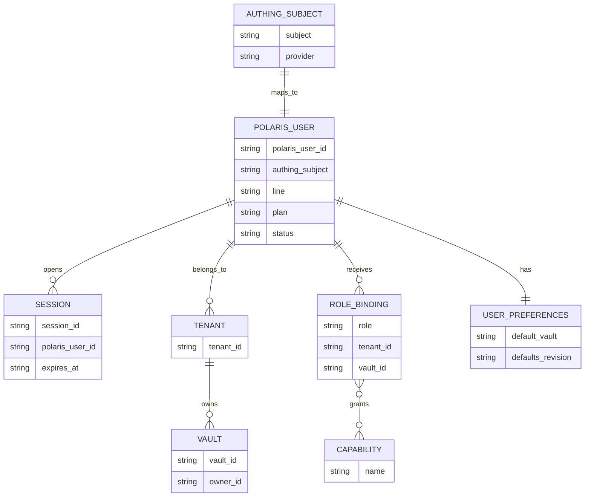
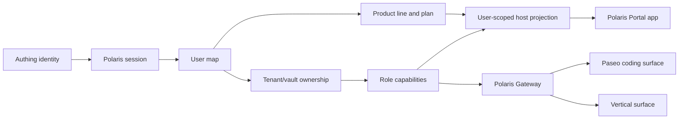
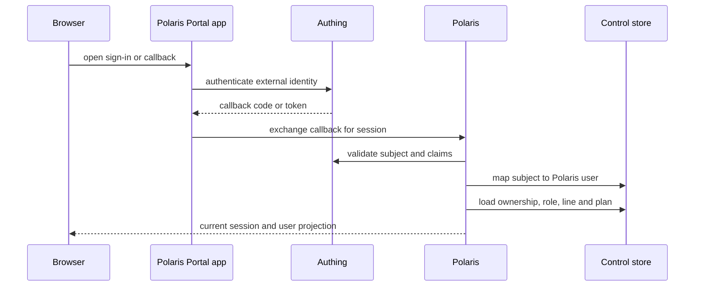
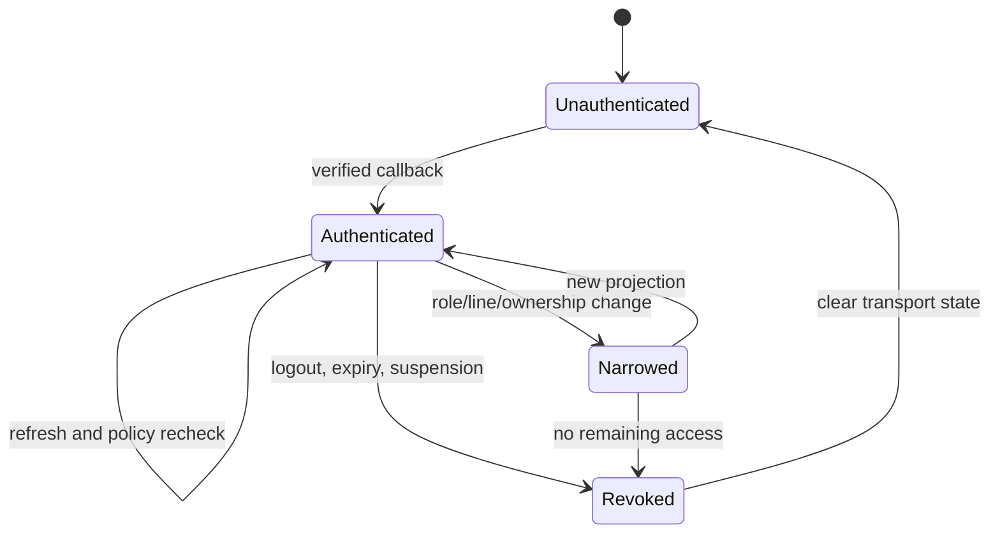
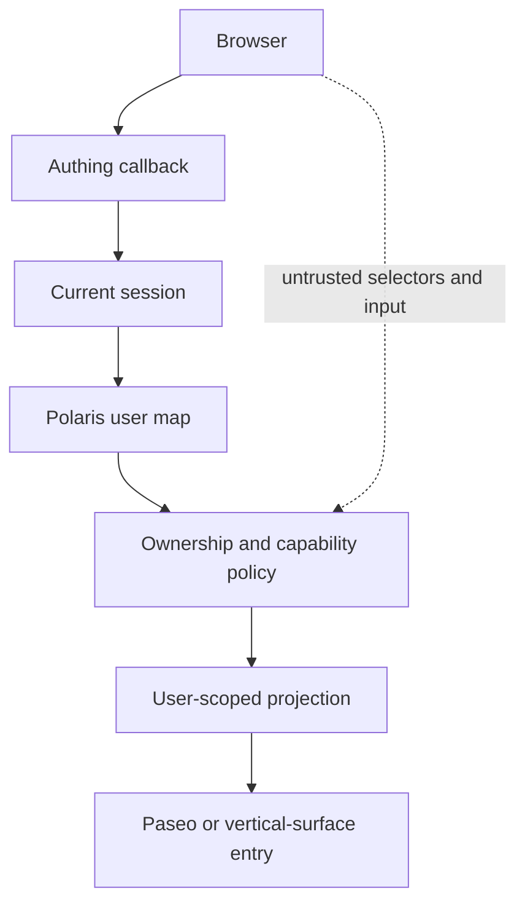

# User Management

This is the canonical Polaris reference for identity, user mapping, tenant and
vault ownership, product-line resolution, and role capability checks. It
combines the former User Management And Access Control section with the
control-plane rules that make those decisions durable and auditable.

Polaris is the only authority for these decisions. Authing proves an external
identity, but it does not own Polaris users, tenants, vaults, product lines,
plans, or capabilities. Polaris Portal renders the user-facing settings and
host directory; it does not create a second identity or ownership store.

The functional boundary is deliberately narrow:

| Owner | Owns | Does not own |
| --- | --- | --- |
| Authing | External identity and sign-in protocol | Polaris ownership or capabilities |
| Polaris | User map, tenant/vault ownership, roles, capabilities, product line, session policy | Coding UI or vertical-surface business behavior |
| Polaris Portal | Login callback UI, profile/settings UI, host directory | Authorization decisions or durable ownership |
| Gateway | Same-origin transport session and per-request proxy assertion | User registration or role policy |
| Vault Management | Runtime lifecycle, data, jobs, backup, capacity | User identity mapping |
| Paseo and vertical surface | Surface behavior inside an admitted scope | User, tenant, vault, or role authority |

## 1. Static Model

### 1.1 Identity And Ownership Objects



| Object | Canonical owner | Durable source of truth |
| --- | --- | --- |
| Authing subject | Authing, observed by Polaris | Authing identity response |
| Polaris user | Polaris | Control store user map |
| Session | Polaris | Session store and signed transport state |
| Tenant membership | Polaris | Control store |
| Vault ownership | Polaris | Control store and `VaultSpec` |
| Role binding | Polaris | Control store policy records |
| Capability set | Polaris policy | Recomputed from current binding |
| Product line and plan | Polaris | User map |
| User defaults | Polaris | User preference record |
| Host projection | Polaris | Current session, ownership, and runtime status |

An Authing subject is an external identifier, not a tenant identifier. A
`serverId` or `surfaceId` is a route key for a selected runtime, not an identity
or capability. The client cannot turn either value into ownership by placing it
in a URL or request body.

### 1.2 Authority And Surface Projection



The projection is intentionally smaller than the control store. It may contain
the current user's host IDs, product actions, selected-driver status, pairing
metadata, and safe reconnect information. It must not contain another user's
host registry, control-store paths, private runtime ports, credentials, or
unverified role claims.

### 1.3 Product Lines And Plans

The product line is per user and is resolved from the Polaris user map. It is
not a deployment-wide environment switch:

| Field | Values | Meaning |
| --- | --- | --- |
| `line` | `coding` or `vertical` | Which surface family the user may open |
| `plan` | `free` or `pro` | Feature richness within that family |

The default resolution is:

```text
coding   -> Polaris Portal + Paseo coding
vertical -> Polaris Portal + Paseo coding + vertical-surface gateway entry
```

The user map is the input to `resolveProductForUser({ line, surfaces })`.
Host environment variables must not override it. A product-line downgrade
must affect the next projection and the next protected request; an old browser
view is not a permission to retain a surface.

## 2. Control Flow

### 2.1 Sign-In And Session Establishment



Polaris normalizes the external subject before using it as a lookup key. The
session response is generated from the Polaris user map and current policy; it
does not simply echo Authing claims. Missing mapping, suspended users,
ambiguous ownership, and invalid claims fail closed.

### 2.2 Resolve A User-Scoped Surface

Every surface action follows the same ordered decision:

```text
current Polaris session
  -> mapped Polaris user
  -> product line and plan
  -> tenant membership and vault ownership
  -> role and capability check
  -> selected backend and current runtime status
  -> user-scoped surface projection
  -> route or gateway launch
```

The Portal app may hide an action for usability, but the server repeats the decision
when the action is requested. The gateway repeats the relevant decision for
every proxied request. Vault lifecycle operations add quota, release profile,
and durable-job admission as specified in [Vault Management](./vault-management.md).

### 2.3 User And Account Changes

Profile, default, role, tenant, and vault changes are control-store mutations.
The mutation must identify the current Polaris user from the session and must
validate the affected object against that user's ownership or administrative
capability. A request-provided `userId`, `tenantId`, or vault root is a
selector to validate, never a source of authority.

After a successful change Polaris rebuilds the affected projection. Changes
that alter access invalidate or narrow existing transport state before the next
surface request. They must not leave a stale host or capability visible merely
because a browser tab has not reloaded.

### 2.4 Session Change, Revocation, And Reconnect



A gateway cookie, iframe URL, pairing offer, and browser cache are transport or
presentation state. None is an authorization cache. Reconnect must reconstruct
the current projection and recheck ownership; it must not revive a previous
user, selected vault, or role from browser state.

## 3. Data Flow

### 3.1 Browser To Control Store



The server-side map is the join point between external identity and product
state. The browser can request a view or mutation, but cannot supply the
identity, capability, tenant, vault, or runtime path that makes it valid.

### 3.2 Durable Control Records

Polaris persists the records that must survive process restart:

| Record | Why it is durable |
| --- | --- |
| Session and user map | Reconstruct identity and product-line resolution |
| Tenant membership and vault ownership | Enforce the isolation boundary |
| Role bindings and capability policy | Recompute access after changes |
| User preferences | Preserve defaults without changing ownership |
| Selected vault/runtime reference | Advertise only the current backend |
| Audit event | Explain identity and access decisions to operators |

The control store is separate from the selected vault's business-data mounts.
The data layout, migration, backup, and restore contract belongs to
[Vault Management](./vault-management.md); no surface receives a control-store
mount.

### 3.3 Scope Passed To Surfaces

| Consumer | Receives | Must not receive |
| --- | --- | --- |
| Polaris Portal | Session, profile, allowed lines, host projection | Global user or vault registry |
| Paseo web | Selected coding route, `serverId`, pairing transport | User authority or host root |
| Polaris Gateway | Current user, owned vault, capability, selected target | Caller-selected origin or stale driver |
| Vertical surface | Short-lived signed request scope | Independent user/role/tenant authority |

The scope is derived again at the boundary that uses it. A projection is a
convenience for navigation, not a delegation of Polaris authority.

## 4. Security And Trust Boundary

### 4.1 Accepted Authority

| Boundary | Accepted authority | Rejected input |
| --- | --- | --- |
| Sign-in | Authing verification plus Polaris mapping | Raw browser claims |
| Session | Polaris session policy | Stale or forged cookies |
| User mutation | Current session and capability | Request `userId` as proof |
| Tenant/vault access | Current ownership records | Route ID or host path |
| Product surface | Current line and capability | Deployment-wide product flag |
| Gateway proxy | Fresh ownership and selected-driver check | Gateway cookie as permission |
| Runtime data | Vault attachment contract | Caller-selected workspace root |

Role checks occur before sensitive lifecycle actions and before gateway proxying.
The vertical-surface adapter verifies the signed scope it receives, but that
verification does not move ownership or role authority into the adapter.

### 4.2 Cross-Account Isolation

An account switch is a security event. The Portal and surface clients must clear
or reconcile in-memory host profiles before accepting the new user's host
projection. A returned host is usable only when its API identifier exactly
matches the requested route and its tenant/vault ownership matches the current
session. Revoked or removed hosts are removed from the projection.

This prevents a previous account's host, pairing data, or runtime profile from
remaining reachable after Authing subject or vault access changes. It also
prevents an attacker from using a valid route key as a cross-tenant lookup.

### 4.3 Fail-Closed Rules

Reject the operation when any of these is missing or inconsistent:

- Authing subject to Polaris-user mapping;
- current session expiry or revocation state;
- tenant/vault ownership or required capability;
- product-line admission;
- selected runtime status;
- exact host identifier and pairing scope;
- control-store transaction or durable action support.

Do not fall back to a retained Docker, Pod, or KubeVirt configuration, a stale
browser host list, an old role, a caller-supplied origin, or a legacy direct
surface route.

## 5. Runtime, Resilience, And Concurrency

### 5.1 Session And Projection Resilience

Session refresh and surface reconnect are repeatable reads of the current
control state. They must be safe after a Portal restart, a daemon restart, or a
gateway worker restart. A failed read leaves the surface unavailable and
retains a diagnostic; it must not broaden the projection or reuse another
user's cached state.

When a role, line, tenant, or vault changes, Polaris narrows the next
projection. Existing gateway transport is invalidated or rechecked before the
next request. Existing Paseo pairing metadata can help reconnect transport,
but cannot bypass the new ownership decision.

### 5.2 Concurrent Mutations

Concurrent user-management mutations are serialized by the control-store
transaction or the durable job contract that owns the operation. The operation
must be idempotent where it can be retried and must record enough audit context
to distinguish a retry from a second logical change.

The following ordering is required when an access change affects a live vault:

```text
validate current session and capability
  -> persist ownership/role change
  -> invalidate or narrow affected projections
  -> stop or revoke surface access when required
  -> record audit result
```

No request may continue using a previously admitted capability after the
control-store change has committed. Runtime replacement, backup, restore,
and rollback are separate durable operations owned by Vault Management.

### 5.3 Recovery And Audit

Polaris records identity, ownership, capability, and projection failures as
redacted audit events. It must be possible to explain why a surface was
admitted or denied after a process restart without storing browser credentials,
request bodies, or private runtime paths in the event.

The user-management contract depends on the same release profile and recovery
evidence as vault lifecycle. It does not create a second worker, quota, or
backup path. See [Polaris Gateway](./gateway.md) for transport recovery and
[Vault Management](./vault-management.md) for durable jobs and data recovery.

## 6. Development View

### 6.1 Repository Responsibilities

| Component | User-management responsibility | Boundary |
| --- | --- | --- |
| `apps/polaris` | Session exchange, mapping, ownership, policy, persistence | Server-side authority |
| `apps/polaris-portal` | Login, callback, profile/settings UI, host projection | Browser presentation and navigation |
| `@polaris/polaris-shell` | Shared route, product-line, host-action, and user contracts | No UI or user authority |
| `@polaris/surface-paseo` | Consume allowed coding projection | No user authority |
| Vertical-surface adapter | Request an admitted gateway surface | No user authority |
| Control store | Durable records and audit | Never mounted into a vault |
| Documentation site | Product and operations contract | No runtime decision |

Tests should use synthetic Authing subjects, users, tenants, vaults, and role
bindings. Do not put real repository identifiers or business data in fixtures.
Focused checks should cover callback mapping, account switching, revocation,
role and line changes, tenant isolation, projection filtering, and protected
surface revalidation.

### 6.2 Contract Changes

When changing identity or access behavior:

1. update the control-store schema or mapping contract;
2. update the server-side capability check;
3. update Portal projection and account-switch cleanup;
4. update Gateway and Paseo consumers only for the reviewed scope;
5. add focused synthetic tests;
6. record the commit and checks in the maintained release documentation.

Do not hide a compatibility route or environment override in a surface patch.
The 0.3 boundary permits one explicit release contract and one migration path.

## 7. Operations View

### 7.1 Preflight

Verify before a release or host cutover:

- Authing callback and token exchange resolve the expected Polaris user map;
- suspended or unmapped identities cannot obtain a usable session;
- user line and plan resolve from the control store, not a host environment;
- tenant and vault projections contain only current ownership;
- role and capability checks run on lifecycle and gateway actions;
- account switching removes stale host and pairing state;
- the control store is private and its backup/recovery procedure is recorded;
- the active release binds to the declared `POLARIS_RELEASE_ID` and capacity
  profile.

### 7.2 Access Change And Incident Response

For a suspected account or role leak:

1. revoke or narrow the Polaris user, role, tenant, or vault binding;
2. invalidate affected sessions and gateway transport state;
3. stop or isolate the affected selected runtime when data exposure is
   possible;
4. verify the new projection and private gateway route with a synthetic check;
5. preserve redacted audit evidence and the release identifier.

Do not repair the incident by deleting only a browser cookie or changing a
surface URL. The durable ownership and session records are the source of truth.

### 7.3 Release Boundary

Polaris owns identity mapping, capability decisions, gateway sessions, logical
quotas, lifecycle admission, durable jobs, audit persistence, ingress, and
deployment policy. The controlled 0.3 capacity, quota, resource-budget, and
SLO limits remain those in the release profile and release evidence. Formal
production promotion and external identity/dependency gates remain governed by
the dated operations records.

## 8. Invariants

The user-management system is internally consistent when:

1. Every authenticated session maps to exactly one active Polaris user.
2. Authing identity is evidence for sign-in, not ownership or capability.
3. Tenant and vault access comes only from current Polaris records.
4. Product line and plan come from the user map, never a host-wide flag.
5. Role capabilities are recomputed before lifecycle and gateway operations.
6. Surface projections contain only the current user's allowed objects.
7. Account switching and revocation remove or invalidate stale transport state.
8. Control-store mutations are recoverable, auditable, and concurrency-safe.
9. No surface, route key, pairing offer, or browser token becomes a second
   authorization authority.
10. Control data remains separate from vault business data and runtime mounts.

If one invariant fails, deny or narrow the affected surface and retain the
diagnostic. Do not select a neighboring user, vault, role, or backend as a
best-effort fallback.

## Related Docs

- [Polaris overview](./index.md)
- [Polaris Portal](./polaris-portal.md)
- [Vault Management](./vault-management.md)
- [Polaris Gateway](./gateway.md)
- [Paseo Management](./paseo.md)
- [Remote Deploy](/development/remote-deploy)
