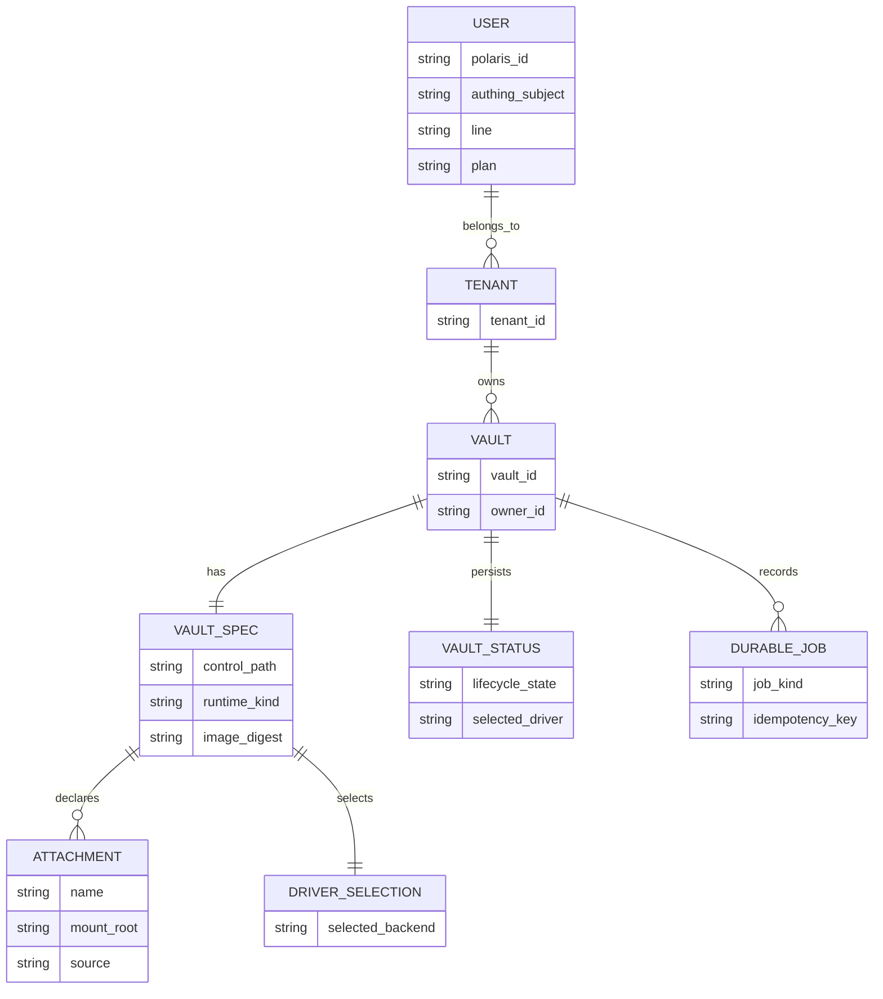
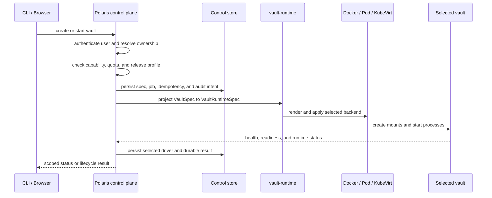
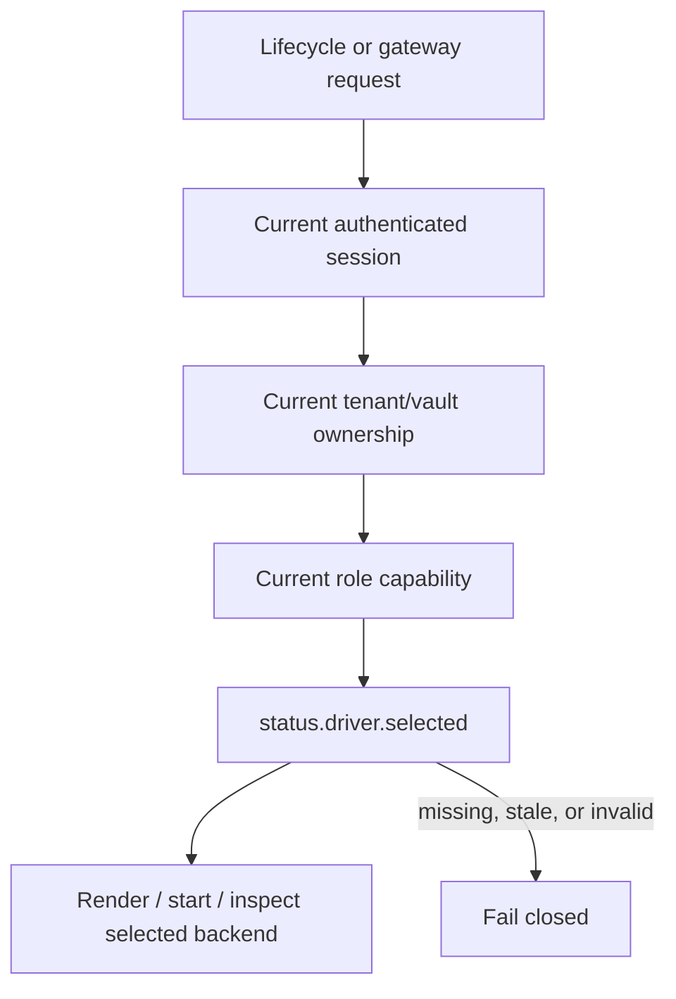
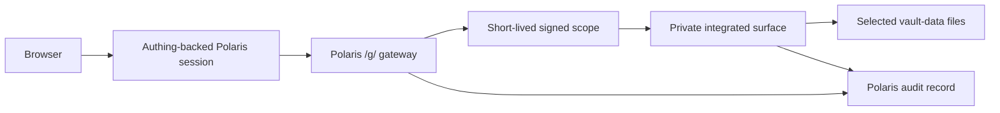
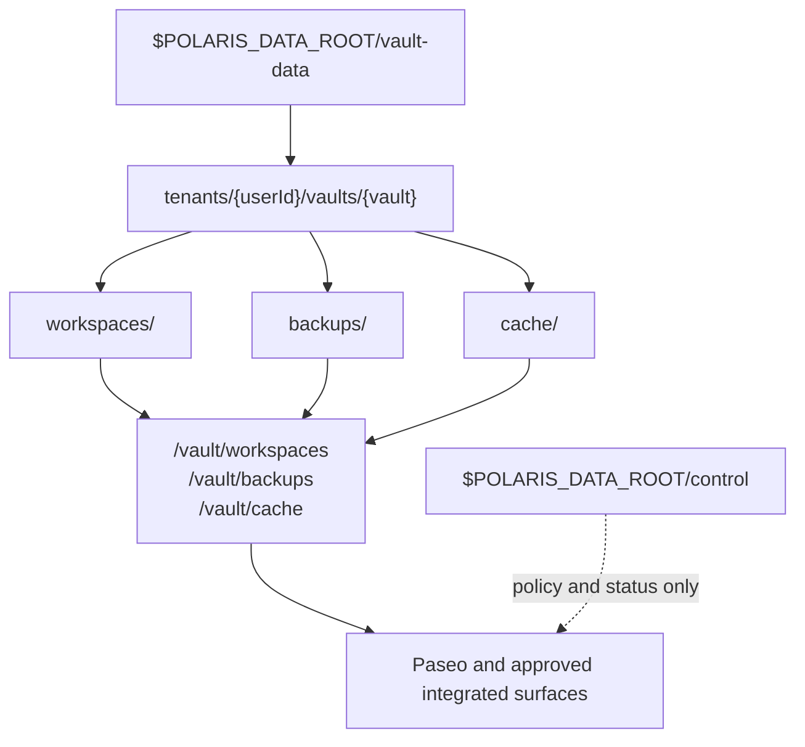
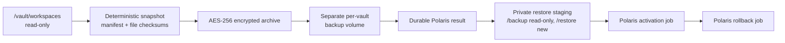
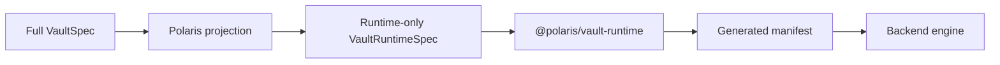

# Vault Management

This is the canonical Polaris reference for vault management. It explains the
same system from five connected views:

1. the static objects and storage contract;
2. the control flow that changes a vault;
3. the data flow through a runtime and the gateway;
4. the development boundaries and checks;
5. the operator workflow for migration, rollout, recovery, and verification.

The former Data And Trust Boundary, Runtime And Backends, Control And
Vault-Data Layout, and Topology pages are consolidated into this document.
They no longer contain parallel versions of the contract.

## 1. Static Model

### 1.1 Domain Objects

A vault is the unit Polaris owns, admits, renders, starts, stops, audits, and
routes. It is not the same thing as a browser workspace or a surface portal.



| Object | Canonical owner | Durable source of truth |
| --- | --- | --- |
| User identity and product line | Polaris user map and Authing session | Control store |
| Tenant and vault ownership | Polaris control plane | Control store and vault spec |
| Vault attachment and runtime contract | Polaris projection | `VaultSpec` |
| Live backend selection | Polaris lifecycle policy | `status.driver.selected` |
| Runtime process state | Selected backend and runtime probes | Status and generated artifacts |
| Workspace business files | The selected vault runtime | `vault-data` |
| Gateway request scope | Polaris-issued signed assertion | Request-local, short-lived |

User management and capability details are maintained in
[User Management](./user-management.md). This page consumes those decisions;
it does not redefine them.

### 1.2 Control Plane Versus Vault Data

The host has two durable planes. They have different owners, mount policies, and
failure consequences:

```text
$POLARIS_DATA_ROOT/
  control/
    users/
      profiles/
      {userId}/
        credentials/
        vaults/{vault}/
          *.agent.yaml
          generated/
          state/
          audit/
    state/
      control.sqlite
      control.sqlite-wal
      control.sqlite-shm
    backup-keys/
  vault-data/
    tenants/{userId}/vaults/{vault}/
      workspaces/
      backups/
      cache/
```

| Plane | Contains | May be mounted into an integrated surface? |
| --- | --- | --- |
| `control/` | Identity mapping, specs, generated output, status, jobs, audit, private keys | No |
| `vault-data/` | Tenant-scoped workspace files, backup artifacts, and cache | Only the selected vault's three business-data children |

`POLARIS_NETFS_LOCAL_EXPORT_ROOT` names the `netfs.local` export path. It must
end in `/vault-data`, with this child layout:

```text
<POLARIS_NETFS_LOCAL_EXPORT_ROOT>/tenants/{userId}/vaults/{vault}
```

On the single host its physical source is `$POLARIS_DATA_ROOT/vault-data`. The
export path and physical source must describe the same tree. Polaris derives
private backup keys below `$POLARIS_DATA_ROOT/control/backup-keys`; that
directory is control data, never a runtime mount.

### 1.3 Runtime Attachment Contract

The selected vault-data leaf is projected into three fixed direct roots. The
three roots are a Polaris contract and are available to any integrated surface
that is explicitly allowed to use them; they are not a surface-owned storage
layout.

| Host child | Runtime root | Normal access |
| --- | --- | --- |
| `workspaces/` | `/vault/workspaces` | Read/write |
| `backups/` | `/vault/backups` | Read/write |
| `cache/` | `/vault/cache` | Read/write |

Every saved `VaultSpec` declares the contract once:

```yaml
attachments:
  vault-data:
    mount_root: /vault/workspaces
    durable_paths:
      - /vault/workspaces
      - /vault/backups
      - /vault/cache
    source:
      kind: netfs
      server: netfs.local
      export_path: <POLARIS_NETFS_LOCAL_EXPORT_ROOT>
      sub_path: tenants/{userId}/vaults/{vault}
```

Other attachments are separate by design:

| Attachment | Runtime root | Reason for separation |
| --- | --- | --- |
| `vault-runtime-state` | `/vault/state` | Paseo, evolution, and runtime state must not be business data |
| `user-identity-state` | `/identity` | User-scoped identity material must not be vault workspace data |
| `ephemeral-runtime` | `/run/vault` | Temporary files, pids, and sockets must not be durable |

Docker uses direct bind or subpath mounts. Pod and KubeVirt use private
volumes or PVC attachments. All three renderers expose the same runtime roots.

## 2. Control Flow

Static objects become meaningful when Polaris changes them. The control flow is
the ordered set of authority checks, durable writes, runtime actions, and
status updates that make those changes safe to retry.

### 2.1 Lifecycle Control Flow



The normal lifecycle is:

```text
create -> spec-present -> rendered -> starting -> running
running -> stopping -> stopped
running -> rebuilding -> running
running -> switching -> running
spec-present or stopped -> deleted
```

For every mutation, Polaris must decide before calling the backend. The backend
does not infer a tenant, choose a driver, grant a capability, or publish a
public route.

### 2.2 Selection And Reconciliation

`status.driver.selected` is the only live backend authority:



Retained Docker, Pod, or KubeVirt configuration is not a fallback. A gateway
cookie is transport state, not a cached authorization decision. Access is
revalidated when a request reaches the gateway.

### 2.3 Durable Jobs

Actions that can outlive a process or change durable data use Polaris durable
jobs with idempotency, leases, recovery, and audit records:

| Action | Durable owner | Runtime role |
| --- | --- | --- |
| Start, stop, rebuild, switch, delete | Polaris | Execute the selected backend command |
| Workspace backup | Polaris | Read the selected workspace tree in a one-shot job |
| Restore staging | Polaris | Verify an archive into a private staging volume |
| Restore activation | Polaris | Replace the selected workspace data under a controlled job |
| Restore rollback | Polaris | Restore the pre-activation workspace copy |
| Live external actions | Polaris | No direct integrated execution until an owned durable path exists |

The integrated surface may provide a format adapter, but it cannot provide a
second lifecycle API or a second job queue.

## 3. Data Flow

Control flow decides whether an operation is allowed. Data flow describes which
bytes cross which boundary after that decision.

### 3.1 Request Data Flow



The browser sees one public origin. Polaris creates a one-time launch ticket,
redeems it into gateway transport state, rechecks current access, signs the
request scope, and proxies only to the configured private origin. The upstream
surface verifies the scope, expiry, tenant, vault, user, and request id.

### 3.2 Runtime Data Flow



Control files are not a runtime data source. They authorize and describe the
mounts; they are not exposed as a filesystem shortcut. A surface can read or
write only the roots projected into its selected vault runtime.

### 3.3 Backup And Restore Data Flow

The integrated backup is a Polaris-owned, network-disabled, digest-pinned
one-shot job. The `surface-backup` label identifies the image-side format
adapter, not the authority that owns the operation.



The archive contains regular files below `/vault/workspaces`, a backup
manifest, and file checksums. It does not contain `/vault/backups`,
`/vault/cache`, `/vault/state`, `/identity`, control databases, specs,
generated manifests, audit records, or encryption keys. Restore verifies the
checksum and archive structure before writing a new private staging volume.

The format adapter is allowed to run only inside the Polaris one-shot job. No
portal backup, restore, activation, or rollback route is part of the
integrated surface contract.

### 3.4 Trust And Failure Boundaries

| Boundary | Trusted input | Rejected or non-authoritative input |
| --- | --- | --- |
| Polaris API | Current session, control-store ownership, capability | Client actor, tenant, vault, or quota claims |
| Gateway | Current selected driver and private origin | Gateway cookie as an auth cache, target override, browser credentials |
| Runtime renderer | Polaris `VaultRuntimeSpec` | Retained backend configuration as fallback |
| Integrated surface | Short-lived signed scope and fixed mounts | Direct identity, role, quota, lifecycle, or host-root decisions |
| Backup job | Polaris job id, selected read-only data, private key | Network access, arbitrary archive path, mutable image |
| Restore job | Completed same-scope backup and verified staging result | Cross-tenant archive, direct production replacement, public volume |

When a boundary check fails, the expected result is rejection and a durable
error or audit record. It is not a best-effort fallback to an older path,
driver, root, or identity source.

## 4. Runtime And Isolation

### 4.1 Runtime Projection



`@polaris/vault-runtime` owns deterministic names, attachment assembly,
resource limits, health probes, renderers, and driver commands. It has no
dependency on Authing, tenant policy, gateway authorization, release
promotion, or durable control-plane jobs.

| Backend | Runtime role | Exposure rule |
| --- | --- | --- |
| Docker | Single-host 0.3 default | Private network or loopback-only port |
| Pod | Kubernetes process isolation | Private Service only |
| KubeVirt VM | VM isolation | Private Service only |

Each selected vault contains the coding daemon and approved surface processes.
The vertical portal listens on `:9090` only when the product line requires it;
the browser never receives that port.

### 4.2 Resource And Image Boundary

The release profile is the source for active-vault capacity, CPU, memory, PID,
storage, worker, lease, and SLO limits. A local environment variable cannot
raise those limits without a new evidence-backed release decision.

Images used by release jobs are digest-pinned. Generated manifests are
owner-restricted and are control-plane artifacts. Runtime state is persisted
only in the attachment intended for it; temporary process files use
`/run/vault` or the backend's private temporary storage.

### 4.3 Multi-Machine Isolation

Pod and KubeVirt deployments that span machines use the operator scripts from
the Polaris repository:

```bash
sudo ./scripts/operations/setup-k3s-sandbox-runtimes.sh
bash ./scripts/operations/setup-k3s-kubevirt.sh
bash ./scripts/operations/setup-k3s-cdi.sh
sudo ./scripts/operations/print-k3s-worker-join-info.sh
```

The sandbox setup installs k3s, Kata, gVisor, and supported RuntimeClass
objects. KubeVirt and CDI are separate control-plane installations. Verify
with:

```bash
k3s kubectl get nodes
k3s kubectl get runtimeclass
kubectl get kubevirt -n kubevirt
kubectl get cdi -n cdi
```

Installation is not runtime evidence. A backend is supported only after its
rendered mounts, private service path, lifecycle commands, resource limits,
and scoped gateway behavior pass the corresponding checks.

## 5. Development View

### 5.1 Repository Responsibilities

| Repository | Owns | Does not own |
| --- | --- | --- |
| Polaris | Identity, user mapping, tenant/vault ownership, capabilities, gateway, quotas, lifecycle, jobs, audit, runtime projection | Surface-specific UI behavior |
| Vertical surface | Surface UI/API behavior, path safety, bounded local work, signed-scope verification | Identity, tenant policy, quota, lifecycle, public ingress, integrated job authority |
| Documentation site | Product architecture, operations, release decisions, and evidence links | Executable runtime behavior |

The package boundary is intentionally narrower than the repository boundary:
`@polaris/vault-runtime` can render and execute a runtime without importing
Polaris control-plane modules, while Polaris integration tests prove that the
projection is authorized and durable.

### 5.2 Local Development Path

```text
.env.dev
  -> polaris-server and local Polaris Portal
  -> POLARIS_DATA_ROOT
  -> control/ and vault-data/
  -> selected Docker vault
  -> /vault/workspaces, /vault/backups, /vault/cache
```

Local development may use an explicit synthetic user and disabled Authing in a
loopback-only fixture. It must still use the same attachment contract,
selected-driver rule, private runtime ports, and gateway boundaries as the
release path.

### 5.3 Test Ownership

| Test layer | Location | Proves |
| --- | --- | --- |
| Runtime package | `packages/vault-runtime/tests/` | Names, attachments, renderers, probes, and injected driver commands |
| Polaris integration | `apps/polaris/tests/` | Projection, identity, ownership, quota, gateway, persistence, and lifecycle |
| Vertical surface | Surface tests | Signed scope, UI/API safety, workspace behavior, and local bounds |
| Deployment contract | `scripts/tests/` | Preflight, manifest, host launcher, and remote deployment policy |
| Documentation | `docs/` checks | VitePress rendering and Mermaid output |

Run the focused package and Polaris checks with synthetic fixtures:

```bash
pnpm --filter @polaris/vault-runtime run check
pnpm --filter @polaris/vault-runtime run test
pnpm --filter polaris run check
pnpm --filter polaris run test:full-minus-infra
```

Unit tests establish implementation behavior. They do not by themselves prove
that a remote host was migrated, restarted, or externally reachable.

## 6. Operations View

### 6.1 Preflight And Deployment

The host launcher syncs replaceable application artifacts only. Persistent
`control/`, `vault-data/`, Docker storage, secrets, and blue/green state remain
outside the code sync boundary. Production preflight checks:

- absolute canonical data and export roots;
- direct runtime mount layout;
- private loopback service bindings;
- digest-pinned images and release identity;
- capacity profile and resource limits;
- private key directory permissions;
- Authing, gateway origin, DNS/TLS, and release-manifest consistency.

The remote test host is verified through the same selected-driver, health,
readiness, gateway, and scoped workspace checks used by the release record.

### 6.2 Offline Data Migration

Existing hosts move from the old layout only through the manifest-driven,
offline migration. The migration does not guess ownership, follow symlinks,
copy special files, or silently ignore non-empty data.

Before applying:

1. Stop Polaris, vault runtimes, integrated surfaces, and gateway workers.
2. Confirm no SQLite writer and preserve the database, WAL, and SHM together.
3. Make target directories real directories, not symlinks.
4. Inventory every tenant/vault and every control tree.
5. Review the dry-run report, manifest digest, and source fingerprints.

The manifest maps:

| Source | Target |
| --- | --- |
| `users/` | `control/users/` |
| `state/` | `control/state/` |
| `backup-keys/` | `control/backup-keys/` |
| Each old vault-data leaf | `vault-data/tenants/{tenant}/vaults/{vault}/workspaces` |

Run dry-run, apply, and verify in that order:

```bash
pnpm --filter polaris run migrate:control-vault-data -- \
  --manifest /path/to/control-vault-data.manifest.json \
  --data-root "$POLARIS_DATA_ROOT" \
  --target-export-root "$POLARIS_NETFS_LOCAL_EXPORT_ROOT" \
  --report /path/to/control-vault-data.dry-run.json

pnpm --filter polaris run migrate:control-vault-data -- \
  --apply \
  --manifest /path/to/control-vault-data.manifest.json \
  --data-root "$POLARIS_DATA_ROOT" \
  --target-export-root "$POLARIS_NETFS_LOCAL_EXPORT_ROOT" \
  --report /path/to/control-vault-data.apply.json

pnpm --filter polaris run migrate:control-vault-data -- \
  --verify \
  --data-root "$POLARIS_DATA_ROOT" \
  --report /path/to/control-vault-data.apply.json
```

Apply fingerprints each target and rewrites only the structured vault-data
source and direct mount contract. Rollback is accepted only while the target
fingerprints still match:

```bash
pnpm --filter polaris run migrate:control-vault-data -- \
  --rollback \
  --data-root "$POLARIS_DATA_ROOT" \
  --report /path/to/control-vault-data.apply.json
```

Archive the old source only after restart and service verification. Never leave
an old path as a runtime lookup fallback.

### 6.3 Restart, Recovery, And Rollback Proof

After migration or deployment, verify in this order:

```text
filesystem and mounts
  -> SQLite integrity and journal mode
  -> selected driver and generated manifest
  -> healthz and readyz
  -> authenticated session and gateway launch
  -> scoped workspace read/write
  -> durable job recovery and audit result
```

The cutover is complete only when:

- every vault-data leaf has `workspaces/`, `backups/`, and `cache/`;
- every spec is below `control/users/` and declares the direct roots;
- `/etc/fstab` and `/etc/exports` publish only canonical `vault-data`;
- rendered Docker, Pod, and KubeVirt manifests contain the three direct roots;
- no process has an old database or old data path open;
- health, readiness, selected-driver status, gateway access, launch, and one
  scoped workspace read succeed after restart;
- failed jobs can be resumed or rejected durably without a second execution;
- rollback is tested against the recorded fingerprints.

### 6.4 Operator Source Of Truth

| Question | Source |
| --- | --- |
| Who may access a vault? | [User Management](./user-management.md) |
| Which backend is live? | `status.driver.selected` |
| Where does durable control state live? | `$POLARIS_DATA_ROOT/control` |
| Where does vault business data live? | `$POLARIS_DATA_ROOT/vault-data` |
| Which roots enter a runtime? | The `vault-data` attachment in `VaultSpec` |
| How is a host migrated? | The manifest-driven commands in this page |
| What proves a release or cutover? | The dated operations release record |

This table is a lookup index, not a second contract. Each rule has one owner:
User Management owns identity and access, Polaris Gateway owns transport and
surface admission, this page owns vault management, and the release records
own deployed evidence.

## 7. Invariants

The system is internally consistent when all of these statements are true:

1. One current user/tenant/vault decision exists in Polaris.
2. One selected backend exists in `status.driver.selected`.
3. One `VaultSpec` attachment contract projects to the three fixed business-data
   roots.
4. Control files are not mounted into the runtime.
5. Browser traffic reaches integrated surfaces only through Polaris.
6. Durable actions have Polaris idempotency, recovery, and audit state.
7. Old storage roots are migrated or archived, never used as fallback paths.
8. Local tests, preflight, and deployed evidence describe the same contract.

If one invariant is false, the correct behavior is fail closed and record the
failure. It is not to select a retained backend, accept a client-supplied
identity, or read an old path opportunistically.

## Related Docs

- [User Management](./user-management.md)
- [Polaris Portal](./polaris-portal.md)
- [Polaris Gateway](./gateway.md)
- [Paseo Management](./paseo.md)
- [0.3.4 current state](/operations/polaris-0.3.4/)
- [0.3.3 archived control/vault-data record](/operations/polaris-0.3.3/post-release-control-vault-data-2026-08-10)
- [Remote Deploy](/operations/remote-deploy)
